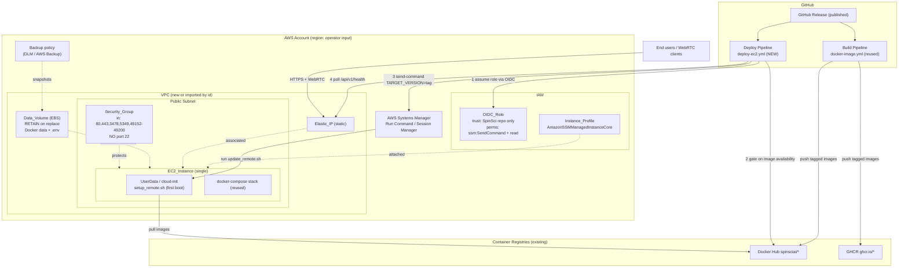
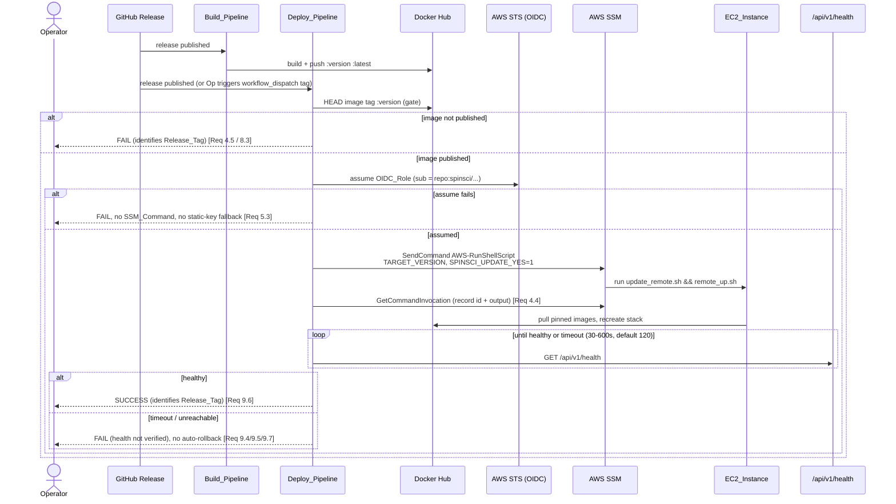

# Design Document

## Overview

This design provisions the SpinSci voice AI application onto a single AWS EC2 instance using AWS CDK (TypeScript) and adds a release-driven deploy pipeline in GitHub Actions that reaches the host over AWS Systems Manager (SSM) Run Command. It fills exactly two gaps around the existing, unchanged tooling:

1. **CDK_Stack** — an AWS CDK app that provisions the network, compute, storage, static address, and IAM needed to run the existing `docker-compose.yaml` stack, and bootstraps the host by invoking the existing `scripts/setup_remote.sh` from EC2 user-data.
2. **Deploy_Pipeline** — a new GitHub Actions workflow that, after the existing Build_Pipeline (`.github/workflows/docker-image.yml`) publishes images, authenticates to AWS via OIDC and runs the existing `scripts/update_remote.sh` on the instance through SSM Run Command, then verifies health.

The design treats the following as **reused, black-box artifacts** and does not redesign them:

- `docker-compose.yaml` — the remote runtime stack (postgres+pgvector, redis, minio, api, ui, nginx, coturn, optional cloudflared).
- `scripts/setup_remote.sh` — first-boot provisioning (installs Docker, generates `.env` secrets, issues certs, validates, starts via `remote_up.sh`).
- `scripts/update_remote.sh` — prebuilt upgrade path (resolves tag, pins image tags, refreshes bundle, revalidates, instructs `remote_up.sh`).
- `remote_up.sh` — preflight + `docker compose up` with the `remote` profile (+ `tunnel` for private IPs).
- `.github/workflows/docker-image.yml` — the multi-arch image build/push on release.

The CDK layer **passes configuration to** these scripts through environment variables (`SERVER_IP`, `CERT_MODE`, `DEPLOY_MODE`, `FASTAPI_WORKERS`, `TARGET_VERSION`, `SPINSCI_UPDATE_YES`, etc.) and **never reimplements** their logic (Req 3.5).

### Key research findings that inform this design

- **The setup script is non-interactive-safe.** `setup_remote.sh` reads `SERVER_IP`, `CERT_MODE`, `DEPLOY_MODE`, `FASTAPI_WORKERS`, `TURN_SECRET`, `LETSENCRYPT_EMAIL` from the environment and, with no TTY, defaults `DEPLOY_MODE=prebuilt` and `FASTAPI_WORKERS=2`. It hard-requires root and refuses to overwrite an existing `.env` unless `SPINSCI_FORCE_OVERWRITE=1`. This "refuse to overwrite `.env`" behavior is the mechanism that gives us secret persistence (Req 7.4) for free — as long as `.env` lives on the persistent Data_Volume.
- **Prebuilt install writes into a `spinsci/` subdir.** In prebuilt mode with no pre-staged files, `setup_remote.sh` does `mkdir -p spinsci && cd spinsci`, downloads the bundle, and writes `.env` + `certs/` there. The Data_Volume mount point must therefore back the directory that becomes this deploy dir.
- **`update_remote.sh` refuses build-mode installs** (`docker-compose.override.yaml` present) and honors `SPINSCI_UPDATE_YES=1` for non-interactive runs. It reads `TARGET_VERSION` from the environment, resolves it to a git tag, and pins Docker Hub image tags. It does **not** regenerate existing secrets — it only fills in *missing* keys. So a redeploy over an intact `.env` preserves all secrets (Req 7.3, 7.5, 8.5).
- **The deploy pipeline runs after images publish.** `docker-image.yml` fires on `release: published`, builds `spinsciai/spinsci-api` + `spinsci-ui`, tags `:version :short_sha :latest`. `update_remote.sh` already probes Docker Hub for the resolved `:version` tag; the Deploy_Pipeline additionally gates on image availability up front (Req 4.5 / 8.3) so it never sends a command for an unpublished tag.
- **No inbound SSH is needed.** SSM Session Manager provides administrative shell access and SSM Run Command provides the deploy channel, so the Security_Group can omit port 22 entirely (Req 2.5, 2.6).

## Architecture

### Repository placement

The CDK app lives at **`infrastructure/`** in the repo root. This matches the existing deployment memory in `scripts/AGENTS.md`, which already names `infrastructure/` as the cloud-init/user-data caller that runs `setup_remote.sh` as root. The existing `deploy/` directory holds runtime templates (nginx/coturn) and the Helm chart and is left untouched.

```
infrastructure/
  bin/
    spinsci-ec2.ts            # CDK app entrypoint; reads context/props, instantiates the stack
  lib/
    spinsci-ec2-stack.ts      # the single Stack
    network-construct.ts      # VPC (create or import) + Security_Group
    compute-construct.ts      # EC2 instance, Elastic IP, UserData
    storage-construct.ts      # Data_Volume (EBS) + attachment + backup policy
    iam-construct.ts          # Instance_Profile + GitHub OIDC provider + OIDC_Role
    user-data.ts              # builds the cloud-init UserData script text
  test/
    spinsci-ec2-stack.test.ts # aws-cdk-lib/assertions unit tests
  cdk.json                    # context defaults, app command
  package.json
  tsconfig.json
  README.md                   # operator runbook (deploy, snapshot/restore, rollback)
.github/workflows/
  deploy-ec2.yml              # NEW Deploy_Pipeline (bash-only, no .ps1 pair — CI script)
```

### System architecture diagram

The component diagram in `diagrams/architecture.mmd` is the canonical topology; it is reproduced and refined here.



### Deploy sequence



## Components and Interfaces

### CDK app / stack structure (Req 1, 3, 5, 6, 7)

The app is a single `SpinSciEc2Stack` composed from focused constructs. All Operator inputs arrive as **CDK context** (via `cdk.json` defaults, `-c key=value`, or `cdk deploy --context`) and are surfaced as typed stack props. Context is used (rather than only env vars) because VPC lookups and defaulting are naturally expressed there.

**Operator inputs (props/context):**

| Input | Context key | Type | Default | Req |
| --- | --- | --- | --- | --- |
| AWS region | `region` (or `CDK_DEFAULT_REGION`) | string | *required* | 1.8 |
| EC2 instance type | `instanceType` | string | `t3.large` (documented) | 1.3, 1.4, 1.8 |
| Public domain / host | `host` | string | *required* | 1.8 |
| Data volume size (GiB) | `dataVolumeSizeGiB` | number (1–16384) | `100` | 1.6 |
| Existing VPC id (optional) | `vpcId` | string \| undefined | undefined → create VPC | 1.1, 1.2 |
| Certificate mode | `certMode` | `auto`\|`sslip`\|`self-signed` | `auto` | 3.4 |
| Deploy mode | `deployMode` | `prebuilt`\|`build` | `prebuilt` | 3.4 |
| Let's Encrypt email | `letsEncryptEmail` | string \| undefined | undefined | (setup) |
| GitHub repo (owner/name) | `githubRepo` | string | `spinsci-hq/spinsci` fork slug | 5.5 |

**Required-input validation (Req 1.9, 9):** `bin/spinsci-ec2.ts` validates presence of `region` and `host` (inputs with no default) *before* the `Stack` is instantiated. On a missing required input it throws with a message naming the missing key and exits non-zero, so `cdk synth`/`cdk deploy` aborts and **no resources are created**. `dataVolumeSizeGiB` is validated to be within 1–16384; `certMode`/`deployMode` are validated against their enums.

### Networking construct (Req 1.1, 1.2, 2)

- **VPC:** If `vpcId` is supplied, import it with `Vpc.fromLookup({ vpcId })` and place the instance in an existing public subnet (fail synth if the imported VPC has no public subnet). Otherwise create a new `Vpc` with 1 public subnet (`subnetType: PUBLIC`), `natGateways: 0`, and `maxAzs: 1` (single-instance topology, so a single AZ is sufficient and avoids idle NAT/AZ cost).
- **Public IP:** The instance is launched into the public subnet with `associatePublicIpAddress` behavior via the public subnet; the Elastic_IP (below) is the stable address (Req 1.5).
- **Security_Group ingress** — exactly the SpinSci stack ports, no SSH:

  | Protocol | Port(s) | Source | Req |
  | --- | --- | --- | --- |
  | TCP | 80 | 0.0.0.0/0 | 2.1 |
  | TCP | 443 | 0.0.0.0/0 | 2.2 |
  | TCP | 3478 | 0.0.0.0/0 | 2.3 |
  | UDP | 3478 | 0.0.0.0/0 | 2.3 |
  | TCP | 5349 | 0.0.0.0/0 | 2.3 |
  | UDP | 5349 | 0.0.0.0/0 | 2.3 |
  | UDP | 49152–49200 | 0.0.0.0/0 | 2.4 |

  No rule for TCP or UDP port 22 is ever added (Req 2.5, 2.6). `allowAllOutbound: true` is set so the instance can reach SSM, Docker Hub/GHCR, and Let's Encrypt.

- **Egress recommendation (SSM + image pulls):** Because the instance has a **public IP + Elastic_IP** in a public subnet with an internet gateway, all outbound (SSM control-channel endpoints, Docker Hub, GHCR, Let's Encrypt) works over the IGW with **no NAT gateway and no VPC interface endpoints**. This is the recommended default: it is the lowest-cost and simplest option for a single public-facing host, and NAT/endpoints add monthly cost with no benefit when the host is already public. VPC interface endpoints for SSM (`ssm`, `ssmmessages`, `ec2messages`) are called out as an **open decision** for a future private-subnet hardening variant (see Open Decisions).

### Compute construct (Req 1.3, 1.4, 1.5, 3)

- **AMI:** **Ubuntu 22.04 LTS (amd64)** via `MachineImage.fromSsmParameter` on the Canonical public SSM parameter. Rationale: `setup_remote.sh` installs Docker itself, and the SpinSci docs/setup path is Debian/Ubuntu-oriented (`apt`-based Docker install and certbot). Amazon Linux 2023 is a documented alternative (Open Decisions) but would exercise a less-tested Docker install path in the shared setup library. The AMI is resolved by SSM parameter so it tracks the latest patched image at deploy time.
- **Instance:** exactly one `Instance` of `instanceType` (default `t3.large`: 2 vCPU / 8 GiB comfortably runs postgres+redis+minio+api+ui+nginx+coturn). Instance count is fixed at one (Req 1.3, 1.4); this is a plain `Instance`, not an Auto Scaling Group, so the Data_Volume lifecycle is decoupled from any scaling group.
- **Elastic_IP:** one `CfnEIP` associated to the instance via `CfnEIPAssociation`. The associated address is exported as a stack output `PublicIp` and is what `SERVER_IP` is set to in UserData, so the reported instance public IP equals the Elastic_IP (Req 1.5).
- **Instance profile:** attached from the IAM construct (Req 1.7).

### Storage construct (Req 1.6, 6)

- **Data_Volume:** a standalone `Volume` (EBS, `gp3`), `size = dataVolumeSizeGiB` (default 100), `encrypted: true`, in the instance's AZ, with **`removalPolicy: RETAIN`** (Req 6.1). Because it is a standalone `Volume` + `CfnVolumeAttachment` (not a block device baked into the instance's launch), the volume's lifecycle is independent of the instance: replacing the instance does not replace or delete the volume (Req 6.4).
- **Attachment:** `CfnVolumeAttachment` maps the volume to a **deterministic device name** (`/dev/sdf`, surfaced by the kernel as `/dev/xvdf` or an NVMe alias). UserData resolves the actual device robustly (by matching the EBS volume id via `nvme`/`lsblk` rather than a hard-coded path) before mounting.
- **Backup (Req 6.5):** a **Data Lifecycle Manager (DLM)** snapshot policy targets the Data_Volume by tag (`spinsci:data-volume = true`), taking daily EBS snapshots with a retention count. DLM is recommended over AWS Backup here for its lower setup overhead for a single-volume, single-schedule need; AWS Backup is noted as the alternative when centralized backup vaults/compliance are required (Open Decisions). Snapshot create and volume restore are described in Data Models → Backup and restore.

### IAM construct (Req 1.7, 5)

- **Instance_Profile / role:** an IAM `Role` with `ServicePrincipal('ec2.amazonaws.com')`, attached managed policy **`AmazonSSMManagedInstanceCore`** (the least privilege that makes the box a managed instance for Session Manager + Run Command). No other permissions are attached unless a later need (e.g. reading a private-registry secret from SSM Parameter Store) is confirmed (Open Decisions). Exposed as an `InstanceProfile` on the instance (Req 1.7).
- **GitHub OIDC provider:** an `iam.OpenIdConnectProvider` for `https://token.actions.githubusercontent.com` with audience `sts.amazonaws.com` (created once; if the account already has one, the stack imports it by ARN via context to avoid a duplicate-provider error).
- **OIDC_Role:** an IAM `Role` assumed via web identity with a **trust policy scoped to the SpinSci repo** (Req 5.5): condition `token.actions.githubusercontent.com:sub` matches `repo:<githubRepo>:*` (optionally tightened to `repo:<githubRepo>:ref:refs/tags/*` and `environment:production`), and `:aud` equals `sts.amazonaws.com`. Assumption from any other repository is rejected because the `sub` condition fails.
- **OIDC_Role permissions (least privilege, Req 5.4):** an inline policy granting only:
  - `ssm:SendCommand` restricted to two resources: the specific instance ARN (`arn:aws:ec2:<region>:<acct>:instance/<instanceId>`) and the document ARN (`arn:aws:ssm:<region>::document/AWS-RunShellScript`);
  - `ssm:GetCommandInvocation`, `ssm:ListCommandInvocations`, `ssm:ListCommands` (read results, `Resource: *` as these actions do not support resource-level scoping for command invocations);
  - optionally `ec2:DescribeInstanceInformation`/`ssm:DescribeInstanceInformation` (read) to detect an unreachable managed instance (Req 4.7).
  No `iam:PassRole`, no write actions beyond `SendCommand`, and **no static access keys anywhere** (Req 5.2). The role ARN is a stack output consumed by the workflow.

### Deploy_Pipeline workflow (`.github/workflows/deploy-ec2.yml`) (Req 4, 5, 8, 9)

- **Triggers:** `on: release: { types: [published] }` for automatic deploys, and `on: workflow_dispatch` with inputs `tag` (Release_Tag to deploy — enables rollback, Req 8.1), `health_timeout` (30–600, default 120, Req 9.3). Permissions block: `id-token: write`, `contents: read` (OIDC needs id-token).
- **No static keys:** the workflow contains no `AWS_ACCESS_KEY_ID`/`AWS_SECRET_ACCESS_KEY` secret usage anywhere (Req 5.2, 5.3).
- **Steps:**
  1. **Resolve tag:** from `github.event.release.tag_name` or the `workflow_dispatch` `tag` input.
  2. **Gate on image availability (Req 4.5, 8.3):** `HEAD https://hub.docker.com/v2/repositories/spinsciai/spinsci-api/tags/<image_tag>/` (and `spinsci-ui`). If not present → fail with a message identifying the Release_Tag, and **do not** proceed to OIDC/SSM.
  3. **OIDC auth (Req 5.1):** `aws-actions/configure-aws-credentials@v4` with `role-to-assume: <OIDC_Role ARN>`, `aws-region: <region>`. If assume fails, the step fails; the job stops before any SSM call (Req 5.3).
  4. **Reachability check (Req 4.7):** `aws ssm describe-instance-information --filters Key=InstanceIds,Values=<id>`; if the instance is not `Online`, fail and record the error.
  5. **Send command (Req 4.1, 4.2, 8.1):** `aws ssm send-command --document-name AWS-RunShellScript --instance-ids <id> --parameters` running the update in the deploy dir with `TARGET_VERSION=<tag>` and `SPINSCI_UPDATE_YES=1` (see SSM_Command shape in Data Models). Capture `Command.CommandId`.
  6. **Record output (Req 4.4):** poll `aws ssm get-command-invocation --command-id <id> --instance-id <id>` until a terminal status; write `CommandId`, `Status`, stdout/stderr to the job log and step summary.
  7. **Health verification (Req 9.1–9.4):** poll `https://<host>/api/v1/health` at a fixed interval (10s, within 5–30s) until it returns success or `health_timeout` elapses; only a successful healthy response counts (Req 9.2).
  8. **Report (Req 9.5–9.7):** on success, report success naming the tag; on send failure / unreachable / non-zero command / health timeout, mark the job failed with a message naming the tag and (for health) noting health verification did not succeed. **No automatic rollback** is performed (Req 9.5).

## Data Models

These are configuration/contract shapes, not persisted domain entities.

### Stack props (TypeScript)

```typescript
export interface SpinSciEc2StackProps extends cdk.StackProps {
  readonly host: string;                     // required (Req 1.8)
  readonly instanceType: string;             // default "t3.large" (Req 1.3/1.4)
  readonly dataVolumeSizeGiB: number;        // 1..16384, default 100 (Req 1.6)
  readonly vpcId?: string;                   // import if set, else create (Req 1.1/1.2)
  readonly certMode: 'auto' | 'sslip' | 'self-signed';   // (Req 3.4)
  readonly deployMode: 'prebuilt' | 'build';             // (Req 3.4)
  readonly letsEncryptEmail?: string;
  readonly githubRepo: string;               // "owner/name" for OIDC trust (Req 5.5)
  readonly oidcProviderArn?: string;         // import existing provider if set
}
```

### UserData environment contract → setup_remote.sh

The UserData script sets exactly these variables before invoking `setup_remote.sh` as root (Req 3.1–3.4, 3.6):

| Variable | Value | Purpose |
| --- | --- | --- |
| `SERVER_IP` | the Elastic_IP | drives PUBLIC_HOST/cert selection (Req 3.3) |
| `CERT_MODE` | `certMode` prop | cert strategy (Req 3.4) |
| `DEPLOY_MODE` | `deployMode` prop | prebuilt/build (Req 3.4) |
| `FASTAPI_WORKERS` | `2` (or prop) | non-interactive default |
| `LETSENCRYPT_EMAIL` | `letsEncryptEmail` prop | optional |
| *(no `SPINSCI_FORCE_OVERWRITE`)* | unset | so an existing `.env` on the volume is preserved (Req 7.4) |

### SSM_Command shape (AWS-RunShellScript)

```jsonc
{
  "DocumentName": "AWS-RunShellScript",
  "InstanceIds": ["i-0abc123..."],
  "Comment": "SpinSci deploy <Release_Tag>",
  "TimeoutSeconds": 3600,
  "Parameters": {
    "workingDirectory": ["/mnt/spinsci-data/spinsci"],
    "commands": [
      "set -euo pipefail",
      "export TARGET_VERSION='<Release_Tag>'",
      "export SPINSCI_UPDATE_YES=1",
      "sudo -E ./scripts/update_remote.sh",   // refresh bundle, pin image tags, revalidate
      "sudo -E ./remote_up.sh"                 // apply: docker compose up --pull always
    ]
  }
}
```

The deploy dir is the Data_Volume-backed `spinsci/` directory created by first-boot setup; `update_remote.sh` requires `docker-compose.yaml` and `.env` to already be present there, which they are.

### Data_Volume layout and secret/data persistence (Req 6, 7)

On the mounted Data_Volume (mount point `/mnt/spinsci-data`):

```
/mnt/spinsci-data/
  docker/                 # Docker data-root (relocated here) → all named volumes:
                          #   postgres_data, redis_data, minio-data, nginx-generated, coturn-generated
  spinsci/                # the deploy dir: docker-compose.yaml, remote_up.sh, scripts/, deploy/, certs/, .env
    .env                  # generated once on first boot; persists across replacement (Req 7.2)
```

Docker's data-root is pointed at `/mnt/spinsci-data/docker` (via `/etc/docker/daemon.json`) **before** Docker starts, so every named volume in `docker-compose.yaml` (postgres/redis/minio and the generated nginx/coturn config volumes) is stored on the Data_Volume (Req 6.2). The deploy dir with `.env` lives on the same volume (Req 7.2). Because both survive instance replacement and the volume is RETAIN, Postgres/Redis/MinIO data and all secrets persist across redeploys and instance replacement (Req 6.3, 6.4, 7.3, 7.5). `update_remote.sh` never rewrites existing secret values, and UserData never passes `SPINSCI_FORCE_OVERWRITE`, so an existing `.env` is left byte-for-byte unchanged on redeploy (Req 7.4).

### Backup and restore (Req 6.5)

- **Create:** the DLM policy creates daily EBS snapshots of the Data_Volume (crash-consistent; for stronger Postgres consistency an operator may briefly `docker compose stop postgres` before an on-demand snapshot). On-demand: `aws ec2 create-snapshot --volume-id <vol> --description "spinsci manual <ts>"`.
- **Restore:** create a new volume from a snapshot in the instance's AZ (`aws ec2 create-volume --snapshot-id <snap> --availability-zone <az> --volume-type gp3`), detach the current Data_Volume, attach the restored volume at the same device name, and reboot/re-run UserData mount logic. Because the deploy dir + `.env` and Docker data-root both live on the volume, the restored volume brings back both data and secrets together.

## Correctness Properties

*A property is a characteristic or behavior that should hold true across all valid executions of a system — essentially, a formal statement about what the system should do. Properties serve as the bridge between human-readable specifications and machine-verifiable correctness guarantees.*

Two property surfaces exist for this feature: **synthesized-template invariants** (verified against `cdk synth` output with `aws-cdk-lib/assertions` / property tests over generated stack configurations) and **deploy-logic invariants** (verified against the pure functions extracted from the Deploy_Pipeline — tag→payload mapping, image gate, health predicate/poller/timeout resolution). Runtime container-level data persistence (Req 6.3, 7.1, 8.4) stays in the integration suite and is intentionally not expressed as a property.

### Property 1: Security group never opens port 22

*For all* valid stack configurations (any `vpcId`, `instanceType`, `certMode`, `deployMode`, `dataVolumeSizeGiB`), every ingress rule in the synthesized Security_Group has a port range that excludes 22 for both TCP and UDP — i.e. no rule satisfies `FromPort <= 22 <= ToPort` for protocol tcp or udp.

**Validates: Requirements 2.5, 2.6, 4.3**

### Property 2: Data volume is never destroyed on stack update

*For all* valid stack configurations, the synthesized `AWS::EC2::Volume` for the Data_Volume carries `DeletionPolicy: Retain` and `UpdateReplacePolicy: Retain`, and is a standalone volume attached via a separate `VolumeAttachment` (not an inline instance block device), so instance replacement cannot delete or recreate it.

**Validates: Requirements 6.1, 6.4**

### Property 3: OIDC trust matches only the SpinSci repository

*For all* configured `githubRepo` values, the synthesized OIDC_Role trust policy binds the `token.actions.githubusercontent.com:sub` condition to `repo:<githubRepo>:*` and the `:aud` condition to `sts.amazonaws.com`; consequently a token whose `sub` names any other repository does not satisfy the trust condition.

**Validates: Requirements 5.5**

### Property 4: OIDC role grants only SSM send-and-read permissions

*For all* valid stack configurations, every action granted by the OIDC_Role policy is a member of the allowed least-privilege set `{ ssm:SendCommand, ssm:GetCommandInvocation, ssm:ListCommandInvocations, ssm:ListCommands, ssm:DescribeInstanceInformation, ec2:DescribeInstanceInformation }`, `ssm:SendCommand` is resource-scoped to the instance ARN and the `AWS-RunShellScript` document ARN, and no statement grants a wildcard admin action, `iam:PassRole`, or any write action beyond `SendCommand`.

**Validates: Requirements 5.4**

### Property 5: Data volume size is accepted only within bounds

*For all* integer `dataVolumeSizeGiB` inputs, stack construction succeeds and produces a Data_Volume of exactly that size when the value is within `[1, 16384]`, and fails with a validation error naming the bound when the value is outside `[1, 16384]`.

**Validates: Requirements 1.6**

### Property 6: Missing required input halts synthesis naming the input

*For all* required inputs that have no default (`region`, `host`), omitting that input causes stack construction/synthesis to throw an error whose message contains the omitted input's name and to produce no synthesized template (no resources).

**Validates: Requirements 1.9**

### Property 7: The deployed target version is exactly the selected tag

*For all* Release_Tag strings — whether taken from the release event or from the `workflow_dispatch` tag input, and regardless of whether the selected tag is older than the latest release — the SSM_Command parameters set `TARGET_VERSION` to exactly that tag, never substituting a different or "latest" tag.

**Validates: Requirements 4.2, 8.1, 8.2**

### Property 8: Deploy is gated on image availability

*For all* Release_Tag strings, when the container registry does not report published images for that tag, the Deploy_Pipeline issues no SSM_Command and produces a failure result whose message identifies the Release_Tag; and when images are present, the gate permits the send.

**Validates: Requirements 4.5, 8.3**

### Property 9: Secrets are identical before and after a redeploy

*For all* pre-existing `.env` states (any values for `OSS_JWT_SECRET`, database password, Redis password, MinIO credentials, TURN secret), applying the deploy/update path (which only fills missing keys and never rewrites existing secret values) leaves each of those secret values byte-for-byte unchanged.

**Validates: Requirements 7.3, 7.5, 8.5**

### Property 10: UserData never overwrites an existing .env (idempotence)

*For all* prior `.env` states present on the mounted Data_Volume, re-running the UserData bootstrap decision does not pass `SPINSCI_FORCE_OVERWRITE` and does not trigger the first-boot secret-generation path, leaving the existing `.env` unchanged — i.e. the bootstrap is idempotent with respect to an existing `.env`.

**Validates: Requirements 7.4**

### Property 11: UserData forwards certificate and deploy mode exactly

*For all* `certMode` × `deployMode` enum combinations, the generated UserData script exports `CERT_MODE` and `DEPLOY_MODE` equal to the configured prop values before invoking the setup script.

**Validates: Requirements 3.4**

### Property 12: Health is recognized only on a successful healthy response

*For all* health-check outcomes (any HTTP status, body, connection error, or timeout), the health predicate returns healthy if and only if the response is a successful (2xx) response indicating the application is healthy; every unreachable, timed-out, error, or non-healthy response is classified as not healthy.

**Validates: Requirements 9.2**

### Property 13: The health poller stops on first healthy response or fails at timeout

*For all* sequences of health responses and all timeouts within `[30, 600]` seconds, the poller queries at a fixed interval within `[5, 30]` seconds, returns success as soon as a response is classified healthy, and returns failure once the timeout elapses with no healthy response observed.

**Validates: Requirements 9.1, 9.4**

### Property 14: Health-check timeout resolution respects bounds and default

*For all* operator-supplied timeout inputs, the resolved timeout equals the input when it is within `[30, 600]`, is rejected with a validation error when outside `[30, 600]`, and equals the default `120` when no value is supplied.

**Validates: Requirements 9.3**

## Error Handling

The failure modes below map to the Deploy_Pipeline's required behavior; **no failure path performs an automatic rollback** (Req 9.5).

| Failure mode | Detection | Handling | Req |
| --- | --- | --- | --- |
| Missing required CDK input | `bin/spinsci-ec2.ts` pre-synth validation | throw naming the input; abort synth; no resources created | 1.9 |
| Out-of-range data volume size / bad enum | prop validation | throw with bound/enum in message; abort synth | 1.6 |
| Images not published for tag | registry `HEAD` gate (step 2) | fail job before OIDC/SSM; summary names the tag; no SSM_Command | 4.5, 8.3 |
| OIDC assume-role fails | `configure-aws-credentials` step non-zero | job fails at that step; no SSM_Command issued; **no static-key fallback** | 5.3 |
| Instance not an Online managed instance | `describe-instance-information` (step 4) | fail and record error naming the instance/tag | 4.7 |
| `send-command` API error | non-zero from `aws ssm send-command` | mark deploy failed; record the error | 4.6 |
| `update_remote.sh` / `remote_up.sh` non-zero on host | terminal `get-command-invocation` status ≠ Success | mark failed; record CommandId + stdout/stderr | 4.4, 4.6 |
| Health endpoint never healthy within timeout | poller reaches `health_timeout` | mark failed; summary names tag + "health verification did not succeed"; instance left running; no rollback | 9.4, 9.5, 9.7 |
| Health endpoint unreachable / error / non-2xx | health predicate → not healthy | treated as not healthy; keep polling until timeout | 9.2 |

Auditing: every run records the resolved Release_Tag, the SSM `CommandId`, the command's terminal status, and the captured stdout/stderr into the GitHub Actions step summary and job log (Req 4.4).

## Testing Strategy

This feature is a mix of **infrastructure-as-code (CDK)** and **deploy automation glue**. Following PBT guidance, IaC and workflow YAML are not exercised with property tests for their own sake; however, several **security- and data-safety invariants** over the *synthesized template* and several **pure deploy-logic functions** are genuine "for all inputs" properties and are covered by property-based tests. Runtime/container behavior and doc requirements are covered by integration and smoke checks.

### Unit / assertion tests (`aws-cdk-lib/assertions`)

Example-based template assertions (Vitest/Jest via `Template.fromStack`):

- VPC + public subnet exists; with `vpcId` set, zero `AWS::EC2::VPC` created (import), else one (Req 1.1, 1.2).
- Exactly one `AWS::EC2::Instance`, `InstanceType` equals input/default (Req 1.3, 1.4); exactly one `AWS::EC2::EIP` + association referencing the instance (Req 1.5).
- Instance role has `AmazonSSMManagedInstanceCore` (Req 1.7).
- Each required SG ingress rule present: TCP 80, TCP 443, TCP+UDP 3478, TCP+UDP 5349, UDP 49152–49200 (Req 2.1–2.4).
- Data_Volume is a standalone `Volume` + `VolumeAttachment` (Req 6.4); backup/DLM policy targets it by tag (Req 6.5).
- UserData content: invokes `setup_remote.sh` as root non-interactively, exports `SERVER_IP` (=EIP), sets Docker data-root under the mount, places the deploy dir on the mount, and delegates rather than reimplementing docker/secret/cert logic (Req 3.1–3.3, 3.5, 3.6, 6.2, 7.2).
- Workflow static analysis: `deploy-ec2.yml` uses `aws ssm send-command` (not ssh), uses `configure-aws-credentials` with `role-to-assume`, and references no static AWS key secret (Req 4.3, 5.1, 5.2); success/failure summaries name the tag (Req 9.6, 9.7); failure path issues no second/rollback command (Req 9.5).

### Property-based tests

A property-based library for the target stack is used — **`fast-check`** with the TypeScript test runner (Vitest) for both the CDK synth properties and the deploy-logic properties. Property tests do **not** reimplement generation logic; they drive real stack synthesis / the real extracted functions. Each property test runs a **minimum of 100 iterations** and is tagged with a comment referencing its design property.

Tag format: `Feature: ec2-cdk-deploy, Property {number}: {property_text}`

| Property | Generator | What it drives |
| --- | --- | --- |
| P1 no port 22 | random valid stack configs | synth → inspect every SG ingress rule's port range |
| P2 volume RETAIN | random valid stack configs | synth → Data_Volume DeletionPolicy/UpdateReplacePolicy |
| P3 OIDC trust repo-scoped | random `githubRepo` strings | synth → trust `sub`/`aud` conditions |
| P4 OIDC least privilege | random valid stack configs | synth → every OIDC policy action ∈ allowed set |
| P5 volume size bounds | random integers | construct stack → success in-range / throw out-of-range |
| P6 required-input halt | omit each required input | construct → throws naming the input, no template |
| P7 TARGET_VERSION == tag | random tag strings (+ random "latest") | tag→SSM-params mapping |
| P8 image gate | random tags + registry-present flag | gate → send vs fail-naming-tag |
| P9 secret preservation | random `.env` secret maps | update-path fill-missing-only → values unchanged |
| P10 .env idempotence | random prior `.env` states | UserData bootstrap decision → no overwrite |
| P11 mode forwarding | `certMode` × `deployMode` enums | UserData exports CERT_MODE/DEPLOY_MODE |
| P12 health predicate | random (status, body, error) | isHealthy iff 2xx+healthy |
| P13 health poller | random response sequences + timeouts | loop interval, stop-on-healthy / fail-at-timeout |
| P14 timeout resolution | random ints incl. undefined | in-range/out-of-range/default |

To keep P7–P14 pure and cheap, the Deploy_Pipeline's decision logic (tag resolution, image gate, SSM parameter build, health predicate, poller, timeout resolution) is factored into a small **bash-callable helper** (`.github/workflows/lib/deploy_lib.sh`) or a tiny Node module that both the workflow and the tests call, so the tested code is exactly the code that runs. The poller property uses an injected fake clock + fake fetch so 100+ iterations cost nothing (no real AWS/network calls).

### Integration tests (1–3 examples each, not PBT)

- **First-boot bootstrap:** launch the stack in a sandbox account (or `cdk deploy` to an ephemeral stack), confirm the instance registers as an SSM managed instance, `.env` is generated on the Data_Volume with all secret keys, and `/api/v1/health` reports healthy (Req 7.1, 3.1).
- **Redeploy preserves data + secrets:** write a marker row in Postgres + an object in MinIO, run the Deploy_Pipeline with a new tag via `workflow_dispatch`, verify the marker and object survive and `.env` secret values are unchanged (Req 6.3, 7.3, 8.4, 8.5).
- **Instance replacement:** taint/replace the instance, verify the RETAIN Data_Volume re-attaches and data survives (Req 6.4).
- **Rollback:** `workflow_dispatch` an older tag, verify images pin to that version and data persists (Req 8.1, 8.4).

### Dry-run / validate path

- `cdk synth` and `cdk diff` gate every change in CI (`infrastructure/` job); `cdk synth` alone verifies all template-level properties without touching AWS.
- The Deploy_Pipeline supports a safe **`workflow_dispatch` with a throwaway/test tag** against a staging instance id (parameterized), so the deploy path is exercised end-to-end without affecting production. The registry gate (P8) makes a mistyped/unpublished tag a no-op failure rather than a broken deploy.
- `cfn-lint`/`cdk-nag` (optional) as a policy check for the security posture (no port 22, encrypted volume, least-privilege role).

## Requirements Traceability

| Requirement | Design coverage |
| --- | --- |
| 1. Provision core infra | Networking + Compute + Storage + IAM constructs; props/context table; required-input validation (P5, P6) |
| 2. Least-privilege ingress | Networking construct SG ingress table; **P1** no-port-22 |
| 3. Bootstrap via setup script | Compute/UserData; UserData env contract; **P11**; delegation (Req 3.5) asserted in unit tests |
| 4. Deploy via SSM | Deploy_Pipeline steps; SSM_Command shape; **P7, P8**; error table (4.4/4.6/4.7) |
| 5. OIDC auth | IAM construct OIDC provider/role; **P3, P4**; workflow no-static-keys assertion |
| 6. Persist data | Storage construct RETAIN + standalone volume + Docker data-root; **P2**; backup/restore section; integration |
| 7. Persist secrets | Data_Volume layout (.env on volume); **P9, P10**; integration |
| 8. Rollback | `workflow_dispatch` tag input through same SSM path; **P7** (never substituted), **P8**, **P9** |
| 9. Verify + surface outcome | Health steps; **P12, P13, P14**; error table; no-auto-rollback assertion |

## Open Decisions (confirm with team lead)

1. **SSM egress: IGW-only vs VPC interface endpoints.** Default design uses the public-IP + IGW path (no NAT, no endpoints) — lowest cost for a public host. If policy requires the instance to reach SSM privately or move to a private subnet, add `ssm` / `ssmmessages` / `ec2messages` interface endpoints (and drop the public IP), at added monthly cost. Needs confirmation.
2. **Registry to pull from: Docker Hub vs GHCR.** `docker-compose.yaml` defaults `REGISTRY=spinsciai` (Docker Hub) and `update_remote.sh` probes Docker Hub. If images must be pulled from a **private** registry, the instance needs registry credentials (recommend SSM Parameter Store + a small read grant on the instance role) and the compose `REGISTRY` overridden. The image-availability gate would also switch to GHCR's API. Needs confirmation on public Docker Hub vs private/GHCR.
3. **AMI: Ubuntu 22.04 vs Amazon Linux 2023.** Design defaults to Ubuntu (matches the setup library's `apt`/certbot path). AL2023 is viable if preferred for AWS-native patching/SSM agent preinstall, but exercises a less-tested Docker install path in the shared scripts. Needs confirmation.
4. **Backup mechanism: DLM vs AWS Backup.** Default is a DLM daily-snapshot policy (low overhead). Switch to AWS Backup if centralized vaults, cross-region copy, or compliance reporting are required.
5. **Helm/EKS coexistence — out of scope.** `deploy/helm/spinsci` remains a future EKS path; reconciling it with this EC2 target is explicitly a non-goal (per requirements Assumptions). Confirmed out of scope.
