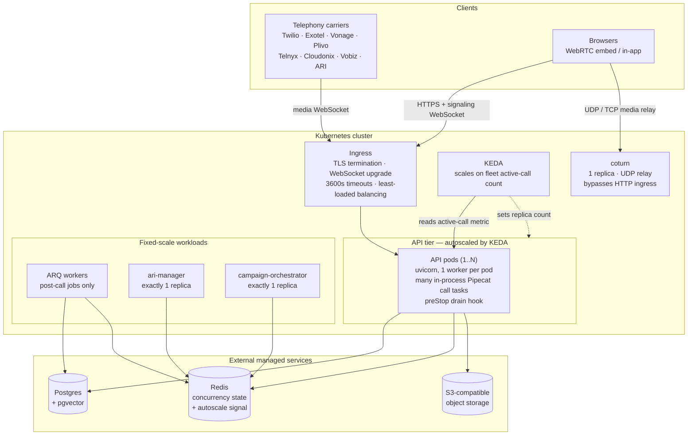
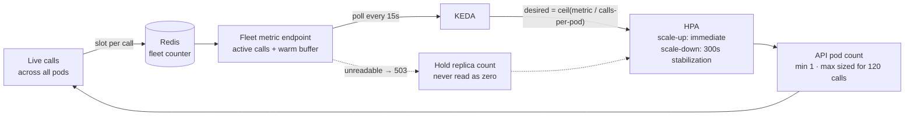
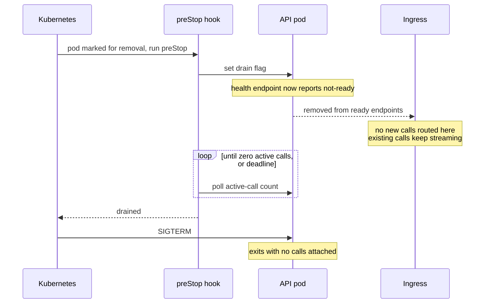
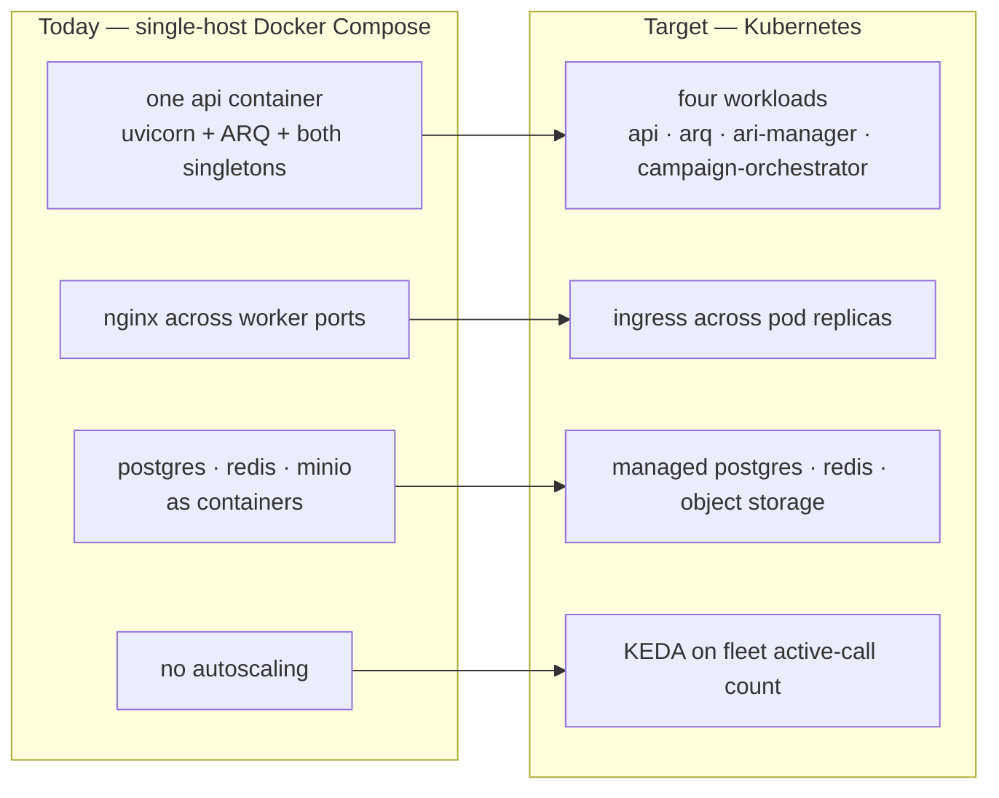

# K8s + KEDA Autoscaling — High-Level Architecture

Target topology for the Kubernetes migration of the voice platform, sized for 90 concurrent
calls with headroom to 120 (5000 calls/day, 8–9 hour window, 3-minute average handle time).

Detailed component design, time budgets, and correctness properties live in the design
document. This file is the orientation view.

## 1. System topology

Three things this view is meant to make obvious:

- **Only the API tier autoscales.** ARQ workers scale independently by hand; the two
  singletons stay pinned at one replica because duplicating them duplicates Asterisk channel
  handling and outbound campaign dials.
- **TURN sits outside the HTTP path.** It is UDP plus a relay port range and needs the real
  client source address, so it gets its own L4 exposure.
- **Redis is load-bearing twice.** It holds the concurrency slots that admit calls *and* the
  fleet counter that drives scaling, so its availability gates both.

## 2. Autoscaling control loop

The calls-per-pod divisor is the one number everything else derives from, and it comes from a
load test rather than an estimate. Event-loop lag is the saturation signal, not CPU: all of a
pod's calls share one asyncio loop, so audio starts degrading while CPU still looks healthy.

## 3. Graceful drain on pod removal

The highest-risk path. uvicorn force-closes call WebSockets on SIGTERM, so any pod removal
that reaches SIGTERM with calls still attached cuts live conversations.

Kubernetes runs the preStop hook *before* SIGTERM, which is what makes this safe. The one case
it does not cover is a force delete or hard node loss: calls are cut and their Redis slots are
orphaned, then reclaimed automatically by the stale-slot timeout.

## 4. What changes from today

The Pipecat runtime model is unchanged: many concurrent call tasks per process, scaled by
adding replicas of the same image. There is no per-call container rewrite, and the Compose path
stays supported for single-host installs.
