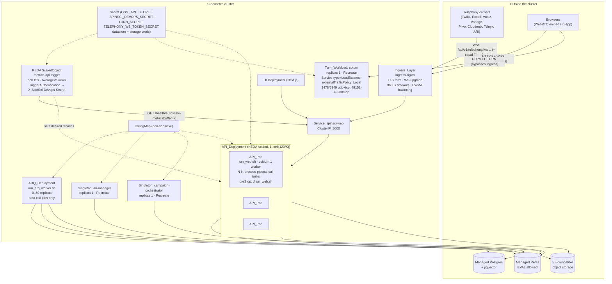

# Design Document

## Overview

This design takes the SpinSci/SpinSci voice platform from its single-host Docker Compose deployment to a Kubernetes deployment whose API tier is horizontally autoscaled by KEDA against the fleet-wide active-call count, sized to carry 90 concurrent calls with headroom to 120.

### Starting position: this is a hardening, not a greenfield build

Research into the repository found that a substantial part of the target topology **already exists** and must be extended rather than replaced:

- `deploy/helm/spinsci/` is a working Helm chart (v1, alpha — "validated with `helm lint` and `helm template`, not yet exercised against a live cluster" per its README) that already decomposes the Compose `api` container into four Deployments: `web`, `arq-worker`, `ari-manager`, `campaign-orchestrator`, plus `ui` and `coturn`.
- Role-selected entrypoints already exist in the image: `scripts/run_web.sh`, `run_arq_worker.sh`, `run_ari_manager.sh`, `run_campaign_orchestrator.sh`, `run_migrate.sh` (all copied in `api/Dockerfile`).
- `deploy/helm/spinsci/templates/web-keda-scaledobject.yaml` already renders a `ScaledObject` + `TriggerAuthentication` against `/api/v1/health/autoscale-metric` with `metricType: AverageValue` and a header-auth `apiKey` mode — gated behind `autoscaling.web.keda.enabled: false`.
- `scripts/drain_web.sh` already implements a preStop drain that polls `/api/v1/health/active-calls` and treats a read error as "still busy".
- The two backend endpoints the requirements name are implemented and unit-tested (`api/tests/test_autoscale_metric.py`, `test_active_calls.py`, `test_fleet_concurrent_count.py`).

So the work is: **close the gaps between the alpha chart and the requirements, add the two application-side changes the chart cannot express, and produce the measured capacity numbers that every sizing value currently guesses at.** The gap analysis below drives task breakdown.

### Gap analysis against requirements

| # | Current state | Required | Kind |
|---|---|---|---|
| G1 | `image.tag: latest` | Immutable tag/digest (R1.1) | Manifest + release process |
| G2 | Image build does not verify the `pipecat` submodule commit | Build fails unless submodule is at `e2c6a2918254439a28521d85bd049778ede2d4be` (R1.2) | Build/CI |
| G3 | `web.resources` are "conservative starting numbers" | Derived from measured Load_Test peaks + 20% (R1.3, R10.5) | Load test → manifest |
| G4 | Liveness `periodSeconds: 30 × failureThreshold: 6 = 180s` — **shorter than the drain window**, so a draining pod can be restarted mid-call | `period × failureThreshold` > drain deadline (R1.6) | Manifest |
| G5 | Readiness probes `/api/v1/health`, which returns 200 throughout drain | Pod reports not-ready within 5s of preStop start (R4.5) | **Application change** |
| G6 | `drainMaxWaitSeconds: 1200`, grace `1260` | 360s drain deadline, grace ≥ 420s (R4.1, R4.3) | Values |
| G7 | PDB uses `minAvailable: 1` | `maxUnavailable: 1` (R4.10) | Manifest |
| G8 | KEDA disabled; `callsPerPod: 2` marked PLACEHOLDER; `pollingInterval: 10`; `bufferCalls: 10` | Enabled; K measured; polling 15s; buffer = K; min 1; max = ceil(120/K) (R3) | Values (after load test) |
| G9 | No `DEFAULT_ORG_CONCURRENCY_LIMIT` in the ConfigMap (app default 10) | 120 (R7.1) | Manifest |
| G10 | No `ARQ_WORKERS` on the web pod | `ARQ_WORKERS=0` explicit (R6.3) | Manifest (+ confirm the app reads it) |
| G11 | Ingress has read/send timeouts but no upgrade/SSL-redirect/least-conn/annotation set, and no explicit "no rewrite" guarantee | R2.1–R2.8 | Manifest |
| G12 | `coturn-deployment.yaml` has a **duplicate `annotations:` key** in the pod template (the second silently wins, dropping `coturn.podAnnotations`); no `external-ip` validation | Correct render; `external-ip` publicly routable and equal to `TURN_HOST` (R9.4, R9.8) | Manifest |
| G13 | `database.mode`/`redis.mode`/`storage.mode` default to `internal`/`internalMinio` | Production profile must be external for all three, with no `emptyDir` for call data (R8.6) | Values profile + docs |
| G14 | No load test, no drain/scale verification suite, no readiness checklist | R10, R11, R13 | New tooling |
| G15 | `docs/deployment/scaling.mdx` is Compose-only and carries the unmeasured "300–500 MB RAM per worker" figure | Kubernetes install/autoscale/drain/upgrade docs; scaling.mdx scoped and cross-linked (R14) | Docs |
| G16 | `FASTAPI_WORKERS` is in the ConfigMap marked "informational only" | Explicit `1`, with the drain-correctness rationale documented (R1.8, R4.12) | Values + docs |

### What is preserved

The runtime model does not change. Pipecat runs **in-process**: `api/services/pipecat/worker_runner.py` builds a `PipelineWorker`/`WorkerRunner` per call and each call is an asyncio task inside a uvicorn worker (`run_pipeline_telephony()`, `run_pipeline_smallwebrtc()`). Every telephony provider WS handler under `api/services/telephony/providers/*/provider.py` and the WebRTC signaling route (`api/routes/webrtc_signaling.py`) drive those same functions. Horizontal scaling means **more replicas of the same image**, not a container per call. The Lua-scripted concurrency accounting in `api/services/call_concurrency/rate_limiter.py` — per-org ZSET `concurrent_calls:{organization_id}`, fleet ZSET `concurrent_calls_fleet`, 20-minute stale timeout, 1-second sliding-window rate limiter, caller-ID pools — is used exactly as-is; only `DEFAULT_ORG_CONCURRENCY_LIMIT` changes, and only through environment configuration.

### Out of scope (explicit)

- **Pipecat Cloud / Daily managed hosting.** The fork at `sdpolke/pipecat@e2c6a291` exports APIs this codebase imports directly (`PipelineWorker`, `WorkerRunner`, `turns.user_start/user_stop`, `utils.run_context.set_current_org_id/set_current_run_id`); managed hosting is a different runtime contract entirely.
- **A per-call container rewrite.** One process hosting many call tasks is the model being scaled.
- **Changes to the per-organization STT/LLM/TTS provider system** (`api/services/configuration/`, `api/services/pipecat/service_factory.py`). Provider credentials stay in the database and never enter a ConfigMap or Secret.

### Infrastructure vs application changes

This split matters for task sequencing, because the application changes gate the drain correctness that everything else depends on.

**Application-side code changes (3):**
1. **Drain readiness flag** — `/api/v1/health` must return non-2xx once drain has begun (G5). New module + health-handler branch.
2. **Multi-worker-aware drain** — `scripts/drain_web.sh` must either assert `FASTAPI_WORKERS=1` or poll every worker port and require all-zero (R4.12).
3. **`ARQ_WORKERS=0` handling** — confirm/implement that the web role starts zero ARQ workers (`run_web.sh` today `exec`s only uvicorn, so this is likely assertion + documentation rather than new code) (R6.3).

Everything else — Deployments, Services, probes, ScaledObject, PDB, Ingress, coturn, ConfigMaps/Secrets — is manifest work in the existing chart. The load test, verification suite, readiness checklist, and documentation are new artifacts, not application changes.

---

## Architecture

### Target cluster topology



Notes on the topology:

- The fleet metric is read **through the web Service**, so KEDA scrapes whichever pod the Service picks. That is correct because the value is fleet-wide state in Redis, not per-pod state — any pod returns the same answer. (Contrast `/health/active-calls`, which is per-process and must be polled on `127.0.0.1` from inside the pod being drained.)
- TURN traffic does **not** traverse the HTTP ingress. It is UDP plus a 49-port relay range and needs the client's real source address, so it gets its own L4 Service.
- All three datastores are external. Redis is load-bearing twice over: it is both the autoscaling signal and the call-admission gate.

### Scale-down drain sequence

This is the highest-risk path in the migration: uvicorn force-closes live call WebSockets with close code 1012 on SIGTERM, so anything that reaches SIGTERM with calls still attached cuts customer conversations mid-sentence.

```mermaid
sequenceDiagram
  autonumber
  participant KEDA
  participant HPA as HPA (KEDA-generated)
  participant KCP as kube-controller-manager
  participant KL as kubelet
  participant Pod as API_Pod (uvicorn)
  participant EP as EndpointSlice
  participant ING as Ingress_Layer
  participant Hook as preStop drain_web.sh

  KEDA->>Pod: GET /health/autoscale-metric?buffer=K (via Service, every 15s)
  Pod-->>KEDA: {"value": calls + K}
  KEDA->>HPA: external metric = calls + K (AverageValue target K)
  Note over HPA: desired = ceil((calls+K)/K)<br/>scaleDown stabilizationWindow ≥300s<br/>policy: max 1 pod / 60s
  HPA->>KCP: scale API_Deployment down by 1
  KCP->>Pod: set deletionTimestamp (pod enters Terminating)
  par Endpoint removal
    KCP->>EP: mark endpoint terminating / remove
    EP->>ING: endpoint update
    Note over ING: stops routing NEW connections<br/>within 5s; keeps established ones
  and Container lifecycle
    KL->>Hook: exec preStop (BEFORE SIGTERM)
    Hook->>Pod: touch drain sentinel
    Note over Pod: /api/v1/health now returns 503
    KL->>Pod: readiness probe (period 5s, failureThreshold 2)
    Pod-->>KL: 503 → NotReady within ≤15s
    Hook->>Hook: sleep DRAIN_INITIAL_DELAY (15s)
    loop every 5s until 0 active calls or 360s deadline
      Hook->>Pod: GET 127.0.0.1/health/active-calls (X-SpinSci-Devops-Secret)
      Pod-->>Hook: {"active_calls": n, loop_lag_*}
      Note over Hook: error / unreadable ⇒ treat as busy
    end
    Note over Pod: existing calls keep streaming<br/>throughout the hook — zero 1012 closes
    Hook-->>KL: exit 0 (n == 0, or deadline reached + log residual)
  end
  KL->>Pod: SIGTERM
  Pod-->>KL: process exits
  Note over KL: SIGKILL only if still running at<br/>terminationGracePeriodSeconds (420s)
```

**The ordering guarantee.** Kubernetes runs the `preStop` hook and *then* delivers SIGTERM to the container; the hook's runtime is charged against `terminationGracePeriodSeconds`. Endpoint removal happens **concurrently** with the hook, not before it — which is exactly why the hook sleeps `DRAIN_INITIAL_DELAY` (15s) before it starts believing a zero reading, and why the drain readiness flag flips at hook start.

**The one case the guarantee does not hold:** a force delete (`kubectl delete pod --grace-period=0 --force`) or a node that disappears hard. The preStop hook never runs, live calls are severed, and the pod's concurrency slots are orphaned in Redis. Those slots are reclaimed by the existing 20-minute `stale_call_timeout` in `rate_limiter.py`, which is why the fleet metric self-heals instead of pinning replicas at max forever (R11.5).

### Time budget arithmetic

| Quantity | Value | Constraint satisfied |
|---|---|---|
| `DRAIN_INITIAL_DELAY` (endpoint-removal wait) | 15s | R2.5 (≤5s to stop new conns) + margin |
| `DRAIN_INTERVAL` (poll period) | 5s | R4.1 (≤5s) |
| per-poll HTTP timeout | 3s | R4.1 (≤5s) |
| `DRAIN_MAX_WAIT` (drain deadline) | 360s | R4.1; = 2 × 180s AHT |
| post-drain shutdown allowance | 45s (420 − 360 − 15) | R4.3 (≥60s total post-drain… see note) |
| `terminationGracePeriodSeconds` | 420s | R4.3 (≥420), R1.7 (>360+15=375) |
| readiness not-ready detection | ≤15s (period 5 × threshold 2 + 1 poll) | R4.5 |
| liveness `period 30 × failureThreshold 20` | 600s | R1.6 (>360s drain window) |
| KEDA `pollingInterval` | 15s | R3.1 |
| scrape timeout | 3s (KEDA operator default) | R3.1 (≤5s) |
| scaleDown `stabilizationWindowSeconds` | 300s | R3.10, R4.9 |

Note on the shutdown allowance: R4.3 asks for the drain deadline plus at least 60s, i.e. ≥420s of grace, *and* the chart's existing render-time guard requires `preStopSleep + drainMaxWait + 30s ≤ terminationGracePeriodSeconds` (15 + 360 + 30 = 405 ≤ 420). Both hold at 420s. Operators who need to cover longer calls raise `drainMaxWaitSeconds` and `terminationGracePeriodSeconds` together; the guard fails the render if they diverge.

---

## Components and Interfaces

### C1. Container image and role selection

**Decision: one image, role-selected entrypoint.** Keep `spinsciai/spinsci-api` as a single image and pick the workload via the container's `command`, as the chart already does (`command: ["./scripts/run_web.sh"]`, `run_arq_worker.sh`, `run_ari_manager.sh`, `run_campaign_orchestrator.sh`, `run_migrate.sh`).

Rationale: the four roles share the entire dependency closure — the pipecat fork, ffmpeg, the Node `ts_validator`, NLTK data, the `docs/` tree. Splitting into four images would multiply a heavy build (the Dockerfile has five stages including a static ffmpeg fetch) and, worse, would make it possible to run a `web` image and an `ari-manager` image built from different commits against one database. One image plus one immutable tag means every role in a release is provably the same code. The cost is image size on nodes that only run ARQ workers; the layer cache and a single pull per node make that acceptable.

Role interactions:
- **`ARQ_WORKERS`** is a Compose-era knob for `start_services_docker.sh`, which runs everything in one process tree. Under Kubernetes the web role's `run_web.sh` `exec`s uvicorn only, so no ARQ worker can exist in an API_Pod. The design still sets `ARQ_WORKERS: "0"` explicitly on the web Deployment (R6.3) so the invariant is declared rather than implied by an entrypoint's internals, and adds an assertion to that effect in the web entrypoint.
- **`ENABLE_ARI_STASIS`** gates the ARI singleton: `ariManager.enabled` must be derived from it so that `ENABLE_ARI_STASIS=false` renders **zero** ari-manager replicas (R5.6). Today `ariManager.enabled` is an independent value that can contradict the ConfigMap; the design ties them together with a render-time check.
- **Immutable tag (G1, R1.1).** `image.tag` must be a release tag or digest, and `values.schema.json` should reject `latest`. The release pipeline records the tag used in the docs' capacity table (R10.10).
- **Submodule pin (G2, R1.2).** The build must resolve `pipecat` to `e2c6a2918254439a28521d85bd049778ede2d4be` and fail with a non-zero exit naming expected vs actual before any push. `api/Dockerfile` bind-mounts `pipecat/` from the build context, so the check belongs in the build wrapper/CI step that prepares the context — a `git -C pipecat rev-parse HEAD` comparison gated ahead of `docker build`, plus a `RUN` guard on a build arg so a manual `docker build` cannot bypass it.

### C2. API_Deployment and `FASTAPI_WORKERS`

**Decision: `FASTAPI_WORKERS=1`, scale by pod.**

`/api/v1/health/active-calls` reads `api/services/observability/active_calls.py`, an in-memory `set` in **one process**. With `FASTAPI_WORKERS>1`, an API_Pod runs several independent uvicorn processes on ports 8000, 8001, … and a single drain poll answers for whichever process the loopback connection landed on. A pod holding 12 calls spread over 4 workers can return `active_calls: 0` on the first poll and be terminated with 12 live calls attached — precisely the failure mode R4.12 forbids.

With one worker per pod:
- The drain poll is unambiguous: one process, one count, and pod-level drain correctness follows directly.
- KEDA owns the only scaling dimension. Two nested scaling knobs (pods × in-pod workers) would make the `AverageValue` target meaningless, since K would no longer be "calls per replica".
- Resource requests/limits map 1:1 to a measured per-process footprint, which is what the Load_Test produces.

The cost is more pods for the same worker count: ~300–500 MB of idle Python per pod is not amortized across workers, and per-pod overhead (kubelet bookkeeping, probes, one more connection to Postgres/Redis per pod) is paid more often. At a 90-concurrent-call target with a measured K in the plausible 8–20 range, that is single-digit-to-low-teens pods — cheap relative to the correctness gained. The multi-worker path is not forbidden; if an operator raises `FASTAPI_WORKERS`, the drain script must poll ports `8000 … 8000+N-1` and require **every** one to read zero, treating any unreachable port as busy. That fallback is specified in C4 and must exist so the knob can never silently become unsafe.

Manifest requirements on API_Deployment: Service on 8000 carrying both HTTP and WS upgrades (R2.1, R1.4); readiness `GET /api/v1/health` period 5 / timeout 3 / failureThreshold 2; liveness a **separate** definition with period 30 / failureThreshold 20 (600s > drain window, closing G4); `terminationGracePeriodSeconds: 420`; `maxUnavailable: 0` with `maxSurge: 1`; PDB `maxUnavailable: 1` (replacing the current `minAvailable: 1`, G7); `FORWARDED_ALLOW_IPS` set to the proxy/pod CIDR or `*` (R1.9) with a render-time failure when it is empty while an ingress is enabled (R1.10); resources derived from the Load_Test (G3).

### C3. KEDA wiring

The existing `ScaledObject` template is structurally right; the values are placeholders. Final shape:

```yaml
spec:
  scaleTargetRef: { name: <release>-web }
  minReplicaCount: 1                       # R3.5
  maxReplicaCount: <ceil(120 / K)>         # R3.5
  pollingInterval: 15                      # R3.1
  # NO spec.fallback — see below
  advanced:
    horizontalPodAutoscalerConfig:
      behavior:
        scaleUp:   { stabilizationWindowSeconds: 0 }
        scaleDown:
          stabilizationWindowSeconds: 300  # R3.10, R4.9
          policies: [{ type: Pods, value: 1, periodSeconds: 60 }]
  triggers:
    - type: metrics-api
      metricType: AverageValue             # desired = ceil(metric / target)
      metadata:
        url: "http://<release>-web.<ns>:8000/api/v1/health/autoscale-metric?buffer=<K>"
        valueLocation: "value"
        targetValue: "<K>"
        authMode: "apiKey"
        method: "header"
        keyParamName: "X-SpinSci-Devops-Secret"
      authenticationRef: { name: <release>-web-keda-auth }
```

Key semantics and rationale:

- **`metricType: AverageValue` is load-bearing.** For an External metric with an `AverageValue` target, the HPA computes `desired = ceil(totalMetricValue / target)`. That yields exactly `ceil((calls + buffer) / K)` (R3.3). `Value` would compare the raw metric to the target relative to current replicas and produce a different, replica-count-dependent answer.
- **`buffer` = K** (R3.4), passed as the query parameter the endpoint already accepts. One pod of warm headroom: `ceil((0 + K)/K) = 1` at idle, and at 90 calls `ceil((90 + K)/K) = ceil(90/K) + 1`.
- **`minReplicaCount: 1`, not 0.** Scale-to-zero would mean no pod to answer inbound calls or the metric scrape itself. Because min > 0, `cooldownPeriod` (which only applies to the scale-to-zero transition) is irrelevant here and is deliberately not set.
- **`maxReplicaCount = ceil(120 / K)`** ties the cluster ceiling to the concurrency ceiling (R3.5, R7.8). Both are rendered from one `callsPerPod` value so they cannot drift.
- **A failed scrape must not read as 0.** The endpoint already returns 503 rather than 0 when Redis is unreadable (`api/routes/main.py`), and the KEDA `metrics-api` scaler surfaces that as a metric error: the HPA cannot compute a target, sets `ScalingActive=False`, and **holds the current replica count** (R3.7). This is only true if `spec.fallback` is absent — `fallback` substitutes a synthetic replica count on scaler failure and would convert an outage into a scale-down. The chart must therefore never render `fallback`, and that must be asserted in a template test.
- **Scrape timeout** is not a per-trigger field on `metrics-api`; it comes from the KEDA operator's `KEDA_HTTP_DEFAULT_TIMEOUT` (default 3000 ms), which satisfies the ≤5s requirement. The install docs must state this, because an operator who raises that global value weakens R3.1.
- **Auth** via `TriggerAuthentication` → `secretTargetRef` → the same Secret key `SPINSCI_DEVOPS_SECRET` the pods read (R12.4). No inline secret (R3.2).
- **Scope.** The `ScaledObject` targets only the web Deployment. ARQ scaling stays a separate, independently-set replica count, and the singletons have no autoscaler at all (R3.8). The chart must suppress the CPU/memory HPA when KEDA is enabled — it already does — because two controllers on one Deployment fight.

### C4. Drain mechanics

**Decision: keep the drain as a shell script in the image (`scripts/drain_web.sh`) invoked by `lifecycle.preStop.exec`,** rather than an inline `command: ["sh","-c", ...]` in the manifest. It is version-controlled with the code it drains, unit-testable in CI without a cluster, and readable. The runtime image is slim and has no `curl`, so the poll is a tiny inline Python `urllib` call — already the case today.

Changes required:

1. **Set the drain flag first.** Before the initial sleep, the hook creates the drain sentinel so readiness flips immediately (C5). This must be the hook's first action; the sleep is useless if the pod is still advertising Ready.
2. **Deadline 360s, interval 5s, per-poll timeout 3s** (R4.1), replacing the current 1200s default (G6).
3. **Multi-worker safety** (R4.12): if `FASTAPI_WORKERS > 1`, iterate ports `8000 … 8000+N-1`, sum the counts, and require the *sum* to be 0 with *every* port answering successfully. Any failed or unparseable read counts as busy (already the current behavior for the single-port case, and it is the right bias: mistaking an error for "drained" cuts calls).
4. **Residual logging** (R4.7): on deadline expiry, log pod name and residual count before exiting 0.
5. **Missing-secret behavior.** Today an unset `SPINSCI_DEVOPS_SECRET` degrades to sleep-only and exits — which would silently disable drain in exactly the deployment where it matters most. Since the secret is *required* when KEDA is enabled (the chart already fails the render without it), the hook should instead log loudly and hold for the full drain window rather than exit early, and the chart's required-key check keeps that path unreachable in practice.

Interaction with the rest of the removal machinery: `maxUnavailable: 0` guarantees a replacement pod is Ready before a draining pod is removed during a rolling update (R4.8); the PDB at `maxUnavailable: 1` limits voluntary disruptions to one draining pod at a time (R4.10); the KEDA scale-down stabilization window (300s) plus the 1-pod-per-60s policy prevent a transient dip from removing a pod that is about to receive calls (R4.9).

### C5. Drain readiness signalling (application change)

R4.5 requires the pod to report itself not-ready within 5s of preStop start. Kubernetes does remove a `Terminating` pod from EndpointSlices on its own, but that says nothing about what the readiness probe reports, and the ingress controllers in scope act on endpoint readiness. An explicit not-ready is also what makes the drain observable to operators and testable in CI.

**Decision: a sentinel file, checked by the health handler.**

- New module `api/services/observability/drain_state.py`: `mark_draining()`, `is_draining()`. `is_draining()` `stat()`s the path in `DRAIN_SENTINEL_PATH` (default `/tmp/spinsci-draining`), with a short (≈1s) memo so a 5s probe period costs nothing.
- `GET /api/v1/health` returns **503** when `is_draining()` is true, otherwise the existing `HealthResponse` unchanged.
- `scripts/drain_web.sh` `touch`es the sentinel as its first action.

Why a file and not an in-process flag or an admin endpoint:
- The preStop hook runs as a **separate process** in the same container, so it cannot mutate the server's memory. A file is the natural shared channel, and `/tmp` is writable by the `SpinSci` user and shared by every uvicorn worker in the pod — so the flag flips for all workers at once even if `FASTAPI_WORKERS>1`.
- A local admin `POST /internal/drain` would work but adds an authenticated mutating endpoint whose only caller is a sibling process, and with multiple workers it would have to be called once per port.
- The file is confined to the container's own filesystem, so it cannot leak across pods.

Consequence to keep in mind: because readiness and liveness both target `/api/v1/health`, a draining pod fails liveness too. That is exactly why the liveness `period × failureThreshold` (600s) must exceed the drain window (360s) — G4 is not cosmetic, it is what stops the kubelet from restarting a pod mid-drain and cutting the calls the drain exists to protect.

### C6. Ingress_Layer

**Decision: `ingress-nginx`** as the named, supported controller, with the chart's Gateway API mode kept as an alternative for operators already running a mesh.

Rationale: the Compose deployment is already nginx with `least_conn` across worker ports, so the operational model transfers; WebSocket upgrade and long timeouts are first-class and configured per-Ingress via annotations; and it does not rewrite paths unless `rewrite-target` is set, which matters more here than usual (see below).

Required annotations:

```yaml
nginx.ingress.kubernetes.io/proxy-read-timeout: "3600"      # R2.2
nginx.ingress.kubernetes.io/proxy-send-timeout: "3600"      # R2.2
nginx.ingress.kubernetes.io/proxy-connect-timeout: "5"      # R2.8 fail fast, don't park
nginx.ingress.kubernetes.io/ssl-redirect: "true"            # R2.3
nginx.ingress.kubernetes.io/force-ssl-redirect: "true"      # R2.3
nginx.ingress.kubernetes.io/load-balance: "ewma"            # R2.4 least-loaded
nginx.ingress.kubernetes.io/service-upstream: "false"       # route to pod endpoints, honor readiness
nginx.ingress.kubernetes.io/proxy-body-size: "100m"
```

- **Upgrade passthrough (R2.1)** needs no annotation: ingress-nginx forwards `Upgrade`/`Connection` for upgrade requests by default. It must be verified by test, not assumed.
- **No path rewriting (R2.6).** The telephony media WS route carries its capability token as a **trailing path segment**, verified byte-for-byte by `api/services/telephony/ws_auth.py`. Any `rewrite-target`, `use-regex` capture, or path normalization that percent-decodes or collapses segments breaks every carrier's media socket at once. The chart must therefore render no `rewrite-target` on the `/api/v1/` rule, and a template test must assert its absence.
- **No query-string modification (R2.7).** The ARI media WS passes `?token=`; carriers strip query strings, ARI does not. Query strings pass through untouched by default; asserted by test.
- **Balancing (R2.4).** ingress-nginx defaults to round-robin, which distributes *connections* evenly by count but ignores how many are still open — bad for long-lived calls, because a pod that just finished 10 calls looks identical to one holding 10. `ewma` picks the least-loaded endpoint by observed latency/in-flight and is the closest available analogue to Compose's `least_conn`. The R2.4 acceptance test (per-pod counts differ by at most 1 after distributing N connections) is what validates the choice.
- **Drain awareness (R2.5).** With `service-upstream: false`, ingress-nginx watches EndpointSlices and drops a terminating/not-ready pod from the upstream within its sync interval (single-digit seconds) while leaving established connections alone. `service-upstream: true` would route to the Service ClusterIP and let kube-proxy pick, which breaks both the balancing and the drain guarantees.

**If a cloud L7 LB is used instead** (ALB/GCLB via Gateway API or an ALB Ingress), the same properties must be re-established with different levers: idle timeout raised to ≥3600s (ALB's default 60s severs a 3-minute call only if idle, but WebRTC signaling *is* idle between events — this is a real cut risk), deregistration delay ≥ the drain window, target-group algorithm set to `least_outstanding_requests`, and confirmation that the LB does not normalize or re-encode the request path. Managed LBs vary in whether they preserve path encoding; that must be verified on the specific LB before it is used, and the design's default remains ingress-nginx precisely to avoid that per-vendor uncertainty.

### C7. coturn under Kubernetes

TURN cannot live behind the HTTP ingress: it is UDP (plus TCP) on 3478/5349 **and** a 49-port UDP relay range, it multiplexes media rather than HTTP requests, and TURN REST auth plus relay allocation want the client's real source address.

**Decision: single-replica Deployment + `Service type=LoadBalancer` with `externalTrafficPolicy: Local`** — the chart's current shape — with the relay range enumerated as Service ports (already implemented via the `untilStep` range).

- `externalTrafficPolicy: Local` preserves the client source IP (R9.1) and, with one replica, means the LB forwards only to the node running coturn.
- `coturn.externalIp` must be a publicly routable IPv4 equal to the address `TURN_HOST` resolves to, and must be rejected if it falls in 10/8, 172.16/12, 192.168/16, 127/8, or 169.254/16 (R9.4). There is a genuine chicken-and-egg: the LB address is not known until after install. The supported flow stays "install with a placeholder, read the LB address, `helm upgrade --set coturn.externalIp=…`", and the chart must **fail the render** when `coturn.enabled` and the value is empty or private, rather than starting a coturn that hands out unusable candidates.
- `TURN_SECRET` is one Secret key consumed by both coturn (as a CLI flag, since coturn does not expand env vars in its config file — the chart already does this) and the API's `api/routes/turn_credentials.py`, so a credential minted by the API validates at the relay for the full `TURN_CREDENTIAL_TTL` (R9.3). Render fails if `ENABLE_COTURN` is true and the secret is empty (R9.8).
- `ENABLE_COTURN=false` ⇒ zero replicas, no ports allocated, `/api/v1/health` reports `turn_enabled: false`, and the credentials endpoint refuses (R9.5, R9.7). `ENABLE_COTURN` in the ConfigMap is already derived from `coturn.enabled`, so these cannot diverge.
- Fixed at 1 replica, excluded from KEDA (R9.9): the relay port range must be owned by exactly one instance.
- **Bug to fix (G12):** `coturn-deployment.yaml` declares `annotations:` twice in the pod template; the later key wins and `coturn.podAnnotations` is silently dropped.

**hostNetwork vs LoadBalancer.** `hostNetwork: true` avoids per-port LB listeners entirely (relevant because AWS NLB's default 50-listener quota is what pins the relay range at 49 ports) and gives native source-IP preservation. The costs: coturn binds the node's ports directly, so the node becomes the published TURN address and `TURN_HOST` must be re-pointed whenever coturn is rescheduled; only one coturn can exist per node; and the pod shares the host network namespace, a meaningful privilege increase. LoadBalancer keeps a stable public address independent of scheduling, which is what `TURN_HOST` needs to be a durable DNS name. **LoadBalancer is the default**; hostNetwork stays a documented escape hatch for clusters where the LB listener quota or per-listener cost makes the relay range impractical.

### C8. External datastores

- **Postgres** (managed) with `pgvector` installed *before* the API starts (R8.1). Migrations run as the existing Helm-hook Job (`migrate-job.yaml`, `run_migrate.sh`), post-install and pre-upgrade, `backoffLimit: 0` so a failed migration fails the release. If `pgvector` is missing, the API_Pod must fail readiness with a log record naming the extension rather than serving traffic (R8.2) — a startup check, since `DATABASE_URL` is available then and a silent partial start is worse than a crash-loop.
- **Redis** (managed) must permit server-side `EVAL` (R8.3). This rules out managed offerings that block scripting. Redis is load-bearing twice: it is the autoscaling signal (`concurrent_calls_fleet`) *and* the admission gate (per-org slot acquisition is a Lua script). Its availability posture therefore gates both scaling and call admission, and the docs must state a maximum tolerated unavailability window in seconds (R8.10).
- **Object storage**: S3-compatible, replacing MinIO. No `emptyDir` or pod-local volume may hold recordings, audio, DB state, or concurrency state (R8.6). The chart's `internal*` modes stay available for single-node/dev installs but are explicitly not the production profile (G13).
- **One Redis logical database for the whole fleet** (R8.7) — web, ARQ, and both singletons — or the fleet ZSET stops describing the fleet.

**Failure-mode chain, stated plainly:** Redis unreachable ⇒ `get_fleet_concurrent_count()` raises (it deliberately does not swallow errors) ⇒ `/health/autoscale-metric` returns 503 within 5s (R8.8) ⇒ KEDA's scaler errors ⇒ HPA holds the current replica count (R3.7). Simultaneously, `try_acquire_concurrent_slot_details` fails and new calls are rejected, while calls already streaming are unaffected because they hold no Redis dependency mid-stream. On recovery the endpoint returns 200 with the true count within 30s and no restart is needed (R8.9), because the Redis client reconnects lazily per call.

### C9. Configuration and secrets

The chart's split is already the right shape: one ConfigMap (`configmap.yaml`) + one Secret (`secret.yaml`, or `secrets.existingSecret`), both injected via `envFrom` on every backend workload, with `DATABASE_URL`/`REDIS_URL` composed inline because they interpolate password vars (and the helper's ordering comment about `$(VAR)` forward references is correct and must be preserved). No `.env` file is mounted anywhere (R12.1) — note `run_web.sh` sources `api/.env` *if present*, which it never is in the image, so the Kubernetes path is unaffected.

Additions:

| Key | Where | Why |
|---|---|---|
| `DEFAULT_ORG_CONCURRENCY_LIMIT: "120"` | ConfigMap | R7.1 (G9) |
| `ARQ_WORKERS: "0"` (web only) | Deployment env | R6.3 (G10) |
| `FASTAPI_WORKERS: "1"` | ConfigMap | R1.8, and no longer "informational only" (G16) |
| `DRAIN_SENTINEL_PATH` | Deployment env | C5 |
| `DRAIN_INITIAL_DELAY: 15`, `DRAIN_MAX_WAIT: 360`, `DRAIN_INTERVAL: 5` | Deployment env | R4.1 |

Secrets (R12.2): `OSS_JWT_SECRET`, `SPINSCI_DEVOPS_SECRET`, `TURN_SECRET`, `TELEPHONY_WS_TOKEN_SECRET`, datastore credentials, object-storage credentials. None of these may appear in a ConfigMap, and none may appear as a literal in a tracked file — enforced by a repeatable check that exits non-zero naming file and key (R12.3). Note that `values.yaml` today ships `ossJwtSecret: "ChangeMeInProduction"`; that is a placeholder, but the check should treat any non-empty default for a Secret key as a finding and the value should become empty-with-required.

`SPINSCI_DEVOPS_SECRET` is read from one Secret name/key by three consumers — the API pods, the KEDA `TriggerAuthentication`, and the preStop hook — so a single rotation keeps drain and scaling authenticated together (R12.4). ConfigMap changes roll the consuming Deployments via the existing `checksum/config` pod annotation, subject to the drain rules (R12.5, R12.9).

Startup fail-fast (R12.8): a container missing a required key must exit non-zero within 30s, log every missing key, and never report ready. `api/constants.py` already does this for `DATABASE_URL`/`REDIS_URL` (bare `os.environ[...]` raises at import). The design extends that to an explicit required-key check so the failure names all missing keys at once instead of the first one.

Per-org STT/LLM/TTS credentials remain in the database behind `api/services/configuration/` (R12.6). No provider API key enters a ConfigMap or Secret.

### C10. Load test harness (new artifact)

Purpose: replace every guessed sizing number (`callsPerPod: 2`, `requests.cpu: 200m`, "300–500 MB RAM per worker") with a measured one.

**Why event-loop lag is the saturation signal, not CPU.** All of a pod's calls share one asyncio event loop. Each call is a chain of coroutines shuttling 20 ms audio frames between STT, LLM, and TTS with tight deadlines. When the loop starts falling behind, frames are delivered late — audible as jitter, choppy playback, and late barge-in — while CPU may still read comfortably below the limit, because much of the per-call work is I/O waits on provider APIs. CPU saturation is a *lagging* indicator of a quality failure that has already happened. `api/services/observability/loop_lag.py` measures the loop's own scheduling delay and `/health/active-calls` already reports `loop_lag_p95_ms` / `loop_lag_max_ms`, so the saturation signal is available without new instrumentation. CPU and RSS are still recorded — they set `requests`/`limits` — but the *capacity* verdict comes from lag.

Shape:
- Target one API_Pod, pinned (a dedicated Deployment or node selector) so the measurement is not polluted by other replicas.
- Concurrency ladder 5 → 60 in steps of 5, each held ≥300s, sampling ≤10s (R10.1). Synthetic calls drive the same entry points production uses; the cheapest faithful driver is the WebRTC signaling path (`/api/v1/.../signaling`, `run_pipeline_smallwebrtc`), which needs no carrier. Provider STT/LLM/TTS calls are the dominant cost and cannot be mocked away without invalidating the measurement, so the run needs real provider credentials and a documented cost per run.
- Per sample: CPU cores and RSS MiB (from the metrics API / cgroup), plus `loop_lag_p95_ms` and `loop_lag_max_ms` from `/health/active-calls` for **every** worker process in the pod.
- Derived: marginal CPU (mCPU/call) and marginal RSS (MiB/call) between ladder steps, plus idle values at 0 calls after ≥60s warm-up (R10.2).
- `Measured_Sustainable_Concurrency` = highest step where, over the final 240s and for every worker, `loop_lag_p95_ms ≤ 150` and `loop_lag_max_ms ≤ 500` (R10.3). Thresholds live in the checked-in test definition.
- `Per_Pod_Call_Target (K)` = `floor(0.8 × MSC)`, ≥1 (R10.4). Requests ≥ idle + marginal × K; limits ≥ 1.25 × requests (R10.5); manifest values additionally ≥ observed peak + 20% (R1.3).
- Records image tag/digest, the requests/limits in effect, worker count, run start timestamp (R10.6); reports calls terminated during any concurrent scale-up, expected 0 (R10.7).
- Failure at the first step, or termination before one full 300s hold, is reported as "no MSC established" with samples retained and K left unset (R10.9).

### C11. Drain and scale verification suite (new artifact)

A checked-in, re-runnable procedure (R11.7) covering the five scenarios of R11.1–R11.5: rolling update under ≥20 calls across ≥2 pods; KEDA scale-down under ≥20 calls; slot release on both normal hangup and pipeline error; fleet metric returning to exactly the buffer at idle; orphan reclamation after a force delete. Each run records pass/fail per criterion, image version, calls driven, observed count of 1012 closes, and completion timestamp (R11.6); a fail marks that image not cleared for business-hours deployment and outcomes are appended, never overwritten (R11.8).

Observability needs: the count of close-code-1012 terminations is the primary signal, captured client-side by the synthetic callers (each records its own close code) and cross-checked against pod logs. Per-pod final drain readings come from the preStop hook's own log lines, which is why the hook logs each poll.

### C12. Repository layout and packaging

**Decision: keep Helm at `deploy/helm/spinsci/`** (single directory, path recorded in the docs per R1.11/R14.1), rather than migrating to plain manifests plus kustomize overlays.

Rationale: the chart already exists and encodes non-trivial logic that raw manifests cannot express — the drain arithmetic guard that *fails the render* when `preStopSleep + drainMaxWait + 30 > terminationGracePeriodSeconds`, `values.schema.json` validation, `checksum/config` roll-on-change, and the `replicas`-omission logic that keeps HPA and KEDA from fighting over one Deployment. The requirements add several more cross-field invariants (`maxReplicaCount = ceil(120/K)`, liveness window > drain window, `externalIp` publicly routable, `ENABLE_ARI_STASIS` ⇔ `ariManager.enabled`) that are natural as render-time failures and awkward as kustomize patches. Environment differences are expressed as values files, and `examples/values-*.yaml` already establishes that pattern; a `values-production.yaml` profile pins the external datastore modes and the measured K.

`helm template | kubectl apply --dry-run=server` provides the zero-error server-side validation R1.11 requires.

### C13. Migration sequencing

1. Provision external Postgres (with `pgvector`), Redis (with `EVAL`), and object storage. Verify the Compose stack can run against them first — this de-risks the datastore migration independently of Kubernetes.
2. Build and publish an immutably tagged image with the submodule pin enforced (G1, G2).
3. Land the application changes (drain readiness flag, multi-worker-aware drain, `ARQ_WORKERS=0` assertion) and their unit tests. Nothing downstream is safe until drain is sound.
4. Close the manifest gaps (G4, G6, G7, G9–G13, G16) with KEDA still disabled and a static replica count.
5. Install to a staging cluster; run the Load_Test (C10) to obtain MSC and K; set resources and K from the results.
6. Enable KEDA with the measured K; run the verification suite (C11) and record results.
7. Complete the telephony readiness checklist (R13) — carrier channel and rate caps, caller-ID pool sizing. Cluster capacity is worthless against a carrier cap that manifests as silent rejections.
8. Raise `DEFAULT_ORG_CONCURRENCY_LIMIT` to 120 and cut traffic over during a low-volume window.
9. Publish the docs (R14) with every number matching the manifests (R14.7).

The Compose path stays supported for single-host installs (R14.5). `docker-compose.yaml`, `setup_remote.sh`, `remote_up.sh`, and the `spinsci-init` render remain untouched by this work; `docs/deployment/scaling.mdx` gets scoped to "Docker Compose path" and cross-links the Kubernetes autoscaling and drain sections (R14.8), including a note that its "300–500 MB RAM per worker" figure is superseded by the measured table for the Kubernetes path (R10.8).

---

## Data Models

### Redis key schema (existing, unchanged)

| Key | Type | Written by | Semantics |
|---|---|---|---|
| `concurrent_calls:{organization_id}` | ZSET, score = acquire epoch | `try_acquire_concurrent_slot_details` Lua / `release_concurrent_slot` | live slots for one org; entries older than 1200s are stale |
| `concurrent_calls_fleet` | ZSET, member `"{org_id}:{slot_id}"` | same Lua script (mirrored atomically) | fleet-wide signal; read by `ZCOUNT stale_cutoff +inf` |
| `concurrent_calls:{scope_key}` | ZSET | same | secondary cap (e.g. `campaign:{id}`); not mirrored to fleet |
| `rate_limit:{org_or_scope}` | ZSET, 1s sliding window | `acquire_token` | call-initiation rate cap |
| `workflow_slot_mapping:{workflow_run_id}` | HASH `{org_id, slot_id, scope_key?}` | bind/release paths | cleanup pointer, TTL 1200s |
| `from_number_pool:{org}:{telephony_config_id}` | ZSET, score 0 = free | `initialize_from_number_pool` / `acquire_from_number` | caller-ID pool |

Fleet count is read **by score**, not `ZCARD`, so an orphaned slot cannot pin the metric high past the stale window — the property that makes force-delete recovery automatic.

### HTTP contracts consumed

```
GET /api/v1/health
  headers: none
  200 → HealthResponse { status, version, backend_api_endpoint, tunnel_url,
                         deployment_mode, auth_provider, turn_enabled,
                         force_turn_relay, signup_enabled, stack_* }
  503 → draining (NEW, C5)

GET /api/v1/health/active-calls          # per-process; drain + load test
  headers: X-SpinSci-Devops-Secret
  200 → { active_calls: int, loop_lag_p95_ms: float, loop_lag_max_ms: float }
  403 → bad/missing secret     503 → devops secret not configured

GET /api/v1/health/autoscale-metric?buffer=<K>   # fleet-wide; KEDA
  headers: X-SpinSci-Devops-Secret
  200 → { value: fleet_active_calls + max(0, buffer) }
  503 → fleet count unreadable (Redis)  — MUST NOT be read as 0
  403 → bad/missing secret
```

### Sizing values (single source of truth in `values.yaml`)

```yaml
autoscaling.web.keda:
  enabled: true
  callsPerPod: <K>                       # = floor(0.8 × MSC), from C10
  bufferCalls: <K>                       # R3.4
  minReplicas: 1                         # R3.5
  maxReplicas: <ceil(120 / K)>           # R3.5, rendered from callsPerPod
  pollingInterval: 15                    # R3.1
  scaleDownStabilizationSeconds: 300     # R3.10, R4.9
web:
  terminationGracePeriodSeconds: 420     # R4.3
  preStopSleepSeconds: 15
  drainMaxWaitSeconds: 360               # R4.1
  livenessProbe:  { periodSeconds: 30, failureThreshold: 20 }   # 600s > 360s
  readinessProbe: { periodSeconds: 5, timeoutSeconds: 3, failureThreshold: 2 }
  pdb: { maxUnavailable: 1 }             # R4.10
config:
  fastapiWorkers: 1                      # R1.8
  defaultOrgConcurrencyLimit: 120        # R7.1
```

Every number the docs state for these settings must equal the rendered manifest value (R14.7), which is checkable by rendering the chart and diffing against the docs table.

### Load test record

```
run: { image_ref, requests{cpu,memory}, limits{cpu,memory}, worker_count, started_at,
       thresholds{loop_lag_p95_ms: 150, loop_lag_max_ms: 500} }
samples[]: { t, step_concurrency, active_calls, cpu_cores, rss_mib,
             per_worker[]{ loop_lag_p95_ms, loop_lag_max_ms } }
derived: { idle_cpu_cores, idle_rss_mib, marginal_mcpu_per_call, marginal_mib_per_call,
           measured_sustainable_concurrency, per_pod_call_target,
           calls_terminated_during_scale_up }
result: pass | no_msc_established
```

### Verification record

```
{ criterion: "R11.1".."R11.5", outcome: pass|fail, image_ref, calls_driven,
  close_1012_count, final_drain_readings[], completed_at }
```

Append-only (R11.8).

### Readiness checklist record

```
{ provider, confirmation_date, max_simultaneous_channels, max_initiations_per_sec,
  configured_rate_limit, caller_ids_per_org_pool, max_calls_per_caller_id,
  confirmed: bool, binding_cap: int|null }
```

`confirmed` only when `max_simultaneous_channels ≥ 120` (R13.1); otherwise the stated value is recorded as the binding cap along with the max replicas and org limit derived from it (R13.5).

---

## Correctness Properties

*A property is a characteristic or behavior that should hold true across all valid executions of a system — essentially, a formal statement about what the system should do. Properties serve as the bridge between human-readable specifications and machine-verifiable correctness guarantees.*

Most of this feature is declarative configuration and external-service behavior, which is verified by render assertions, smoke checks, and live-cluster integration tests (see Testing Strategy). The properties below are the parts with a genuine input space: the drain decision logic, the replica and sizing arithmetic, concurrency-slot conservation, request-line fidelity through the proxy, and the manifest-shape invariants. Redundant candidates identified during prework have been consolidated — for example, "no call is cut" appears once, parameterized by removal cause, rather than once per removal path.

### Property 1: Submodule pin gates the image build

*For any* resolved `pipecat` submodule commit, the image build succeeds only when the commit equals `e2c6a2918254439a28521d85bd049778ede2d4be`, and for every other commit exits non-zero naming both the expected and the actual commit and publishes no image.

**Validates: Requirements 1.2**

### Property 2: The termination time budget is internally consistent

*For all* combinations of `preStopSleepSeconds`, `drainMaxWaitSeconds`, `terminationGracePeriodSeconds`, readiness `periodSeconds`/`timeoutSeconds`/`failureThreshold`, and liveness `periodSeconds`/`failureThreshold`, the chart renders successfully if and only if every one of the following holds: `1 ≤ readiness.timeout < readiness.period`; `liveness.period × liveness.failureThreshold > drainMaxWaitSeconds`; `terminationGracePeriodSeconds > drainMaxWaitSeconds + preStopSleepSeconds`; and `terminationGracePeriodSeconds ≥ drainMaxWaitSeconds + 60`.

**Validates: Requirements 1.5, 1.6, 1.7, 4.3**

### Property 3: Replica count is derived from the per-pod call target

*For any* per-pod call target K in 1..120 and *any* scraped metric value v ≥ 0, the desired replica count equals `clamp(ceil(v / K), 1, ceil(120 / K))`, the rendered `buffer` query parameter equals K and lies in 0..120, the rendered `minReplicaCount` equals 1, and the rendered `maxReplicaCount` equals `ceil(120 / K)`.

**Validates: Requirements 3.3, 3.4, 3.5, 3.9**

### Property 4: An unreadable fleet count never reports as zero

*For any* Redis failure mode (connection refused, command error, or a response exceeding 2 seconds) and *any* buffer value, `GET /api/v1/health/autoscale-metric` responds 503 within 5 seconds and emits no 200 response whose value is 0 or equal to the buffer alone.

**Validates: Requirements 8.8, 3.7**

### Property 5: No Kubernetes-initiated pod removal terminates a live call

*For any* API_Pod removal initiated under Kubernetes control — scale-down, rolling update, node drain, eviction, or a roll triggered by a ConfigMap or Secret change — and *for any* number and distribution of Active_Calls on the affected pods, the count of Active_Calls closed with WebSocket close code 1012 is 0, and every such call remains connected until its own caller- or agent-initiated completion.

**Validates: Requirements 4.4, 10.7, 11.1, 11.2, 12.9**

### Property 6: A removed pod's last drain reading is zero

*For any* API_Pod removed under Kubernetes control other than a force delete with grace period 0, and *for any* set of Active_Calls it held, the final Drain_Endpoint reading observed on that pod before SIGTERM is 0 active calls, or the 360-second drain deadline elapsed and a log record naming the pod and its residual active-call count was emitted.

**Validates: Requirements 4.6, 4.7, 11.2**

### Property 7: The drain hook exits only on a genuine all-worker zero

*For any* sequence of Drain_Endpoint poll outcomes — including non-success statuses, unparseable bodies, timeouts, and per-worker count vectors in which some components are zero and others are not — the drain hook returns at the first poll round in which every worker process reports 0 and every worker port answered successfully, or at the 360-second deadline, and never earlier.

**Validates: Requirements 4.1, 4.11, 4.12**

### Property 8: Drain state makes the pod unready

*For any* request to `GET /api/v1/health` issued after the drain flag has been set, the response status is non-2xx; *for any* request issued before it is set, the response is 2xx and carries the unchanged health payload.

**Validates: Requirements 4.5**

### Property 9: Concurrency slots are conserved across every outcome

*For any* call acquisition and *any* subsequent outcome — normal hangup, pipeline error, transport drop, rejected `EVAL`, or a telephony provider rejection for an account channel or rate limit — the call's slot is absent from both the per-organization `concurrent_calls:{organization_id}` ZSET and the `concurrent_calls_fleet` ZSET within 60 seconds of the outcome, any acquired caller-ID number is returned to its pool, and a failed acquisition leaves both ZSETs exactly as they were.

**Validates: Requirements 8.4, 11.3, 13.7**

### Property 10: An idle fleet reports exactly the buffer

*For any* sequence of calls driven to completion across any number of API_Pods, the Fleet_Metric_Endpoint value returns to exactly the configured buffer within 60 seconds of the last completion, with no residual call count.

**Validates: Requirements 11.4, 3.11**

### Property 11: Admission grants exactly up to the effective limit

*For any* organization with effective limit L and *any* current active-call count c, an acquisition attempt with no wait timeout remaining succeeds if and only if `c < L`; on success both the per-organization and fleet-wide counts increase by exactly 1, and on failure both counts are unchanged and an error indicating the concurrent call limit was reached is surfaced.

**Validates: Requirements 7.5, 7.6**

### Property 12: The effective organization limit resolves deterministically

*For any* per-organization `CONCURRENT_CALL_LIMIT` configuration state — absent, present and parseable as an integer ≥ 1, present but unparseable or below 1, or a read that raises — the effective limit equals the configured value when it parses as an integer ≥ 1 and equals `DEFAULT_ORG_CONCURRENCY_LIMIT` in every other case, and the acquisition attempt completes rather than being rejected on the read failure.

**Validates: Requirements 7.3, 7.4**

### Property 13: A malformed concurrency-limit environment value cannot block calls

*For any* string value of the `DEFAULT_ORG_CONCURRENCY_LIMIT` environment variable, including absent, empty, non-numeric, zero, and negative values, the resolved limit is an integer ≥ 1 and application startup does not raise.

**Validates: Requirements 7.2**

### Property 14: Singleton replica counts are invariant

*For any* API_Deployment replica count between the configured minimum and maximum, every Singleton_Deployment has exactly 1 replica; and *for any* configuration in which `ENABLE_ARI_STASIS` is false, the `ari_manager` Singleton_Deployment renders 0 replicas regardless of any other flag.

**Validates: Requirements 5.4, 5.6**

### Property 15: API and ARQ replica counts are independent

*For any* ARQ_Deployment replica count in 0..50 and *any* API_Deployment replica count in the configured range, setting either leaves the other unchanged.

**Validates: Requirements 6.2**

### Property 16: Every workload resolves the same datastores

*For every* backend workload — API_Deployment, ARQ_Deployment, and each Singleton_Deployment — the resolved `DATABASE_URL` and `REDIS_URL` name the same Postgres instance and the same Redis instance and logical database, using identical connection configuration values.

**Validates: Requirements 6.4, 8.7**

### Property 17: The request line reaches the application verbatim

*For any* request path and query string — including trailing capability-token segments, percent-encoded octets, dots, and mixed case — the path and query observed by the API_Pod are byte-for-byte identical to those sent by the client; and *for any* plain-HTTP request to the public hostname, the redirect `Location` is the HTTPS form of that same path and query, byte-for-byte.

**Validates: Requirements 2.3, 2.6, 2.7**

### Property 18: New connections are balanced across ready pods

*For any* number of new connections N distributed by the Ingress_Layer across *any* number of ready API_Pods M, the resulting per-pod active connection counts differ by at most 1.

**Validates: Requirements 2.4**

### Property 19: Configuration, secrets, and storage are placed correctly

*For every* rendered manifest in the production profile: every key read at startup by any workload appears in a ConfigMap exactly once with a single value; every sensitive key (`OSS_JWT_SECRET`, `SPINSCI_DEVOPS_SECRET`, `TURN_SECRET`, `TELEPHONY_WS_TOKEN_SECRET`, datastore credentials, object-storage credentials) appears only as a reference to a Secret and never as a literal or in a ConfigMap; every consumer of the devops secret — API_Deployment, the PreStop_Handler, and the Scaled_Object — references the same Secret name and key; no per-organization provider credential appears in any ConfigMap or Secret; no `.env` file is mounted into any container; and no `emptyDir` or pod-local volume and no in-cluster Postgres, Redis, or MinIO workload is used for call recordings, call audio, database state, or concurrency state. *For any* manifest violating any of these, the repeatable check exits non-zero naming the offending file and key.

**Validates: Requirements 3.2, 8.6, 12.1, 12.2, 12.3, 12.4, 12.6**

### Property 20: Startup fail-fast names every missing key

*For any* non-empty subset of the required configuration keys removed from a container's environment, the container exits with a non-zero status within 30 seconds, emits a log record naming every removed key, and never reports ready.

**Validates: Requirements 12.8**

### Property 21: The TURN external address is publicly routable

*For any* IPv4 address supplied as the Turn_Workload `external-ip`, the render is rejected if and only if the address falls within 10.0.0.0/8, 172.16.0.0/12, 192.168.0.0/16, 127.0.0.0/8, or 169.254.0.0/16, and the accepted value equals the address to which `TURN_HOST` resolves.

**Validates: Requirements 9.4**

### Property 22: TURN credentials are valid exactly within their TTL

*For any* credential pair generated from `TURN_SECRET` at any issue time, the Turn_Workload accepts it at every check time within `TURN_CREDENTIAL_TTL` of issue and rejects it at every check time after the encoded expiration timestamp.

**Validates: Requirements 9.3**

### Property 23: ICE filtering resolves consistently with the documented table

*For any* `ENVIRONMENT` value and *any* `SERVER_IP` state (set to a public address, set to a private or CGNAT address, or unset), the advertised and filtered ICE candidate types resolved by the API equal those recorded in Deployment_Documentation, including the resulting media path when `FORCE_TURN_RELAY` is true.

**Validates: Requirements 9.6**

### Property 24: Disabling coturn removes the relay entirely

*For any* configuration in which `ENABLE_COTURN` is false, the deployment renders zero Turn_Workload replicas, allocates none of the TURN or relay ports, reports `turn_enabled` as false on `GET /api/v1/health`, and returns an error from the TURN credentials endpoint without generating credentials.

**Validates: Requirements 9.5, 9.7**

### Property 25: Measured sustainable concurrency selects the highest clean step

*For any* recorded Load_Test sample series, `Measured_Sustainable_Concurrency` is the highest ladder step for which, over the final 240 seconds of the step and for every worker process in the API_Pod, `loop_lag_p95_ms ≤ 150` and `loop_lag_max_ms ≤ 500`; any step in which any single worker exceeds either threshold is excluded, and when no step qualifies the result is a failure with samples retained and `Per_Pod_Call_Target` left unset.

**Validates: Requirements 10.3, 10.9**

### Property 26: Sizing arithmetic follows from the measurements

*For any* recorded idle values, marginal per-call values, and `Measured_Sustainable_Concurrency` M: the marginal figures equal the change in the measured value between two recorded steps divided by the change in Active_Calls between them; `Per_Pod_Call_Target` K satisfies `1 ≤ K ≤ floor(0.8 × M)`; the rendered `requests` are at least `idle + marginal × K`; the rendered `limits` are at least `1.25 × requests`; and the rendered values are at least the observed peak plus 20 percent.

**Validates: Requirements 1.3, 10.2, 10.4, 10.5**

### Property 27: Documented numbers equal rendered manifest values

*For every* setting in the documented settings table — `Per_Pod_Call_Target`, warm buffer, minimum replicas, maximum replicas, `FASTAPI_WORKERS`, `terminationGracePeriodSeconds`, and the scale-down stabilization window — the number stated in Deployment_Documentation equals the value the chart renders for that setting; and *for any* deployed image reference differing from the reference recorded by the Load_Test, the documented capacity figures are marked unvalidated.

**Validates: Requirements 10.10, 14.7**

### Property 28: Verification clearance is append-only and fail-dominant

*For any* sequence of recorded verification outcomes for an image version, the image is marked not cleared for business-hours deployment if any recorded outcome is a fail, and no previously recorded outcome is mutated or removed by a later run.

**Validates: Requirements 11.8**

### Property 29: Provider limit rejections are classified distinctly

*For any* telephony provider rejection payload caused by an account-level channel limit or call-initiation rate limit, the recorded call-failure entry carries the provider name and the provider-supplied rejection reason and is classified distinctly from a network transport failure.

**Validates: Requirements 13.3**

### Property 30: Caller-ID pool allocation is exact

*For any* caller-ID pool of size N initialized through `initialize_from_number_pool` and *any* number of simultaneous requested outbound calls R, the number of successful `acquire_from_number` results is exactly `min(N, R)`, and every released number becomes acquirable again.

**Validates: Requirements 13.4**

### Property 31: The binding capacity cap is the minimum of stated and desired

*For any* provider-stated maximum simultaneous channels and *any* provider-stated maximum call initiations per second, the recorded binding capacity cap equals `min(stated_channels, 120)`, the effective admitted initiation rate equals `min(stated_rate, configured_rate)`, and the derived Scaled_Object maximum replica count and per-organization concurrency limit follow from the recorded binding cap.

**Validates: Requirements 13.5, 13.6**

### Property 32: The public origin is reconstructed behind the proxy

*For any* request arriving at an API_Pod over the public HTTPS origin through the TLS-terminating proxy, the request URL the application reconstructs carries the `https` scheme and the public host; and *for any* configuration in which `FORWARDED_ALLOW_IPS` is empty or excludes the proxy source address while an ingress is enabled, deployment validation fails with an error indicating that webhook signature verification would receive a non-public request URL.

**Validates: Requirements 1.9, 1.10**

---

## Error Handling

### Failures that must hold the system still rather than act

| Failure | Response | Why |
|---|---|---|
| Redis unreachable / slow (>2s) | `/health/autoscale-metric` → 503; KEDA scaler errors; HPA holds replica count | 0 is the most aggressive scale-down instruction possible. `get_fleet_concurrent_count()` deliberately does not swallow errors (unlike its sibling methods) so the error reaches the endpoint. `spec.fallback` must never be rendered, or KEDA would substitute a value and convert an outage into a scale-down. |
| Drain poll fails (non-200, unparseable, timeout) | Treated as "still busy"; keep polling | Mistaking an error for a drained pod cuts calls. Biasing toward waiting costs at most the drain deadline. |
| Devops secret missing at drain time | Log loudly and hold for the drain window | The old sleep-only fallback silently disabled the safety mechanism. The chart's required-key check keeps this path unreachable in practice. |
| KEDA cannot reach the metric endpoint at all (Service down) | Replica count frozen at its last value | Same reasoning as a Redis failure. Alertable via the `ScalingActive=False` condition. |

### Failures that must fail fast at deploy time

| Failure | Response | Requirement |
|---|---|---|
| `pipecat` submodule not at the pinned commit | Build exits non-zero naming expected vs actual; no image published | R1.2 |
| Time-budget fields inconsistent (grace ≤ drain + sleep, liveness window ≤ drain window, readiness timeout ≥ period) | Helm render fails with the offending values named | R1.6, R1.7, R4.3 |
| `FORWARDED_ALLOW_IPS` empty while an ingress is enabled | Render fails naming webhook signature verification | R1.10 |
| `ENABLE_COTURN` true with empty `TURN_SECRET`, or `coturn.externalIp` empty/private | Render fails; no partially configured relay serves traffic | R9.4, R9.8 |
| KEDA enabled without `SPINSCI_DEVOPS_SECRET` | Render fails (already implemented) | R3.2 |
| `image.tag` is a floating tag | Schema rejects | R1.1 |
| A literal secret value in a tracked manifest | Check exits non-zero naming file and key | R12.3 |
| Required configuration key missing at container start | Exit non-zero within 30s, log every missing key, never report ready | R12.8 |
| `pgvector` absent from the target database | Readiness fails with a log record naming the extension | R8.2 |
| Alembic migration fails | Job `backoffLimit: 0` fails the install/upgrade | existing chart behavior |

### Runtime failures with recovery paths

- **Force-deleted or hard-lost pod.** Live calls are severed and slots orphaned. The 20-minute `stale_call_timeout` reclaims them; the fleet metric is read `ZCOUNT stale_cutoff +inf`, so orphans stop counting on schedule without any write. The fleet metric returns to buffer-only within 21 minutes (R11.5).
- **Liveness restart during drain.** Prevented structurally by Property 2's liveness-window invariant. If it happens, it presents exactly as a force delete and recovers the same way — which is why it is a render-time failure rather than a runbook note.
- **Slot release fails on a Redis error.** `release_concurrent_slot` returns `None` and `release_workflow_run_slot` deliberately keeps the mapping so a later cleanup path (status callback, StasisEnd) can retry; the stale timeout is the backstop. Unchanged by this design.
- **Telephony provider rejects for an account cap.** The slot and caller-ID are released (Property 9) and the failure is recorded with the provider name and reason so a carrier cap is diagnosable rather than appearing as generic call failure (R13.3, R13.7).
- **Carrier cap below 120.** Recorded as the binding cap in the readiness checklist, with max replicas and the org limit derived from it (R13.5). Cluster capacity above a carrier cap buys nothing.
- **ARQ pod killed mid-job.** Job stays claimable by a surviving worker with an interrupted-job error recorded (R6.6).
- **Singleton pod lost.** `Recreate` restores exactly one replica; the design accepts a brief gap in ARI event handling and campaign scheduling in exchange for never running two. Two `ari_manager` replicas duplicate Asterisk channel handling; two `campaign_orchestrator` replicas duplicate outbound dials, because the dedup locks are per-process in-memory.

---

## Testing Strategy

Two complementary layers, plus a strict split between what CI can prove and what only a live cluster can.

### Unit and property tests (CI, no cluster)

Property-based testing applies to the parts of this feature with a real input space: the drain decision logic, the replica/sizing arithmetic, config resolution, concurrency accounting, and the manifest-shape invariants evaluated against rendered output. Use **Hypothesis** for the Python side (already the natural choice for this repo's pytest suite) and drive the shell drain logic from Python via subprocess against a stub HTTP server. Each property test runs a **minimum of 100 iterations** and carries a tag comment referencing its design property:

```python
# Feature: k8s-keda-autoscaling, Property 7: The drain hook exits only on a genuine all-worker zero
```

Each correctness property is implemented by a **single** property-based test. No property-based testing framework is written from scratch.

| Area | What CI proves | Properties |
|---|---|---|
| Chart render invariants | Render the chart across generated value combinations; assert acceptance/rejection and rendered field values. `helm template` + `kubectl apply --dry-run=server` for zero-error validation. | 2, 3, 14, 15, 16, 19, 21, 24, 27 |
| Drain script | Run `drain_web.sh` against a stub serving generated poll-outcome sequences and per-worker vectors; assert exit timing and reason. | 7 |
| Health/drain endpoints | Extend `api/tests/test_active_calls.py`, `test_autoscale_metric.py`, `test_fleet_concurrent_count.py`: drain flag → 503; Redis failure → 503 never 0. | 4, 8 |
| Concurrency accounting | Extend `api/tests/test_call_concurrency.py` with fake Redis: admission at the boundary, conservation across failure paths, pool allocation. | 9 (unit half), 11, 12, 13, 30 |
| Config/URL reconstruction | Forwarded-header handling and webhook URL reconstruction. | 32 |
| TURN credentials and ICE | HMAC validity window and `resolve_ice_filter_policies` over generated inputs. | 22, 23 |
| Build gate | Run the submodule guard against generated wrong SHAs. | 1 |
| Sizing/verification tooling | The MSC selector and sizing arithmetic as pure functions over generated sample series — testable with no cluster and no load run. | 25, 26, 28, 31 |
| Secret hygiene | Repo-wide literal-secret scan over tracked manifests. | 19 |
| Docs/manifest parity | Render the chart, parse the docs settings table, assert equality. | 27 |

Deliberately **not** property-tested: liveness/readiness probe semantics, endpoint propagation timing, KEDA/HPA controller behavior, ingress proxy behavior, coturn media relay, provider channel capacity. These are external-service behaviors where 100 iterations find nothing that 2 do not.

### Integration tests (live cluster required)

| Scenario | Requirements |
|---|---|
| WS upgrade through the ingress; 3600s idle hold; upgrade refused within 5s with no ready pod | R2.1, R2.2, R2.8 |
| Request-line fidelity end-to-end through the real controller (path token segment, `?token=`, HTTP→HTTPS redirect) | R2.3, R2.6, R2.7 (Property 17 — generated inputs driven through a live ingress) |
| Connection distribution across M ready pods | R2.4 (Property 18) |
| Draining pod stops receiving new connections within 5s; established connections survive | R2.5 |
| KEDA scale-up/down against real fleet metrics; scale-down stabilization delay; convergence to 1 replica at idle | R3.10, R3.11 |
| Metric endpoint 503 → replica count frozen; `ScalingActive=False` | R3.7 |
| preStop-before-SIGTERM ordering from pod log timestamps; force-delete bypass | R4.6 |
| Rolling update and scale-down under ≥20 live calls across ≥2 pods, zero 1012 closes | R11.1, R11.2 (Property 5, 6) |
| Slot release and return to buffer-only at idle; orphan reclamation after force delete | R11.3–R11.5 (Property 9, 10) |
| Singleton rollout ordering, no two replicas running | R5.7, R5.8, R5.9 |
| ARQ drain, requeue on interruption, not-ready on datastore outage, claim latency from 0 replicas | R6.5–R6.8 |
| Object-storage durability across full pod deletion; `pgvector` missing → not ready; Redis recovery within 30s | R8.2, R8.5, R8.9 |
| TURN reachability on all five port groups with source-IP preservation; `TURN_HOST` reachable on every returned URI | R9.1, R9.2 |
| ConfigMap/Secret change rolls consumers with no call terminated | R12.5, R12.9 |

Property 5 is the one property whose validation *requires* a cluster. It is still written as a property — parameterized over removal cause and live-call count, swept across a handful of values rather than 100 — because the universal statement is what matters and a single passing example would be misleading. The verification suite (C11) is its harness, and its runs are recorded per image version.

### Load test (live cluster, separate from CI)

The Load_Test (C10) is a measurement procedure, not a pass/fail test, and it costs real provider spend. It runs against a pinned single pod on demand — before finalizing sizing, and again whenever the image or provider mix changes materially. Its *analysis* functions (MSC selection, marginal computation, K derivation) are pure and property-tested in CI, so a bad run is distinguishable from a bad analyzer.

### Manual / operator-completed verification

Requirement 13's telephony confirmations and Requirement 14's documentation completeness cannot be machine-verified. They are checked as: the readiness checklist has a dated entry per configured provider with `confirmed` set only when the stated maximum is ≥ 120 (schema check, automatable), and the docs contain the required sections and working relative links (link check, automatable), while the accuracy of a carrier's written statement is inherently an operator responsibility.
