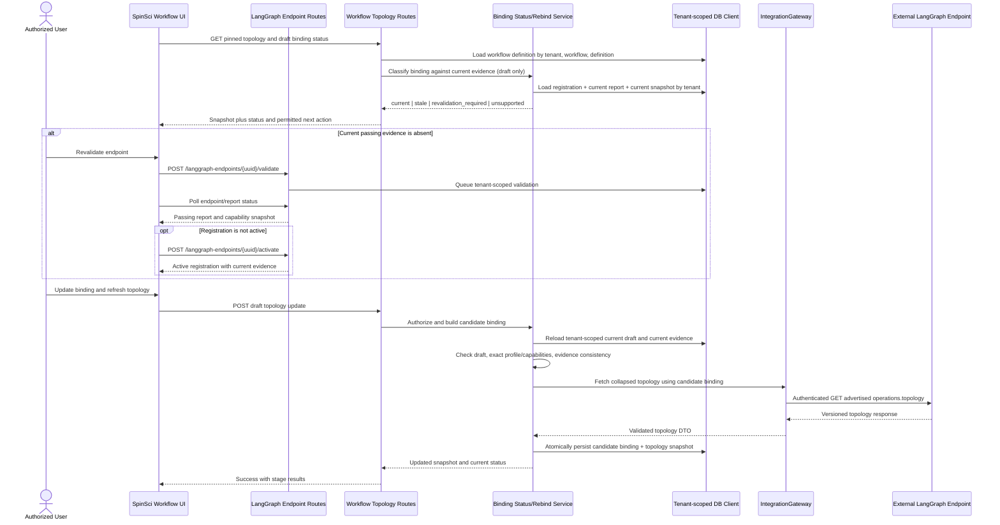

# Design Document

## Overview

Endpoint-authoritative LangGraph workflows are not SpinSci workflow definitions. SpinSci renders their graph structure in a separate read-only React Flow surface rather than merging it into the persisted SpinSci canvas. The existing canvas remains the source of truth for SpinSci media, lifecycle, orchestration, and runtime nodes; Endpoint topology remains an optional inspection artifact.

The completed implementation already provides the endpoint topology contract, secure SpinSci proxy, version-local snapshot persistence, and isolated topology viewer. The follow-up fixes a control-plane evidence mismatch: an Endpoint_Registration can have a current passing Capability_Snapshot that advertises `operations.topology`, while an older Current_Draft remains bound to a previous snapshot whose `operations` map lacks `topology`. The current refresh path reads only the old binding and therefore reports `topology_unsupported` even though the Endpoint now supports the operation.

The fix adds read-only binding-status classification and an explicit draft lifecycle action. An Authorized_User can revalidate the Endpoint when current passing evidence is absent, then update the Current_Draft to the registration's current passing evidence and refresh topology. Rebinding and topology pinning are persisted atomically after the external topology response validates. Published and historical versions continue to use only their version-local binding and Topology_Snapshot.

### Repository findings informing the design

- `api/services/langgraph_integration/topology.py` currently checks `binding.contract_version` and `binding.operations` before calling `IntegrationGateway`; this correctly protects pinned execution but cannot distinguish an old binding from a truly unsupported current registration.
- `api/routes/workflow.py` already has a read-only GET route and explicit draft-only POST refresh route. The GET route reads only the pinned snapshot, and the POST route does not rebind stale evidence.
- `api/services/workflow/langgraph_binding.py` already compares a binding with the registration's current Validation_Report and Capability_Snapshot and enforces exact Selected_Capabilities and compatibility-profile equality.
- `api/schemas/workflow_configurations.py` stores all evidence, compatibility, credential, policy, operation, and Topology_Snapshot fields required for a deterministic allowlisted rebind.
- `ui/src/app/workflow/[workflowId]/components/ConfigurationsDialog.tsx` currently supplies only the GET loader to the topology view.
- `ui/src/components/langgraph/ExternalLangGraphTopologyView.tsx` currently treats every unavailable response as unsupported and exposes no draft update action.
- The example Endpoint already advertises contract v1.2 `operations.topology` and tests collapsed and expanded views. The follow-up does not redesign that contract and does not model topology as a Selected_Capability.

## Architecture



### Lifecycle decisions

1. **Reads remain side-effect free.** GET may classify a Current_Draft against current registration evidence, but GET never changes the Endpoint_Binding, registration, or Topology_Snapshot.
2. **Endpoint revalidation and activation remain explicit.** The existing endpoint validation action performs discovery and writes new immutable validation evidence. The workflow UI invokes that action only after user confirmation, waits for a passing result, and invokes the existing activation action when the registration is not active before offering or continuing rebind.
3. **Draft update is explicit and atomic.** The update action constructs a candidate binding, retrieves topology through the candidate, and commits the candidate binding plus Topology_Snapshot in one tenant-scoped transaction. Authentication, network, unsupported, and schema failures leave the old binding and old snapshot unchanged.
4. **Current bindings can refresh without evidence replacement.** If the classifier reports current-and-supported, the same update service uses the existing binding as the candidate and atomically replaces only the Current_Draft Topology_Snapshot.
5. **Publication performs no external call.** The explicit update action is the lifecycle point for fetching and pinning current topology. Publishing or copying the draft into history carries the existing Endpoint_Binding and Topology_Snapshot forward unchanged, so publication remains deterministic and Endpoint outages do not mutate or invalidate prior snapshots.
6. **Immutable versions remain detached.** GET for a published or historical definition returns only its pinned Topology_Snapshot and does not compare with mutable Endpoint_Registration evidence. Mutation routes reject immutable definitions before external calls.

## Components and Interfaces

### Endpoint contract

A topology-supporting Endpoint advertises a manifest operation:

```json
{
  "schema_version": "1.2",
  "operations": {
    "topology": "/v1/topology"
  }
}
```

`operations.topology` is a Discovery_Manifest operation. It is not added to `selected_capabilities` and is not included in exact Selected_Capability comparison.

The existing authenticated operation remains:

```text
GET /v1/topology?view=collapsed|expanded
```

The response remains the versioned `EndpointTopology` DTO:

```text
EndpointTopology
- schema_version
- graph_id
- revision
- view: collapsed | expanded
- nodes: [{ id, label, type?, metadata? }]
- edges: [{ id?, source, target, label?, metadata? }]
```

`collapsed` is the default SpinSci view. Endpoint-local IDs never become SpinSci workflow node IDs.

### BindingStatusClassifier

Add a focused service near the existing LangGraph binding/topology services. The classifier accepts the tenant-scoped workflow definition and returns a structured status. For Current_Drafts, the service loads current activation evidence through the DB client using `organization_id` and `registration_uuid`.

Classification order matters:

1. Missing or invalid workflow binding → `endpoint_not_configured`.
2. Immutable version → `immutable_snapshot_only`; do not load mutable registration evidence.
3. Missing registration or tenant mismatch → tenant-safe `endpoint_unavailable`.
4. Missing current report/snapshot, non-passing report, or report not covering current snapshot → `endpoint_revalidation_required` or `endpoint_validation_failed`.
5. Current Capability_Snapshot omits `operations.topology` → `topology_unsupported`.
6. Bound report/snapshot identities or digests differ from current passing evidence → `binding_stale`.
7. Bound evidence matches and advertises the operation → `binding_current`.

Checking current operation support before stale identity means a registration whose newest valid manifest truly omits topology is reported as unsupported, not as recoverable stale evidence.

The classifier uses identities and digests, not a comparison of only the `operations` map. This prevents a changed contract, limits, ownership declaration, or validation result from being incorrectly treated as current.

### Candidate binding builder

Add a pure allowlist-based builder that receives the existing Endpoint_Binding, Endpoint_Registration, current Passing_Validation_Report, and covered Capability_Snapshot. It first reuses or extends `validate_binding_against_evidence` to enforce:

- registration identity consistency;
- active registration and passing current report;
- report coverage of the current Capability_Snapshot;
- exact `compatibility_profile` equality;
- exact Selected_Capability set equality;
- contract/profile/mode/state/region compatibility;
- complete required validation evidence.

The builder updates only fields derived from the same current passing evidence set:

- `validation_report_uuid` and `validation_report_digest`;
- `capability_snapshot_uuid`, `capability_snapshot_digest`, and `capability_snapshot`;
- `contract_version`;
- manifest-derived `operations`, `limits`, and `ownership`;
- validation `evidence` covered by the report.

The builder preserves:

- `registration_uuid` and `endpoint_url`;
- `credential_reference`;
- `compatibility_profile` and `selected_capabilities`;
- `state_mode`, `live_invocation_mode`, and `non_conversational_modes`;
- `data_region`;
- `data_sharing_policy`, `redaction_policy_id`, and `compiled_policy_versions`;
- `first_event_deadline_ms`, `first_event_action`, and `terminal_failure_action`.

A mismatch in exact profile or Selected_Capabilities is a compatibility error requiring an explicit workflow endpoint-selection/configuration change; the rebind action does not silently adopt registration choices. The existing `topology_snapshot` is held only as rollback state and is not attached to the candidate because its `endpoint_binding_revision` references the old Capability_Snapshot.

### Draft topology update service

Extend `api/services/langgraph_integration/topology.py` or add a narrowly named sibling service. The update service:

1. Loads the workflow definition by `organization_id`, `workflow_id`, and `definition_id`.
2. Rejects non-draft definitions before endpoint lookup or external access.
3. Loads the Endpoint_Registration and current activation evidence in the same tenant.
4. Classifies the binding.
5. Rejects unsupported, absent, failed, or incompatible evidence with a typed status.
6. Uses the existing binding when current or the candidate binding when stale.
7. Builds `RuntimeEndpointSnapshot` from that chosen binding, including its advertised Topology_Operation and preserved credential reference.
8. Fetches `collapsed` topology through IntegrationGateway.
9. Validates the DTO and computes the canonical digest.
10. Creates `LangGraphTopologySnapshot(endpoint_binding_revision=candidate.capability_snapshot_uuid, ...)`.
11. Atomically updates only the selected Current_Draft's `workflow_configurations.langgraph_endpoint` after confirming that the draft and expected old binding revision have not changed.
12. Returns the updated snapshot, new binding status, and completed lifecycle stages.

Optimistic revision comparison or an equivalent conditional DB update prevents a concurrent draft save from being overwritten. On conflict, the service returns `draft_changed`; the UI reloads the draft and asks the user to retry.

### HTTP API

Preserve the existing routes and add one explicit update operation:

```text
GET  /api/v1/workflow/{workflow_id}/versions/{definition_id}/langgraph-topology
POST /api/v1/workflow/{workflow_id}/versions/{definition_id}/langgraph-topology/refresh
POST /api/v1/workflow/{workflow_id}/versions/{definition_id}/langgraph-topology/update-binding
POST /api/v1/langgraph-endpoints/{endpoint_uuid}/validate
POST /api/v1/langgraph-endpoints/{endpoint_uuid}/activate
```

- **GET topology** returns the pinned snapshot plus classification metadata for a Current_Draft. For Immutable_Versions, the response is derived only from version-local data.
- **POST refresh** remains backward compatible and refreshes only a current-and-supported Current_Draft binding. If the binding is stale, it returns `binding_stale` rather than `topology_unsupported` and directs the caller to the explicit update operation.
- **POST update-binding** performs the candidate-binding topology retrieval and atomic commit described above. The route name makes the binding mutation explicit. It does not initiate asynchronous endpoint validation implicitly.
- **POST endpoint validate/activate** remain the explicit revalidation and activation operations. Existing endpoint-management authorization and immutable validation history remain in force.

Workflow mutation routes require the workflow-update permission. The update-binding route additionally requires the endpoint permission needed to consume current activation evidence for a binding update. Endpoint revalidation continues to require its existing validation permission. Every DB read and write includes `organization_id`; foreign endpoint and definition identifiers yield tenant-safe responses.

The generated frontend client is regenerated after the API schemas and route are finalized.

### Frontend orchestration

`ConfigurationsDialog` supplies the topology view with:

- a side-effect-free loader;
- workflow and definition mutability context;
- endpoint validation action and status polling where permitted;
- current-binding refresh action;
- stale-binding update action.

`ExternalLangGraphTopologyView` separates snapshot render state from binding lifecycle state. It renders any valid pinned snapshot even when the Current_Draft is stale, while clearly labeling the snapshot as based on older endpoint evidence. This preserves useful version-local evidence until an explicit update succeeds.

Draft actions:

- `binding_current` + supported: **Refresh topology**.
- `binding_stale`: **Update endpoint binding and refresh topology**.
- `endpoint_revalidation_required`: **Revalidate endpoint**, followed by the explicit update action after a passing report becomes current.
- `topology_unsupported`: no refresh action; link or instruction to inspect authenticated discovery and restart/update the Endpoint.
- Immutable version: no revalidation, rebind, or refresh action.

The UI reports lifecycle stages independently: validation requested/in progress/failed/passed, draft binding update pending, topology retrieval pending, and snapshot pinned. Generated-client errors are checked through `response.error` and normalized with `detailFromError`. Auth failures never display secret values, and schema/network diagnostics remain redacted and actionable.

The dedicated React Flow graph remains read-only and isolated from `workflowStore`, `activeRuntimeNodeId`, the SpinSci canvas, and the persisted `workflow_definition`.

### Documentation component

Implementation later creates `docs/integrations/langgraph-topology.mdx` and adds the page to `docs/docs.json`. The guide uses valid YAML frontmatter and second-person language. It covers:

1. prerequisites, required permissions, endpoint URL, and credential availability;
2. starting or restarting the example/external Endpoint after contract changes;
3. authenticated discovery and confirmation that `operations.topology` exists;
4. validation and activation from **LangGraph Endpoints**;
5. opening an existing Current_Draft or creating a new draft from an Immutable_Version;
6. updating the draft Endpoint_Binding;
7. refreshing and viewing the pinned topology;
8. `snapshot_unavailable`, `topology_unsupported`, authentication, network, and schema troubleshooting.

Shell and `curl` examples use placeholders such as `$LANGGRAPH_ENDPOINT_URL` and `$LANGGRAPH_API_KEY`. During implementation, each command is executed against the implemented contract with non-secret test values before publication. The documentation task creates the page only after backend and UI behavior is stable; this spec update does not create the final page.

## Data Models

### Extended topology response

```text
ExternalTopologyResponse
- status: available | unavailable
- reason?: string
- topology?: EndpointTopology
- digest?: string
- endpoint_binding_revision?: string
- binding_status?: DraftBindingStatus
- actions?: TopologyActionAvailability
- stages?: TopologyLifecycleStages
```

Existing response fields remain compatible. New metadata is additive and contains no credentials, manifest secrets, or raw unredacted diagnostics.

### Draft binding status

```text
DraftBindingStatus
- state:
    endpoint_not_configured
    immutable_snapshot_only
    endpoint_unavailable
    endpoint_revalidation_required
    endpoint_validation_failed
    topology_unsupported
    binding_stale
    binding_current
- reason?: string
- bound_validation_report_uuid?: string
- bound_capability_snapshot_uuid?: string
- current_validation_report_uuid?: string
- current_capability_snapshot_uuid?: string
```

Only non-secret evidence identifiers needed to explain staleness are exposed. Immutable responses omit current registration identifiers because immutable reads do not consult mutable evidence.

### Action availability

```text
TopologyActionAvailability
- can_revalidate: boolean
- can_update_binding: boolean
- can_refresh_topology: boolean
- immutable: boolean
```

The backend derives flags from version mutability, status, and authorization. The UI treats flags as presentation guidance; every mutation route independently enforces authorization.

### Lifecycle stages

```text
TopologyLifecycleStages
- validation: not_required | required | pending | passed | failed
- binding_update: not_required | pending | updated | failed
- topology_refresh: not_started | pending | pinned | failed
```

A failed update includes a stable reason code and redacted user message. The previous binding and Topology_Snapshot remain stored.

### Binding and snapshot invariants

- `topology_snapshot.endpoint_binding_revision == binding.capability_snapshot_uuid` for every usable Topology_Snapshot.
- A rebound binding's report and snapshot identities and digests come from one current passing evidence set.
- `selected_capabilities` never gains a synthetic `topology` entry.
- Rebinding does not modify credential or policy fields.
- One workflow-version update never changes another definition's configuration JSON.
- Immutable definitions are never write targets for rebind or refresh.

## Correctness Properties

*A property is a characteristic or behavior that should hold true across all valid executions of a system—essentially, a formal statement about what the system should do. Properties serve as the bridge between human-readable specifications and machine-verifiable correctness guarantees.*

### Property 1: Read-only topology access preserves version state

For any workflow version, a topology GET or binding-status classification leaves the Endpoint_Binding and Topology_Snapshot byte-equivalent to their pre-request values.

**Validates: Requirements 6.6**

### Property 2: Immutable versions remain unchanged

For any published or historical workflow version, every refresh or rebind attempt leaves the version-local Endpoint_Binding and Topology_Snapshot unchanged, including after later draft or Endpoint_Registration updates.

**Validates: Requirements 3.5, 7.7, 8.8**

### Property 3: Cross-tenant identifiers preserve confidentiality and integrity

For any workflow, definition, registration, Validation_Report, or Capability_Snapshot identifier owned by another tenant, topology read and mutation requests reveal no resource data and change no resource in either tenant.

**Validates: Requirements 3.2, 7.6**

### Property 4: Successful stale rebind uses one consistent evidence set

For any successful stale-binding update, every replaced evidence-derived binding field comes from one current Passing_Validation_Report and its covered Capability_Snapshot, and the resulting Topology_Snapshot `endpoint_binding_revision` equals the resulting binding `capability_snapshot_uuid`.

**Validates: Requirements 3.4, 7.2, 7.3, 8.3**

### Property 5: Topology never becomes a selected capability

For any binding classification, refresh, or rebind, `topology` is absent from `selected_capabilities`, and a successful rebind preserves the pre-update Selected_Capability set exactly.

**Validates: Requirements 7.4, 7.5**

### Property 6: Failed updates preserve binding and snapshot atomically

For any external unsupported response, authentication failure, network failure, schema failure, or concurrent-draft conflict, the selected draft's Endpoint_Binding and Topology_Snapshot remain byte-equivalent to their pre-request values.

**Validates: Requirements 8.4, 8.5**

### Property 7: Successful updates are isolated to the selected draft

For any successful topology refresh or stale-binding update, only the selected Current_Draft may change; every other draft, published version, and historical version remains byte-equivalent to its pre-request state.

**Validates: Requirements 7.7, 8.4, 8.8**

### Property 8: Current-binding refresh changes only topology

For any successful refresh of a current Endpoint_Binding, the Topology_Snapshot may change while validation evidence, capability evidence, credential, compatibility, Selected_Capability, policy, mode, region, timeout, and failure-action fields remain byte-equivalent to their pre-request values.

**Validates: Requirements 7.4, 8.2, 8.4**

### Property 9: Endpoint topology is isolated from workflow state

For any valid endpoint topology payload, loading, laying out, or rendering the payload changes neither the SpinSci workflow canvas nodes and edges nor the workflow store, persisted `workflow_definition`, undo history, validation state, `WorkflowRuntimeNodeTransition` events, or `activeRuntimeNodeId`.

**Validates: Requirements 1.1, 1.2, 5.1**

## Error Handling

| Condition | Stable status/reason | Behavior | UI guidance |
|---|---|---|---|
| No pinned topology | `snapshot_unavailable` | Keep binding unchanged | Update/refresh the Current_Draft; create a draft for immutable versions |
| Current evidence supports topology but draft evidence differs | `binding_stale` | Keep old binding and snapshot until explicit action succeeds | Update endpoint binding and refresh topology |
| Current passing snapshot lacks `operations.topology` | `topology_unsupported` | Do not call a topology URL | Check authenticated discovery and restart/update the Endpoint |
| No current report covers current snapshot | `endpoint_revalidation_required` | Do not rebind | Revalidate the Endpoint and wait for a passing report |
| Current validation failed | `endpoint_validation_failed` | Preserve draft evidence | Open validation report and resolve contract/auth/network issues |
| Profile or Selected_Capabilities mismatch | `binding_incompatible` | Reject silent rebind | Reconfigure or explicitly select a compatible endpoint binding |
| Immutable target | `snapshot_required_for_immutable_version` | Reject before external call | Open/create a Current_Draft |
| Credential/authentication failure | `topology_auth_failed` | Roll back update | Verify endpoint credential without displaying the secret |
| Endpoint/network policy failure | `topology_network_failed` | Roll back update | Verify endpoint availability, URL, and private-network policy |
| Contract/schema violation | `topology_schema_invalid` | Roll back update | Verify contract v1.2 discovery and topology response schema |
| Contract-defined unsupported response | `topology_unsupported` | Roll back update | Verify the advertised operation matches deployed endpoint behavior |
| Concurrent draft edit | `draft_changed` | Conditional write fails | Reload the draft and retry |
| Cross-tenant identifier | tenant-safe 404/authorization response | Perform no read-through or write | Select a resource in the active organization |

Unexpected errors use the existing API error envelope and audit path. Logs and responses redact authorization headers, credential values, prompts, transcripts, tool arguments, and endpoint response content beyond approved diagnostics.

## Testing Strategy

This follow-up uses focused example-based unit, API integration, and React component tests. Property-based testing is not included because the new behavior is primarily tenant-scoped persistence orchestration, permission enforcement, external-call sequencing, immutable-version handling, and UI state transitions. Repeating those side-effect-heavy scenarios across generated inputs would provide less value than explicit fixtures for each evidence and lifecycle state.

### Backend unit tests

- Classify an old draft snapshot without `operations.topology` as `binding_stale` when current passing evidence advertises the operation.
- Classify a current passing snapshot that omits the operation as `topology_unsupported`.
- Classify matching current evidence as `binding_current`.
- Classify missing, non-passing, and snapshot-mismatched reports as revalidation-required or failed.
- Build a candidate binding from one passing evidence set and verify the exact update allowlist.
- Verify Selected_Capabilities remain exact and do not contain topology.
- Verify profile or Selected_Capability mismatch rejects the candidate.
- Verify credential, endpoint URL, modes, region, policy, timeout, and failure-action fields remain unchanged.

### Backend API/service tests

- Recover a stale Current_Draft by rebinding to current passing evidence and pinning collapsed topology with the new Capability_Snapshot identity.
- Refresh a current binding and verify report/snapshot evidence fields remain unchanged while topology digest/snapshot updates.
- Return genuine `topology_unsupported` without an external call when current evidence omits the operation.
- Preserve the old binding and snapshot when authentication, network, unsupported-response, or schema validation fails.
- Verify GET classification and snapshot retrieval perform no writes.
- Reject refresh and rebind for published and historical definitions and verify stored JSON remains byte-equivalent.
- Verify a successful draft update changes only the selected definition and that publish/history copies remain version-local.
- Verify cross-tenant workflow, definition, registration, report, and snapshot identifiers cannot be read or mutated.
- Verify required endpoint and workflow permissions independently.
- Verify optimistic conflict handling does not overwrite a concurrent draft save.
- Retain regression tests for workflow execution, the SpinSci canvas, runtime highlighting, and endpoints without topology support.

### UI tests

- Show the existing pinned graph plus a stale-evidence notice and update action for `binding_stale`.
- Show refresh without rebind for `binding_current`.
- Show genuine unsupported guidance for `topology_unsupported`.
- Show revalidation guidance and validation progress/failure for absent or failed current evidence.
- Chain successful endpoint validation, explicit binding update, topology refresh, and viewer reload.
- Normalize generated-client `{ data, error }` responses with actionable auth, network, schema, and snapshot messages.
- Hide or disable mutation actions for published and historical versions.
- Verify failed updates retain the previously rendered pinned snapshot.
- Retain mapper, layout, read-only interaction, workflow-store isolation, and workflow editor regression tests.

### Documentation validation

- Validate MDX and YAML frontmatter with the repository's documentation checks.
- Validate the `docs/docs.json` navigation entry.
- Execute every shell and `curl` example against the implemented routes using placeholder or test credentials.
- Check that discovery instructions refer to `operations.topology`, not Selected_Capabilities.
- Review instructions for second-person voice and all required troubleshooting statuses.
