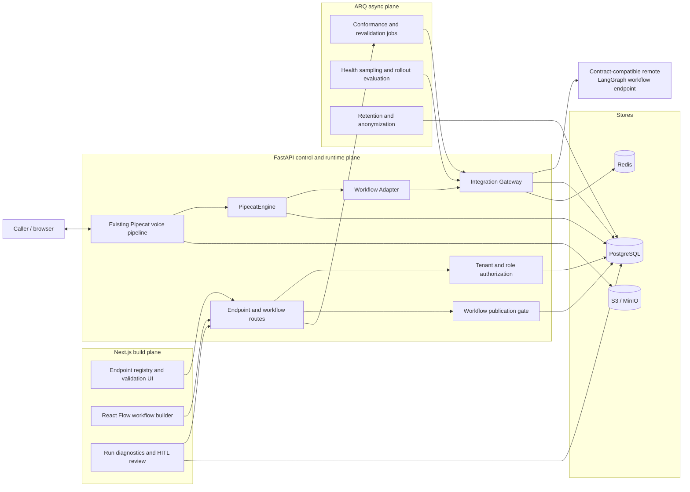
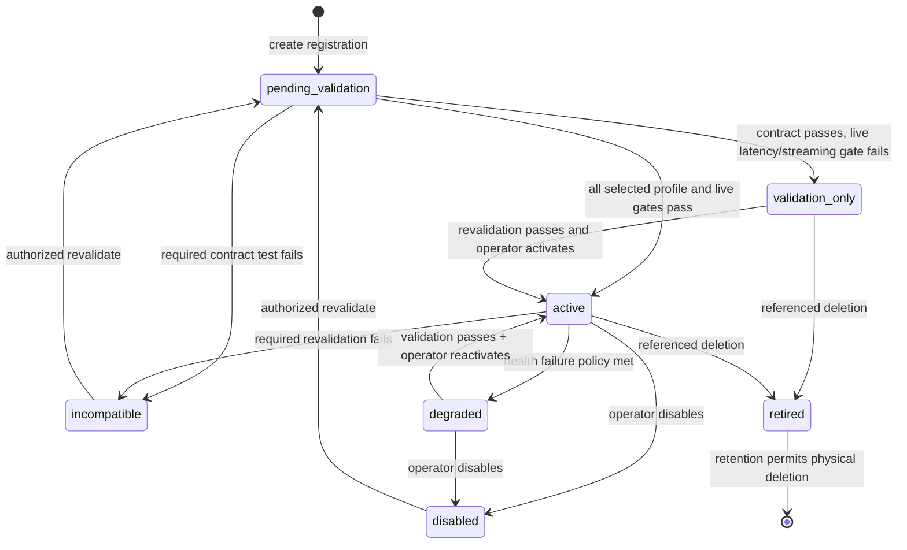
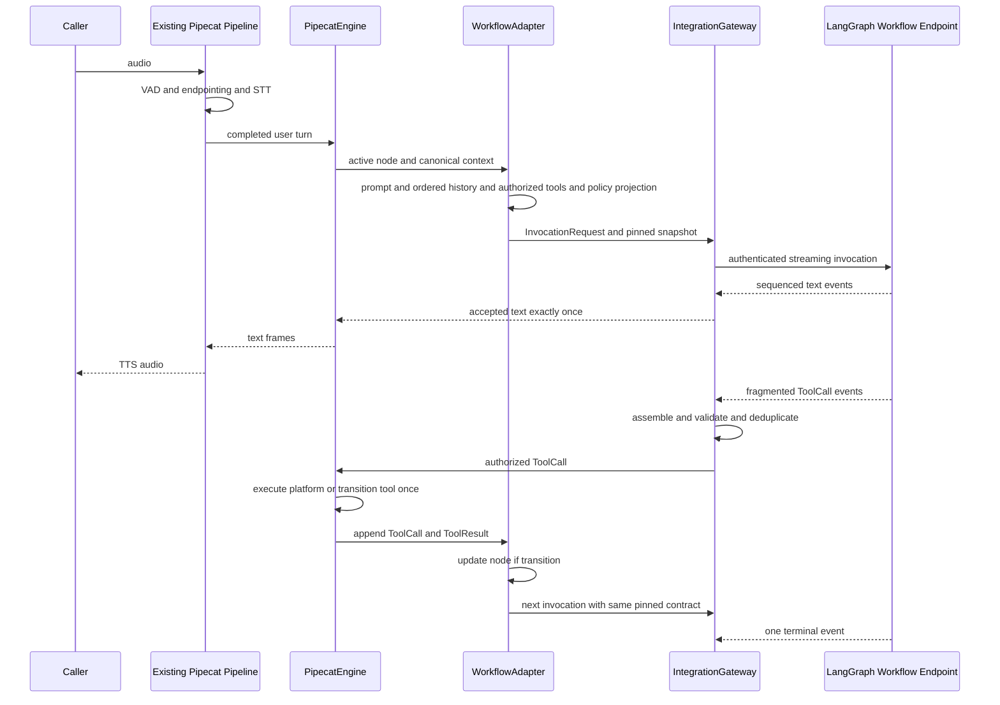

# Design Document: LangGraph Voice Integration

## Overview

### Purpose

This design adds an experimental, tenant-scoped way for a Mural workflow to use a remotely deployed LangGraph workflow endpoint as its conversational reasoning service while Mural continues to own the voice and workflow runtime. The feature is additive: existing workflows, model providers, text sessions, WebRTC sessions, telephony providers, and Pipecat pipelines follow their current code paths unless an authorized workflow version explicitly pins a validated endpoint and the organization feature flag is enabled.

“Any LangGraph agent” means any **contract-compatible remote chat agent** that implements a supported Mural contract version and compatibility profile. It does not mean arbitrary in-process Python graph objects, uploaded packages, undocumented LangGraph application APIs, direct audio processors, or audio-native/realtime speech-to-speech agents.

The design treats compatibility as an observable wire contract rather than a dependency on LangGraph internals. A non-LangGraph service may implement the contract, but the product surface and conformance guidance target LangGraph workflow endpoints.

### Goals

- Preserve Mural ownership of telephony, media, STT, TTS, VAD, endpointing, turn-taking, barge-in, answering-machine detection (AMD), recording, transcript assembly, active workflow node, and workflow-version selection.
- Preserve `PipecatEngine` as the authority for node prompts, transition registration, platform tools, context updates, and node progression.
- Add explicit discovery, conformance validation, lifecycle, contract negotiation, state ownership, privacy, and operational controls before an endpoint can serve a live turn.
- Pin endpoint behavior to immutable `WorkflowDefinitionModel` versions and therefore to `WorkflowRunModel.definition_id`.
- Make every remote result untrusted until schema, sequence, authorization, state, and tenant checks pass.
- Provide deterministic text-session preflight and conformance tests before live voice eligibility.
- Support synchronous, streaming, and asynchronous contract operations while requiring streaming for live voice.
- Support optional checkpointed state and human-in-the-loop (HITL) interrupts without allowing endpoint state to override Mural state.

### Non-goals

- Loading or executing user-supplied Python, LangGraph graph objects, or packages in the Mural process.
- Sending raw audio, telephony sockets, Pipecat frames, or direct processor access to an endpoint.
- Replacing Mural’s frontend workflow graph with an endpoint-owned graph.
- Supporting the integration on realtime speech-to-speech paths.
- Guaranteeing compatibility with every LangGraph library, deployment product, server version, or custom API.
- Making endpoint-internal tools subject to Mural authorization; only wire-visible Mural platform tools are covered.

### Existing repository seams

The implementation extends rather than replaces these existing seams:

| Concern | Existing seam | Design use |
|---|---|---|
| Immutable workflow behavior | `api/db/models.py` (`WorkflowDefinitionModel`, `WorkflowRunModel.definition_id`) | Store the complete endpoint binding and capability snapshot in the definition’s `workflow_configurations`; copy the resolved snapshot into run integration records for indexed diagnostics. |
| Publish gate | `api/routes/workflow.py::_validate_workflow_definition` and `publish_workflow` | Add endpoint ownership, validation, capability, mode, privacy, latency, and feature-flag checks before publishing. |
| Graph semantics | `api/services/workflow/workflow_graph.py` | Reuse stable transition names from edge labels; add endpoint-specific validation without adding a second graph engine. |
| Prompt and tool composition | `api/services/workflow/pipecat_engine.py::_setup_llm_context` | Refactor composition behind a `WorkflowAdapter` consumed by both local model services and remote endpoints. |
| Live pipeline | `api/services/pipecat/run_pipeline.py`, `pipeline_builder.py` | Select a contract-backed reasoning processor only for non-realtime runs; leave all surrounding processors unchanged. |
| Text preflight | `api/services/workflow/text_chat_runner.py` and `text_chat_session_service.py` | Exercise the same adapter/gateway and workflow rules without telephony cost. |
| Tools | `api/services/workflow/pipecat_engine_custom_tools.py`, tool DB/services | Reuse execution handlers after exact-name, schema, tenant, node, and confirmation authorization. |
| Background work | `api/tasks/arq.py` | Run onboarding validation, scheduled revalidation, health sampling, retention, and rollout evaluation. |
| URL controls | `api/utils/url_security.py` | Extend current hosted-mode checks to each redirect and the actual connection destination. |
| Tracing | `api/services/pipecat/tracing_config.py`, pipeline observers/log buffer | Add gateway spans and event correlation under the existing per-run trace. |
| Builder | `ui/src/app/workflow/[workflowId]`, `ui/src/components/flow`, Zustand store | Add endpoint binding, ownership badges, capability warnings, and publication errors without a separate builder. |
| API client | FastAPI OpenAPI and `ui/src/client` | Generate typed endpoint-management and conformance APIs after backend schemas stabilize. |

### Research findings informing the design

- The [OWASP SSRF Prevention Cheat Sheet](https://cheatsheetseries.owasp.org/cheatsheets/Server_Side_Request_Forgery_Prevention_Cheat_Sheet.html) recommends defense in depth, strict destination validation, and redirect controls. Therefore registration-time DNS checks are insufficient: Mural validates every redirect and pins/validates the destination again when opening each connection.
- The [W3C Trace Context recommendation](https://www.w3.org/TR/trace-context/) defines interoperable `traceparent` and `tracestate` propagation and warns against placing personal data in trace fields. Mural originates tenant scope independently, forwards valid trace context, and never accepts organization identity from endpoint trace headers.
- The [WHATWG server-sent events format](https://developer.whatwg.org/server-sent-events.html) establishes UTF-8 `text/event-stream` framing and event boundaries. The contract uses SSE transport but adds explicit versioned JSON envelopes, monotonically increasing sequence numbers, and exactly one terminal event.
- [LangGraph interrupt guidance](https://docs.langchain.com/oss/python/langgraph/interrupts) describes durable checkpoint and same-thread resume behavior. Mural treats thread and checkpoint values as opaque endpoint state, scopes them to organization and voice run, and resumes only through a declared Stateful Run Profile.

Content from external sources was rephrased for compliance with licensing restrictions.

### Key design decisions

1. **Dedicated endpoint domain, not generic model override.** An endpoint has validation, lifecycle, privacy, health, state, and audit semantics that generic `model_overrides` cannot represent safely.
2. **Adapter at the reasoning boundary.** `WorkflowAdapter` produces contract requests from the same prompt/history/tool state currently assembled by `PipecatEngine`; `IntegrationGateway` owns network and protocol concerns.
3. **Mural state wins.** Endpoint checkpoints may optimize or enrich endpoint execution, but cannot mutate Mural’s active node or canonical history except through accepted contract events and authorized tools.
4. **At-least-once network, exactly-once Mural effects.** Retryable transport attempts may repeat an invocation, while durable `(invocation_id, tool_call_id)` and terminal-result records suppress duplicate tools, speech, transitions, and terminal actions.
5. **Fail closed on protocol uncertainty.** Malformed, out-of-order, unauthorized, post-terminal, cross-tenant, or secret-bearing data produces a protocol/security error and no state progression.
6. **Feature flag checked at every entry point.** UI visibility, registration, attachment, publication, run selection, and runtime dispatch all enforce the organization flag; hiding UI alone is never authorization.

## Architecture

### Logical architecture



### Runtime placement

For a standard recognize-reason-synthesize pipeline, only the reasoning processor changes:

```mermaid
flowchart LR
  In[Transport input] --> VAD[VAD / turn detection]
  VAD --> STT[STT]
  STT --> AMD[Optional AMD gate]
  AMD --> UserAgg[User context aggregator]
  UserAgg --> Reasoner{Pinned reasoner}
  Reasoner -->|Existing workflow| Local[Existing LLM service]
  Reasoner -->|Validated endpoint| Remote[Contract reasoning processor]
  Local --> Callbacks[Existing engine callbacks]
  Remote --> Callbacks
  Callbacks --> RecordingRouter[Optional recording router]
  RecordingRouter --> TTS[TTS]
  TTS --> Out[Transport output]
  Out --> AudioBuffer[Recording buffer]
  AudioBuffer --> AssistantAgg[Assistant context aggregator]
```



The realtime speech-to-speech branch remains unchanged and rejects endpoint attachment at publication and run creation. The existing side-channel text LLM remains available for operations not explicitly pinned to the endpoint. If endpoint use is selected for extraction or AMD, the adapter requests the pinned synchronous mode; otherwise existing providers handle those operations.

### Control-plane lifecycle



`pending_validation`, `validation_only`, `active`, `degraded`, `disabled`, `incompatible`, and `retired` are persisted states. A separate immutable validation outcome records `discovery_timeout`, `invalid_manifest`, individual test failures, warnings, and latency results. No state name is overloaded to hide test details.

### Live-turn sequence



### State ownership

| State category | Owner | Persistence and rule |
|---|---|---|
| Organization, feature flag, roles | Mural | Existing auth/config plus explicit permission checks. |
| Workflow version, active node, prompt, edge mapping | Mural | Immutable workflow definition and runtime engine. |
| Canonical transcript and wire-visible conversation history | Mural | Ordered accepted messages; endpoint output enters only after validation. |
| Tool definitions, authorization, execution, results | Mural for platform tools | Endpoint can request but cannot expand authority. |
| Telephony/media/STT/TTS/VAD/turn-taking/barge-in/AMD/recording | Mural | Existing Pipecat and telephony services. |
| Endpoint-internal graph state and internal tools | Endpoint | Outside Mural authorization guarantee; disclosed in UI. |
| Thread, external run, checkpoint values | Endpoint issues; Mural stores opaquely | Same-tenant and same-run scoped; never interpreted as credentials. |
| Invocation, attempt, trace, retry, accepted-event ledger | Mural | Durable identifiers and event/effect deduplication. |
| Human review decision and audit | Mural | Immutable audit record; resume is a new invocation. |

### Compatibility profiles

The immutable Compatibility Matrix defines profile requirements per contract version:

| Profile | Required behavior | Eligibility |
|---|---|---|
| **Chat Compatibility Profile** | Ordered chat messages, authoritative system instruction, supplied JSON-schema tools, assistant text, tool calls, structured errors, streaming framing, cancellation behavior if declared | Baseline for any supported endpoint. Streaming is mandatory for live voice. |
| **Stateful Run Profile** | Chat profile plus thread/run/checkpoint identifiers, asynchronous status if declared, interrupts, resume, and cancellation semantics | Optional; required for endpoint checkpoints or HITL. |

Capabilities are selected, not inferred. The Capability Manifest may declare a superset; validation and runtime enable exactly the version/profile/modes/state mode/limits selected and later pinned. An undeclared or unselected event is a protocol error.

### Capability discovery and negotiation

Discovery is an authenticated `GET /.well-known/mural-langgraph` relative to the registered origin. The complete response must arrive and validate within five seconds. A representative manifest is:

```json
{
  "schema_version": "1.0",
  "endpoint_id": "support-agent-prod",
  "display_name": "Support Agent",
  "data_regions": ["us-east"],
  "contract_versions": ["1.0", "1.1"],
  "compatibility_profiles": ["chat", "stateful_run"],
  "invocation_modes": ["streaming", "synchronous", "asynchronous"],
  "state_modes": ["mural_authoritative", "endpoint_checkpointed"],
  "operations": {
    "invoke": "/v1/invocations",
    "status": "/v1/runs/{external_run_id}",
    "cancel": "/v1/invocations/{invocation_id}/cancel",
    "resume": "/v1/invocations/{invocation_id}/resume",
    "health": "/v1/health"
  },
  "features": {"interrupts": true, "idempotent_invocations": true},
  "limits": {
    "request_bytes": 1048576,
    "response_bytes": 2097152,
    "event_bytes": 65536,
    "tool_argument_bytes": 262144
  }
}
```

Negotiation groups semantic versions by major version, intersects endpoint offers with the current Compatibility Matrix, and chooses the highest mutually supported compatible minor version. Mural supports the two most recent compatible minor versions for each supported major. The selected version is recorded in the Validation Report and later copied into the immutable workflow snapshot. Breaking semantic changes require a new major; optional backward-compatible fields require a new minor. Unknown optional fields are ignored only where the negotiated schema marks the object extensible.

### Deployment and scaling implications

- The gateway runs inside the current API/data-plane process for the first release to avoid a media handoff. Every network operation is asynchronous and bounded by connect, first-event, turn, idle-stream, and total deadlines.
- Streaming endpoint connections add file descriptors, sockets, buffers, and event-loop work per call. Capacity tests measure active endpoint streams and loop lag in addition to active calls; production limits reserve headroom per worker.
- ARQ workers execute onboarding validation, scheduled revalidation, health sampling, retention, and rollout evaluation. They do not proxy live streams.
- Redis holds short-lived cancellation signals, active-invocation coordination, health sampling windows, and rollout counters. Durable invocation/effect outcomes remain in PostgreSQL so a Redis flush cannot permit duplicate tools.
- Existing graceful drain remains authoritative. On shutdown, the gateway marks active invocations cancelled, suppresses forwarding, attempts endpoint cancellation within the remaining grace period, and lets existing call finalization run.
- No new externally reachable Mural service is required. Endpoint callbacks, if asynchronous callback mode is enabled in a later rollout phase, use an authenticated FastAPI route and the same organization checks as polling.

## Components and Interfaces

### 1. Endpoint management API

A new `api/routes/langgraph_endpoints.py` router under `/api/v1/langgraph-endpoints` keeps HTTP parsing, organization resolution, and response shaping in routes. Multi-step lifecycle rules live under `api/services/langgraph_integration/`; all SQL lives in a focused `api/db/langgraph_endpoint_client.py` mixin included by `DBClient`.

Representative operations:

| Method and path | Purpose | Required permission |
|---|---|---|
| `POST /langgraph-endpoints` | Create tenant-scoped pending registration from URL, credential reference, selected profile/capabilities | `langgraph_endpoint:create` |
| `GET /langgraph-endpoints` | List current-tenant registrations | `langgraph_endpoint:list` |
| `GET /langgraph-endpoints/{uuid}` | Detail, manifest summary, lifecycle, masked credential metadata | `langgraph_endpoint:read` |
| `PATCH /langgraph-endpoints/{uuid}` | Update mutable metadata or replace same-tenant credential; forces revalidation when behavior changes | `langgraph_endpoint:update` |
| `POST /langgraph-endpoints/{uuid}/validate` | Enqueue immutable validation run | `langgraph_endpoint:validate` |
| `POST /langgraph-endpoints/{uuid}/activate` | Activate only a currently eligible snapshot | `langgraph_endpoint:activate` |
| `POST /langgraph-endpoints/{uuid}/deactivate` | Block new selections | `langgraph_endpoint:deactivate` |
| `DELETE /langgraph-endpoints/{uuid}` | Delete unreferenced or retire referenced registration | `langgraph_endpoint:delete` |
| `GET /langgraph-endpoints/{uuid}/validation-reports` | List immutable reports | `langgraph_endpoint:read` |
| `GET /langgraph-compatibility-matrices` | Published current/prior compatibility matrices | authenticated tenant user |
| `POST /langgraph-interrupts/{uuid}/decisions` | Submit an allowed same-tenant review decision | `langgraph_interrupt:review` |

The existing `/credentials` API remains the credential authority. Registration stores only `credential_id`; API responses expose type, UUID, and timestamps, never secret values. Credential replacement triggers revalidation and cross-worker invalidation through `WorkerSyncManager` if credentials are cached.

### 2. Endpoint registration service

Responsibilities:

- Validate URL length and credential ownership before creating a row.
- Enforce the organization feature flag and lifecycle permissions.
- Normalize endpoint origin without storing embedded user information, query credentials, or fragments.
- Queue discovery/conformance with an idempotent ARQ job key.
- Compare discovered capabilities with the selected set and current Compatibility Matrix.
- Make lifecycle transitions through explicit compare-and-set rules.
- Detect workflow-version references before physical deletion.
- Retain prior Validation Reports and capability snapshots.

A failed create-time URL or credential check performs no registration mutation. A failed later discovery updates the registration’s current validation outcome while preserving immutable report evidence.

### 3. Conformance service

`api/services/langgraph_integration/conformance/` owns deterministic fixtures, protocol simulators, latency harnesses, and report generation. ARQ entry points are registered in `api/tasks/arq.py`.

Validation stages execute in order and stop only where continuing would be unsafe:

1. Registration security and DNS/connection policy.
2. Authenticated discovery and manifest schema.
3. Contract-version negotiation.
4. Request/response schema fixtures.
5. SSE framing, event ordering, fragment assembly, terminal handling, and post-terminal suppression.
6. Tool call/result, authorization boundary, and idempotency fixtures.
7. Error, timeout, retry, disconnect, and cancellation fixtures.
8. Stateful thread/checkpoint/interrupt/resume fixtures when selected.
9. Fixed-environment latency suite: at least 100 streaming and 100 tool-free completion requests.
10. Optional live-pipeline smoke evidence.

Reports record suite version, matrix version, contract version, selected profile, immutable manifest snapshot, test results, warnings, measured distributions, fixture digest, environment metadata, and live-smoke evidence. Required non-latency failures yield `incompatible`; otherwise latency or missing streaming yields `validation_only`; passing eligibility permits authorized activation.

Scheduled revalidation runs at least every 24 hours for active registrations. Three failures in a rolling 15-minute interval block new run selection. Health sampling uses the configured interval for 60 seconds after the first failure; all due samples failing changes the status to `degraded` and alerts operators. Recovery never auto-activates: current health and required validation must pass, then an operator reactivates.

### 4. Integration Gateway

`api/services/langgraph_integration/gateway.py` is the only component that talks to endpoint URLs. It does not know frontend graph semantics.

Responsibilities:

- Resolve the immutable endpoint snapshot and same-tenant credential reference.
- Apply SSRF validation on initial URL, every redirect, DNS resolution, and connection destination.
- Authenticate discovery, invocation, status, resume, cancellation, health, and callbacks.
- Create `Invocation_ID` once per logical operation and `Attempt_ID` per network attempt.
- Serialize versioned requests; parse bounded JSON/SSE responses incrementally.
- Enforce sequence, event type, size, terminal, deadline, and selected-capability rules.
- Persist invocation/attempt/event/effect records through DB clients.
- Retry only eligible pre-event failures once and only within the remaining deadline.
- Suppress duplicate or post-cancellation events and dispatch cancellation when declared.
- Propagate trace context and emit metrics without trusting endpoint tenant claims.
- Return typed accepted events to the Workflow Adapter.

The gateway exposes internal interfaces rather than HTTP-specific objects:

```text
invoke_stream(snapshot, request, cancellation) -> AsyncIterator[AcceptedRuntimeEvent]
invoke_sync(snapshot, request) -> AcceptedCompletion | ContractError
start_async(snapshot, request) -> ExternalRunHandle
await_async(snapshot, handle, deadline, cancellation) -> AcceptedCompletion | ContractError
resume(snapshot, checkpoint, decision, request) -> AsyncIterator[AcceptedRuntimeEvent]
cancel(snapshot, invocation_id, reason) -> CancellationOutcome
```

### 5. Workflow Adapter

`api/services/workflow/langgraph_adapter.py` bridges `PipecatEngine` state to the gateway. It does not perform raw HTTP.

Responsibilities:

- Build the authoritative system instruction from the current node before history.
- Project canonical ordered messages into contract messages without reordering roles.
- Generate exactly one stable Transition Tool per outgoing edge using the existing `transition_tool_name` behavior, with a version-pinned collision check.
- Obtain Platform Tool schemas from existing tool composition and mark each tool’s owner and authorization policy.
- Apply the Data Sharing Policy and endpoint-transmission Redaction Policy before request serialization.
- Map accepted text events to Pipecat text frames exactly once.
- Assemble gateway-validated tool calls into existing `FunctionCallParams` execution paths.
- Append accepted assistant messages, Tool Calls, and Tool Results in acceptance order.
- Keep the current node active for plain text, unknown tools, invalid arguments, or failed transition tools.
- Build the next invocation after a transition or Tool Result using the target node’s prompt/tools and pinned policy.
- Detect conflicts between endpoint state claims and Mural’s active node/history and stop progression.

The adapter is introduced behind a common reasoning interface. Existing local model paths continue using current Pipecat LLM services; endpoint-backed workflows use a contract reasoning processor whose outputs are ordinary Pipecat frames. This avoids branching STT/TTS/transport/recording logic.

### 6. Versioned runtime contract

Every operation includes `contract_version`. The representative invocation request is:

```json
{
  "contract_version": "1.1",
  "operation": "invoke",
  "invocation_id": "inv_01J...",
  "attempt_id": "att_01J...",
  "voice_run_id": "90811",
  "workflow_version_id": "442",
  "mode": "streaming",
  "state_mode": "mural_authoritative",
  "messages": [
    {"role": "system", "content": [{"type": "text", "text": "Current node prompt"}]},
    {"role": "user", "content": [{"type": "text", "text": "I need billing help"}]}
  ],
  "tools": [
    {
      "name": "move_to_billing",
      "description": "Transition when billing help is requested",
      "input_schema": {"type": "object", "properties": {}, "additionalProperties": false},
      "owner": "mural_transition",
      "authorization": "current_node"
    }
  ],
  "context": {"locale": "en-US"},
  "deadlines": {"first_event_ms": 1500, "turn_ms": 10000},
  "trace": {"traceparent": "00-...-...-01"}
}
```

For `endpoint_checkpointed`, `state` may contain only same-tenant opaque values already persisted for the Voice Run:

```json
{
  "thread_id": "thr_external_123",
  "external_run_id": "run_external_456",
  "checkpoint_reference": "opaque-checkpoint-token"
}
```

A synchronous success contains exactly one assistant result:

```json
{
  "contract_version": "1.1",
  "invocation_id": "inv_01J...",
  "result": {
    "type": "assistant",
    "message": {"role": "assistant", "content": [{"type": "text", "text": "Done"}]},
    "status": "completed"
  }
}
```

A synchronous error contains exactly one structured error instead:

```json
{
  "contract_version": "1.1",
  "invocation_id": "inv_01J...",
  "result": {
    "type": "error",
    "error": {"category": "overloaded", "code": "capacity", "retryable": true},
    "status": "failed"
  }
}
```

An asynchronous acceptance contains one non-empty external run ID and no terminal result:

```json
{
  "contract_version": "1.1",
  "invocation_id": "inv_01J...",
  "status": "accepted",
  "external_run_id": "run_external_456"
}
```

Status responses use the same result union as synchronous invocation and remain correlated to both identifiers:

```json
{
  "contract_version": "1.1",
  "operation": "status",
  "invocation_id": "inv_01J...",
  "external_run_id": "run_external_456",
  "status": "running",
  "result": null
}
```

Cancellation is idempotent by Invocation ID:

```json
{
  "contract_version": "1.1",
  "operation": "cancel",
  "invocation_id": "inv_01J...",
  "reason": "caller_barge_in"
}
```

```json
{
  "contract_version": "1.1",
  "invocation_id": "inv_01J...",
  "status": "cancelled"
}
```

Resume supplies one previously persisted same-tenant checkpoint and an allowed review decision while creating a new logical invocation:

```json
{
  "contract_version": "1.1",
  "operation": "resume",
  "invocation_id": "inv_new_01J...",
  "prior_invocation_id": "inv_old_01J...",
  "voice_run_id": "90811",
  "state": {
    "thread_id": "thr_external_123",
    "checkpoint_reference": "opaque-checkpoint-token"
  },
  "decision": {"type": "approve", "value": null}
}
```

Health responses are bounded, authenticated, versioned, and contain no tenant assertion:

```json
{
  "contract_version": "1.1",
  "operation": "health",
  "status": "healthy",
  "endpoint_id": "support-agent-prod",
  "observed_at": "2026-01-15T12:00:00Z"
}
```

Authenticated asynchronous callbacks, when selected instead of polling, carry the same versioned status/result envelope plus the callback registration identifier. Mural resolves organization scope from that registration and rejects conflicting organization, Voice Run, endpoint, or External Run identifiers.

#### Runtime Event envelope

Streaming responses use `Content-Type: text/event-stream; charset=utf-8`. Each SSE `data` value is one complete JSON envelope; multiline JSON and implicit browser reconnection are not used by the gateway. Mural controls retries at invocation level.

```json
{
  "contract_version": "1.1",
  "invocation_id": "inv_01J...",
  "sequence": 3,
  "event_id": "evt_01J...",
  "type": "text_delta",
  "data": {"text": "I can help with that."}
}
```

Supported event data shapes are:

| Type | Required data | Rule |
|---|---|---|
| `text_delta` | non-empty `text` | Speakable and persisted once by sequence. |
| `tool_call_start` | `tool_call_id`, `name` | ID unique within invocation; name must be supplied. |
| `tool_call_delta` | `tool_call_id`, JSON argument `fragment` | Concatenated strictly in sequence order. |
| `tool_call_end` | `tool_call_id` | Assembled value must be one JSON object matching pinned schema. |
| `usage` | token/cost metadata supported by contract | Operational only; cannot progress state. |
| `status` | declared non-terminal status | Must follow allowed state transitions. |
| `interrupt` | type, reason, allowed decisions, expiry, checkpoint | Stateful profile and interrupt capability required. |
| `checkpoint` | thread/run/checkpoint opaque values | Stateful profile required; persisted only after validation. |
| `completed` | optional final assistant metadata | First and only terminal event. |
| `error` | structured category/code/retryable metadata | First and only terminal event. |

Sequences start at zero and increase by one. Duplicate or missing sequence positions are protocol errors unless the exact duplicate is recognized from the durable accepted-event ledger, in which case it is ignored. The first terminal event closes mutation eligibility. Every later event is recorded as post-terminal protocol data but cannot affect transcript, TTS, tools, transitions, checkpoints, or run state.

#### Error schema and mapping

Contract errors use stable categories: `authentication`, `authorization`, `invalid_request`, `invalid_response`, `unsupported_version`, `rate_limited`, `overloaded`, `timeout`, `cancelled`, `state_conflict`, `security_violation`, and `internal`. Endpoint `retryable` is advisory; Mural’s pinned retry policy is authoritative. Caller-facing details are selected by the workflow’s failure action and never expose endpoint payloads or secrets.

### 7. Retry, cancellation, and idempotency coordinator

The invocation coordinator implements a pure decision function over accepted-event state, error category/status, attempts used, remaining deadline, and cancellation state:

- Reuse one Invocation ID across attempts; create a new Attempt ID for each network attempt.
- Retry exactly once only for connection failure, timeout, or HTTP 408/425/429/502/503/504 before any event is accepted and only when the remaining deadline permits.
- Never automatically retry after text, tool fragment, interrupt, or terminal acceptance.
- On hangup, barge-in replacement, node change, operator action, or shutdown, atomically mark cancellation accepted, stop forwarding within 250 ms, and dispatch endpoint cancellation within 250 ms if declared.
- Treat repeat terminal results as lookups of the recorded outcome.
- Use a unique constraint on `(invocation_id, tool_call_id)` for accepted Tool Calls and return the persisted Tool Result on duplicate.
- Execute exactly one terminal-failure action using a unique terminal-effect record.
- Never switch to an unpinned endpoint or model after terminal failure.

### 8. Tool authorization and execution

The endpoint sees only tools selected for the current node and enabled for the registration. Each Tool Definition includes owner and authorization metadata but never credentials.

Processing order is fixed:

1. Parse and size-check fragments.
2. Ensure one stable Tool Call ID and one name/argument assembly.
3. Match exact name against the current node’s pinned Tool Definitions.
4. Verify registration-level enablement and organization/Voice Run ownership.
5. Validate arguments against the pinned JSON schema with no implicit schema changes.
6. Enforce argument-size limits and resource ownership checks.
7. For high-impact tools, require an unexpired pinned confirmation/HITL decision.
8. Insert the durable accepted Tool Call row; if it already exists, return cached result.
9. Execute through existing transition/custom-tool/knowledge/MCP/call-control handlers.
10. Persist and append structured Tool Result before another invocation.

Transition tools execute exactly one edge and update the active node only after authorization and schema acceptance. Unknown, disabled, cross-tenant, oversized, modified-schema, or unconfirmed high-impact calls are not executed. Security violations emit a structured security event. Endpoint-internal tools are neither represented nor authorized by Mural and are visibly labeled as endpoint-owned.

### 9. Interrupt and HITL coordinator

A valid interrupt requires Stateful Run Profile, selected interrupt capability, a same-run Checkpoint Reference, a non-empty allowed-decision set, and an expiration instant.

- Text/preview runs enter `awaiting_human_review` and expose the interrupt to authorized reviewers.
- Live calls start the pinned policy within two seconds: `speak_and_wait`, `transfer`, or `end_call`.
- `speak_and_wait` accepts 10–300 seconds and executes one pinned expiration effect using a uniqueness guard.
- Valid decisions before expiry create immutable audit records and resume with a **new Invocation ID** against the same-tenant checkpoint.
- Invalid decisions preserve review state. Expired interrupts reject every later decision and cannot be rewritten.
- Resume does not trust endpoint node/history claims; the adapter re-sends Voice Run correlation and Mural-owned state.

### 10. Voice lifecycle boundary

The existing pipeline remains authoritative:

- Telephony admission, provider webhooks, media sockets, transfer, hangup, and normalized provider events remain under existing telephony services.
- STT produces a completed text turn; no raw audio is included in the contract request.
- Existing VAD, user-turn strategies, endpointing, user-idle handling, and interruption settings remain in `run_pipeline.py`.
- AMD remains before the reasoning stage. If pinned to the endpoint, it uses synchronous non-streaming inference; otherwise it uses the existing configured classifier.
- Accepted non-empty text events become Pipecat text frames once and proceed through existing callback, recording-router, TTS, transport-output, audio-buffer, and assistant-aggregation processors.
- Duplicate sequence positions never reach TTS.
- Barge-in still interrupts synthesized speech; it additionally cancels the superseded endpoint invocation.
- Existing in-memory audio/transcript buffers and post-call artifact upload/finalization remain unchanged.
- Feature-disabled and non-endpoint workflows never instantiate the gateway processor.

### 11. Frontend workflow mapping and UI

#### Endpoint management

Add an authenticated App Router surface for endpoint list/detail/create/edit/validate/activate/deactivate/retire, using generated client functions and existing auth/error conventions. The UI displays identity, profile, negotiated version, selected modes/state mode, capabilities, data region, lifecycle, last validation, latency eligibility, masked credential metadata, immutable report history, and known limitations.

#### Workflow builder

`ConfigurationsDialog` gains a feature-flagged “Reasoning endpoint” section rather than creating a new node type. This keeps one frontend graph and allows the endpoint selection to apply consistently to all agent nodes. The immutable workflow configuration snapshot contains:

```json
{
  "langgraph_endpoint": {
    "registration_uuid": "...",
    "validation_report_uuid": "...",
    "contract_version": "1.1",
    "compatibility_profile": "chat",
    "state_mode": "mural_authoritative",
    "live_invocation_mode": "streaming",
    "non_conversational_modes": {"variable_extraction": "synchronous", "amd": "synchronous"},
    "capability_snapshot": {},
    "data_sharing_policy": {},
    "redaction_policy_id": "...",
    "first_event_deadline_ms": 1500,
    "first_event_action": "fallback_message",
    "terminal_failure_action": "transfer",
    "interrupt_policy": null
  }
}
```

The builder annotates prompt, history, state, platform tool, transition tool, endpoint-internal tool, telephony, and recording ownership. Edge labels remain the source of transition-tool names; duplicate normalized names are highlighted by existing structured workflow errors. Unsupported capabilities disable the control and explain what the selected endpoint lacks. Publication shows warnings for long-running tools, asynchronous waits, slow first events, and endpoint-internal tool ownership.

#### Publish gate

`publish_workflow` adds checks after graph validation and before the DB transaction:

- organization feature flag enabled and experimental acknowledgment recorded;
- same-tenant registration and credential;
- registration active and selected Validation Report current;
- profile/version/modes/state capabilities exactly match a passing snapshot;
- streaming selected for live voice and realtime speech-to-speech disabled;
- first-event deadline/action, terminal action, interrupt policy, retention, region, sharing, and redaction settings valid;
- every node feature/tool maps to a selected capability;
- required live-eligibility evidence present.

Publishing copies the complete immutable endpoint binding into `WorkflowDefinitionModel.workflow_configurations`. Subsequent revalidation never mutates prior workflow versions. Attaching or changing an endpoint always creates/updates a draft and publishes a new version.

### 12. Observability and diagnostics

Each discovery, invocation, attempt, status poll, resume, cancellation, health check, and callback creates a span under the existing OpenTelemetry setup. Mural sends valid W3C trace context and records organization scope as a local protected attribute, not as endpoint-controlled data.

Metrics use bounded tenant-safe dimensions:

- request, active invocation, retry, error, tool call, interrupt, and health-result counts;
- first-event, completion, stream-duration, cancellation-suppression, and cancellation-dispatch milliseconds;
- protocol-error and security-rejection counts;
- endpoint-attributable turn failure rate and p95 first-event latency for rollout gates.

A per-Voice Run diagnostic view merges existing Pipecat/run-log events with endpoint attempts, accepted event sequences, tool calls, transitions, errors, and external identifiers in monotonic order. It records user-turn completion, request dispatch, first event, first synthesized audio, terminal event, and cancellation with millisecond timestamps. Trace links and alerts contain no unredacted Sensitive Data. Malformed endpoint trace headers are ignored with a warning; valid headers may continue a trace but cannot set tenant identity.

## Data Models

### Persistent entities

All new tenant-owned tables include `organization_id`, indexed foreign keys, created/updated timestamps where applicable, and DB-client methods that require organization scope.

#### `langgraph_endpoint_registrations`

| Column | Type/constraint | Purpose |
|---|---|---|
| `id`, `endpoint_uuid` | integer PK, UUID unique | Internal/public identifiers. |
| `organization_id` | FK, indexed, not null | Tenant boundary. |
| `name`, `endpoint_url` | bounded strings | Display name and normalized origin/base URL; URL max 2,048. |
| `credential_id` | FK to existing credentials, not null | Secret reference only. |
| `selected_profile`, `selected_capabilities` | string + JSON | Exact validation scope. |
| `lifecycle_status` | string/check constraint | Pending, validation-only, active, degraded, disabled, incompatible, retired. |
| `current_validation_report_id` | nullable FK | Current immutable eligibility evidence. |
| `current_capability_snapshot_id` | nullable FK | Latest discovered immutable manifest snapshot. |
| `private_network_enabled` | boolean default false | Self-hosted deployment-level decision projection; hosted always false. |
| `created_by`, `created_at`, `updated_at`, `retired_at` | audit fields | Lifecycle audit. |

Unique registration names are scoped by organization. Referenced deletion sets `retired`; unreferenced deletion follows retention policy.

#### `langgraph_capability_snapshots`

Immutable normalized manifest, manifest digest, discovery contract schema version, offered versions/profiles/modes/state modes/features/limits, data regions, endpoint identity, discovery timestamp, and organization/registration FKs. A changed digest requires revalidation and cannot be pinned until passing.

#### `langgraph_compatibility_matrices`

Immutable matrix UUID/version, effective date, Mural release version, supported contract versions, profile rules, modes, state modes, limitations, deprecations, and publication timestamp. No update-in-place; a new row supersedes the current row.

#### `langgraph_validation_reports` and `langgraph_validation_results`

The report stores registration/organization, matrix, capability snapshot, suite version, selected profile/version, status, start/end time, latency summary, fixture digest, environment metadata, warnings, live-smoke evidence, and immutable report digest. Child results store test identifier/version, required flag, outcome, duration, measurements, and redacted error details. Results never store secrets and obey observability redaction before persistence.

#### Workflow definition snapshot

No new FK is added from immutable workflow definitions to mutable endpoint state as the source of runtime behavior. Instead, `workflow_configurations.langgraph_endpoint` stores the registration UUID plus a full immutable binding: report UUID/digest, contract/profile/modes/state mode, capability snapshot/digest, policy IDs and compiled policy versions, deadlines/actions, and ownership declarations. The registration FK remains useful for reference detection, but runtime behavior comes from the snapshot.

#### `langgraph_voice_run_bindings`

One optional row per endpoint-backed `workflow_run_id`, unique and tenant-scoped. It copies endpoint registration UUID, workflow definition ID, contract/profile/modes/state mode, snapshot digests, policy versions, and feature-flag state at run creation. It also stores current external thread/run/checkpoint references as encrypted or opaque bounded values. This provides indexed diagnostics without mutating the workflow version.

#### `langgraph_invocations`

Invocation UUID unique, Voice Run binding, operation, active node ID, mode, logical status, first-event/terminal timestamps, cancellation acceptance, terminal outcome digest, retry count, caller-facing action, elapsed time, and trace ID. One logical invocation can have multiple attempts.

#### `langgraph_invocation_attempts`

Attempt UUID unique, invocation FK, ordinal, dispatch/end timestamps, HTTP status, transport outcome, whether any event was accepted, and redacted error category. Unique `(invocation_id, ordinal)`.

#### `langgraph_accepted_events`

Invocation FK, sequence, endpoint event ID, type, accepted timestamp, payload digest, redacted bounded metadata, and mutation outcome. Unique `(invocation_id, sequence)` and `(invocation_id, endpoint_event_id)` when event ID is present. Raw payload storage is optional and governed by capture/retention policy.

#### `langgraph_tool_effects`

Invocation FK, Tool Call ID, name, canonical argument digest, authorization outcome, execution status, result digest/cached redacted result, and transition target if applicable. Unique `(invocation_id, tool_call_id)` is the exactly-once guard.

#### `langgraph_interrupts` and `langgraph_human_review_audits`

Interrupt rows include organization/run/invocation, type/reason, allowed decisions, expiry, opaque checkpoint reference, status, and unique expiration-effect marker. Audit rows are append-only and include reviewer identity, decision, accepted/rejected outcome, timestamp, run, checkpoint digest, and resulting resume invocation ID.

#### `langgraph_security_events`

Append-only timestamp, organization, registration, Voice Run, invocation, Tool Call, tool name, violation category, enforcement decision, and trace ID. Payloads and credentials are excluded.

#### Retention policy

A tenant-scoped policy stores bounded retention periods for invocation metadata, external identifiers, checkpoint references, optional payload captures, reports, and audits as allowed by deployment policy. Payload capture disabled means no prompts, transcripts, tool arguments/results, or checkpoint contents are persisted in integration tables. Expired governed integration data is deleted or irreversibly anonymized within 24 hours by an idempotent ARQ sweep.

### Redis data

Redis is coordination, never the sole correctness ledger:

- cancellation pub/sub or stream keyed by Invocation ID;
- short-TTL active-invocation ownership and status-poll locks;
- health-sampling windows and scheduled revalidation deduplication;
- rollout-stage counters/windows;
- ARQ jobs with deterministic registration/report/run identifiers.

A Redis loss may delay cancellation dispatch or background work, but PostgreSQL accepted-event/tool/terminal guards prevent duplicate durable effects.

### Migration strategy

1. Add all new tables, indexes, check constraints, and nullable relationships without changing existing rows or pipeline behavior.
2. Add new organization configuration keys for experimental enablement, acknowledgment, rollout stage, retention bounds, and self-hosted private-network decision. Defaults keep the feature disabled.
3. Add schemas and DBClient methods, then deploy read/write control-plane APIs while runtime dispatch remains disabled.
4. Add workflow-configuration fields as optional JSON with no backfill; absence means existing reasoning behavior.
5. Add optional run binding creation behind the feature flag; existing and historical runs remain valid without a binding.
6. Enable gateway/runtime selection only after conformance and smoke testing. No existing enum alteration is required for `workflow_runs`; integration lifecycle/status strings use checked text to allow additive lifecycle evolution.
7. Rollback disables dispatch and new selection first. New tables and snapshots remain readable for audit; no destructive down-migration is required during operational rollback.

The migration is additive and online: create tables/indexes using deployment-safe migration practices, avoid rewriting `workflow_definitions` or `workflow_runs`, and keep every new foreign key nullable until its producing code is deployed. Historical workflow definitions are interpreted as non-endpoint workflows.

## Correctness Properties

*A property is a characteristic or behavior that should hold true across all valid executions of a system-essentially, a formal statement about what the system should do. Properties serve as the bridge between human-readable specifications and machine-verifiable correctness guarantees.*

The properties below target pure protocol, policy, transformation, and state-reducer code. Network timing, database transactions, UI rendering, telephony, and deployment behavior are covered separately by example, integration, performance, and smoke tests.

### Property 1: Eligibility follows the matrix, profile, mode, tests, and lifecycle

For all Compatibility Matrices, Capability Manifests, selected profiles, validation-result sets, invocation modes, and lifecycle states, an endpoint is selectable for live voice if and only if the version/profile is supported, every required non-latency test passes, streaming is selected, the latency gate passes, and the lifecycle state permits new runs; any required non-latency failure yields `incompatible`, while a latency-only failure yields `validation_only`.

**Validates: Requirements 1.1, 1.2, 1.7, 3.6, 3.7, 7.8, 15.2**

### Property 2: Unsupported integration requirements are rejected deterministically

For all declared agent requirements, if any requirement needs direct audio, in-process objects, executable packages, or undocumented payload semantics, classification is Unsupported Agent and includes every applicable incompatibility reason.

**Validates: Requirements 1.6**

### Property 3: Canonical message order is preserved

For all valid ordered Conversation Histories, adapting, redacting, serializing, and sending the history preserves the relative acceptance order of system, user, assistant, Tool Call, and Tool Result messages, with the current Mural node prompt first as the authoritative system instruction; in `Mural_authoritative` mode every available message appears exactly once.

**Validates: Requirements 1.3, 5.2, 5.3, 5.5**

### Property 4: Only negotiated output semantics can progress state

For all endpoint payloads, state progression occurs only for contract-defined outputs valid under the pinned contract; undefined outputs, invalid synchronous cardinality, or semantic violations produce a Protocol Error and leave Conversation History and active-node state unchanged.

**Validates: Requirements 1.4, 6.10, 7.2**

### Property 5: Discovery validation and version negotiation are exact

For all manifests and Compatibility Matrices, every schema violation is reported, selected capabilities are a subset of declared capabilities, no undeclared behavior is enabled, and version negotiation chooses the highest mutually supported compatible minor within a common supported major or returns version incompatibility when no such major exists.

**Validates: Requirements 2.6, 2.7, 2.9, 6.2, 6.5**

### Property 6: Workflow edges and Transition Tools form a stable bijection

For all valid immutable workflow versions, every outgoing edge maps to exactly one Transition Tool, every Transition Tool maps back to exactly one edge, normalized tool names are unique within their required namespace, and repeated adaptation of the same version produces identical names.

**Validates: Requirements 4.3, 4.4**

### Property 7: Node entry creates one initial invocation

For all valid runtime node-entry traces, each distinct entry into an endpoint-backed node creates exactly one initial invocation, regardless of duplicate notifications or unrelated runtime events.

**Validates: Requirements 4.1**

### Property 8: Outbound requests are minimal, authorized, and redacted

For all valid workflow states, Data Sharing Policies, and Redaction Policies, the outbound request contains the current prompt, ordered history, current-node tools, and only fields both required by the selected profile and explicitly allowlisted; disallowed fields and raw audio/media/processor handles are absent, and matching sensitive values are transformed before serialization or observability persistence.

**Validates: Requirements 4.2, 10.4, 10.11, 13.2, 13.3, 13.4, 13.5**

### Property 9: Endpoint output cannot bypass node progression rules

For all active nodes and endpoint results, plain text or a rejected/unknown/schema-invalid Tool Call preserves the current node, while an authorized schema-valid Transition Tool executes exactly its mapped edge once; the next request then uses the target prompt/tools, updated ordered history, and the same pinned policy.

**Validates: Requirements 4.5, 4.6, 4.7, 4.8, 4.9**

### Property 10: Mural state wins every conflict

For all endpoint thread, checkpoint, history, or active-node claims, any conflict with Mural’s canonical Conversation History or active node preserves Mural state, stops automatic progression, and emits a state-conflict Protocol Error.

**Validates: Requirements 5.9**

### Property 11: Resume uses only the latest scoped checkpoint

For all persisted checkpoint histories and resume requests, the adapter selects only the latest checkpoint owned by the same organization and Voice Run, includes Voice Run correlation, and never resumes from a foreign or stale selected checkpoint.

**Validates: Requirements 5.8, 8.8**

### Property 12: Pinned versions remain wire-authoritative

For all invocations created from an immutable Workflow Version, the request contract version equals the pinned negotiated version, and adding optional fields in a compatible minor version does not invalidate any payload valid under the preceding supported minor.

**Validates: Requirements 6.3, 6.7**

### Property 13: Streaming accepts one ordered terminal history

For all Runtime Event sequences, accepted events have contiguous declared sequence order, the first terminal event uniquely determines the outcome, and adding any events or terminal events after it cannot change transcript, tools, transitions, checkpoints, TTS, or Voice Run state.

**Validates: Requirements 7.3, 7.10, 7.11**

### Property 14: Synchronous and asynchronous cardinality is exact

For all synchronous results and asynchronous acceptances, synchronous mode accepts exactly one assistant-or-error result, while asynchronous mode accepts exactly one non-empty External Run ID; every other cardinality is rejected without progression.

**Validates: Requirements 7.1, 7.4**

### Property 15: Asynchronous deadlines produce one pinned outcome

For all asynchronous invocations that remain non-terminal at the pinned deadline, the configured timeout policy executes exactly once; when cancellation is declared, cancellation is selected before the timeout effect.

**Validates: Requirements 7.6, 7.7**

### Property 16: Interrupt state transitions are closed and irreversible

For all interrupt payloads and review decisions, an interrupt is accepted only under a selected interrupt-capable Stateful Run Profile with all required fields; allowed unexpired decisions create a new resume Invocation ID, disallowed decisions preserve awaiting-review state, and expiration executes once and permanently rejects later decisions.

**Validates: Requirements 8.1, 8.7, 8.8, 8.9, 8.10, 8.11**

### Property 17: Retry decisions preserve logical identity and obey the event boundary

For all logical invocations, attempts, retryable conditions, deadlines, and accepted-event states, every attempt has a unique Attempt ID under one Invocation ID, and exactly one retry occurs only for a listed pre-event failure with sufficient remaining time; no retry occurs after any accepted event, after the retry is consumed, or when time is insufficient.

**Validates: Requirements 9.1, 9.2, 9.3, 9.4, 9.5, 9.6**

### Property 18: Terminal outcomes and failure actions are idempotent

For all completed or terminally failed Invocation IDs, replaying a terminal result returns the recorded logical outcome without new persistence/forwarding, executes at most one pinned terminal-failure action, and never changes the pinned endpoint selection.

**Validates: Requirements 9.9, 9.12, 9.13**

### Property 19: Tool Call fragmentation round-trips

For all valid JSON argument objects and all ordered fragmentations of their serialized representation, Tool Call assembly yields exactly one object equal to the original; changing the Tool Call ID, tool name, or assembled arguments under a reused ID is a Protocol Error.

**Validates: Requirements 11.1, 11.2, 11.3, 11.4**

### Property 20: Platform Tool effects are authorized and exactly once

For all Tool Calls, execution occurs exactly once per `(Invocation ID, Tool Call ID)` if and only if the exact name is pinned to the current node/Workflow Version/organization/Voice Run, the registration enables it, arguments satisfy the pinned schema and size bound, tenant resources match, and any high-impact confirmation is valid; duplicate accepted calls return the cached Tool Result, and all other calls execute zero times.

**Validates: Requirements 9.10, 11.5, 11.6, 11.8, 14.2, 14.3, 14.4, 14.6, 14.7, 14.11, 14.12**

### Property 21: Tool history causality is preserved

For all accepted Platform Tool executions, the assistant Tool Call and matching Tool Result are appended in that order before any subsequent endpoint invocation.

**Validates: Requirements 11.7**

### Property 22: Speakable text is forwarded exactly once

For all accepted non-empty text events, including text preceding a Tool Call, each unique `(Invocation ID, sequence)` is forwarded to TTS exactly once, and duplicate sequence positions produce no additional forwarding.

**Validates: Requirements 10.6, 10.7, 11.14**

### Property 23: First-event deadlines are bounded and idempotent

For all configured first-event deadlines and actions, configuration is valid only for deadlines from 500 through 3,000 milliseconds with exactly one allowed action, and reaching the deadline without accepted text or Tool Call executes that action and records its timeout metric exactly once.

**Validates: Requirements 11.11, 11.12, 11.13**

### Property 24: Denied authorization produces no mutation

For all tenant-role actions whose authorization check fails, the response is an authorization error and endpoint, credential, workflow, Voice Run, audit-target, and endpoint-state snapshots remain unchanged.

**Validates: Requirements 12.6**

### Property 25: Credential responses are non-secret projections

For all stored credential values, every endpoint-registration response contains only credential type, reference identifier, and last-updated metadata and contains no stored secret value or reversible derivative.

**Validates: Requirements 12.8**

### Property 26: Hosted address classification blocks non-public destinations

For all IPv4 and IPv6 destinations, hosted-mode URL eligibility rejects loopback, private, link-local, multicast, reserved, unspecified, and carrier-grade NAT addresses and permits only destinations outside every blocked set.

**Validates: Requirements 12.10**

### Property 27: Retention and capture policies cannot broaden storage

For all retention requests and payloads, out-of-bound retention values leave the active policy unchanged, and disabling payload capture stores operational metadata while storing none of the prompt, transcript, tool argument, Tool Result, or checkpoint content.

**Validates: Requirements 13.7, 13.9**

### Property 28: Endpoint content cannot alter pinned controls or persist detected secrets

For all endpoint text and response fields, control-like instructions cannot change system instructions, credential references, tool allowlists, organization scope, or contract settings; any detected secret required for continuation causes a Protocol Error, zero secret persistence, and unchanged Voice Run state, and every configured size limit is enforced before effectful processing.

**Validates: Requirements 13.12, 14.9, 14.10**

### Property 29: Capability change detection is complete

For all previously validated and newly discovered manifests, changing any contract version, profile, mode, state mode, feature, or operational limit changes the normalized snapshot digest and requires revalidation; semantically equivalent ordering changes do not.

**Validates: Requirements 15.4**

### Property 30: Health degradation follows the complete sample window

For all configured health samples due in the 60 seconds after a first failure, the registration becomes degraded exactly at the end of the window if and only if every due sample failed, and the status-change alert is emitted once.

**Validates: Requirements 15.7**

### Property 31: Trace and metric projections are causally correct

For all exchange and lifecycle event traces, Voice Run and non-Voice Run Trace Contexts contain exactly their applicable required fields; counts equal a reference reduction; first-event, completion, stream, and cancellation latencies equal the specified timestamp differences; recorded event order is monotonic; first audio follows its producing text; and terminal events follow dispatch and all prior sequences.

**Validates: Requirements 16.2, 16.3, 16.5, 16.6, 16.7, 16.8, 16.9, 16.14, 16.15, 16.16**

### Property 32: Alerts are bounded, complete, and redacted

For all metric series, configured thresholds, and evaluation intervals, an alert is emitted at interval end if and only if the policy is violated, and every alert contains the required tenant-safe endpoint/version/metric/value/unit/threshold/interval/trace fields without unredacted Sensitive Data.

**Validates: Requirements 16.10, 16.11, 16.12**

### Property 33: Malformed trace headers cannot replace Mural trace identity

For all malformed endpoint trace headers, the gateway ignores them, retains the Mural-originated trace and tenant scope, and records a protocol warning.

**Validates: Requirements 16.18**

### Property 34: Conformance results equal their declared oracle

For all deterministic valid fixtures, a fixture passes if and only if observed events, terminal outcome, Tool Calls, and state mutations equal the declared expectations; for all malformed fixtures it passes if and only if the expected structured error occurs with no unauthorized mutation or Tool Call.

**Validates: Requirements 17.2, 17.4**

### Property 35: Feature-off requests are mutation-free

For all endpoint creation, attachment, publication, and invocation requests made while the organization feature flag is disabled, the result is a feature-disabled error and no integration state changes.

**Validates: Requirements 18.3**

### Property 36: Rollout stages advance only in order

For all rollout-state transitions, the only permitted forward transition is to the immediate next stage in `internal_test_tenant`, `selected_tenant_allowlist`, `percentage_cohort`, `general_experimental_availability` order.

**Validates: Requirements 18.5**

### Property 37: Rollout gates use every qualifying evaluation point

For all rolling evaluation series, expansion halts if and only if every configured point in a continuous 15-minute interval has at least 100 endpoint-attributable turns and either failure rate exceeds 5 percent or p95 first-event latency exceeds 2,000 milliseconds.

**Validates: Requirements 18.7, 18.8**

### Property 38: Live eligibility evidence is complete

For all candidate workflow versions, live-voice eligibility is granted only if successful text-session conformance, one accepted Transition Tool transition, cancellation verification, and recording verification are all present and passing.

**Validates: Requirements 18.12**

### Property 39: Documentation examples publish only for passing versions

For all executable examples and claimed contract versions, an example/version association can be published if and only if execution against that contract version passes.

**Validates: Requirements 19.6**

## Error Handling

### Failure principles

1. **Preserve the call boundary.** Endpoint failures never transfer ownership of media or telephony to the endpoint.
2. **Preserve state before availability.** Unknown or invalid responses do not advance history, node, tool, checkpoint, or call state.
3. **Bound every wait.** Discovery, connect, first event, stream idle, completion, async status, cancellation, and HITL waits have explicit deadlines.
4. **Separate operator evidence from caller messages.** Detailed redacted diagnostics go to reports/traces; callers receive a pinned safe action/message.
5. **Make effects idempotent.** Tool, transition, timeout, expiration, terminal, and alert effects are guarded by durable uniqueness.
6. **Do not silently fall back.** Terminal endpoint failure executes the pinned action and never switches to an unpinned model or endpoint.

### Error categories and behavior

| Category | Examples | Retry | State/effect behavior |
|---|---|---|---|
| Registration validation | URL too long, foreign credential, feature off | No | No registration mutation. |
| Discovery | timeout, malformed manifest, no common version | User-triggered revalidation only | Immutable failed report; no activation. |
| Authentication/authorization | endpoint 401/403, denied Mural role, foreign tenant resource | No automatic retry | No state progression; security/audit event where applicable. |
| Retryable pre-event transport | connect failure, timeout, 408/425/429/502/503/504 | Once if time remains | Same Invocation ID, new Attempt ID. |
| Post-event transport | disconnect after any accepted event | No | Terminal failure action once; preserve accepted transcript/effects. |
| Protocol | schema, sequence gap, duplicate terminal, post-terminal data, undeclared capability | No | Record Protocol Error; ignore unauthorized mutation. |
| Tool security | unknown/disabled/schema-invalid/oversized/cross-tenant/unconfirmed | No | Structured Tool Result denial/error; zero execution; security event when applicable. |
| State conflict | checkpoint/history/node disagreement | No | Preserve Mural state and stop automatic progression. |
| First-event timeout | no text/tool by pinned deadline | No | Execute one fallback/transfer/end action and record timeout. |
| Turn/async timeout | no terminal by turn deadline | No automatic retry after accepted event | Cancel first when declared, then pinned timeout/terminal action. |
| Cancellation | barge-in, hangup, node change, operator, shutdown | N/A | Suppress forwarding and attempt endpoint cancel within 250 ms. |
| Interrupt expiry | no valid decision by expiry | No | One expiration action; permanently expired record. |
| Health/revalidation | repeated health/contract failures | Scheduled validation | Block new runs, degrade/incompatible as policy dictates; active runs retain snapshot. |
| Redis outage | cancellation signal, health window, ARQ queue unavailable | Infrastructure retry | Durable DB guards preserve exactly-once; alert, do not infer healthy/zero. |
| PostgreSQL outage | cannot persist acceptance/effect safely | No effectful processing | Fail closed before tool/transition/TTS mutation that requires a missing durable guard. |

### Caller-facing actions

Workflow Versions pin one first-event action and one terminal-failure action. `fallback_message` uses configured Mural-owned text and existing TTS, `retry_prompt` asks the caller to repeat without replaying the failed endpoint invocation, `transfer` invokes existing authorized call-transfer handling, and `end_call` invokes existing call finalization. The first-event action deliberately excludes automatic retry because a late endpoint stream may still arrive; cancellation/suppression closes it before the action is emitted.

### Failure-mode analysis

| Failure mode | Detection | Containment | Recovery |
|---|---|---|---|
| Endpoint is slow | first-event/completion deadlines and metrics | Pinned caller action; no unbounded queue | Revalidate capacity or disable endpoint. |
| Endpoint emits partial Tool Call then disconnects | accepted fragment ledger + stream close | No retry; no tool execution without valid `tool_call_end` | Terminal action or caller retry on a new logical turn. |
| Endpoint repeats data | event/tool/terminal unique constraints | Suppress duplicate speech/tools/results | Return cached logical outcome. |
| Endpoint changes manifest | normalized snapshot digest | Existing versions/runs keep old snapshot; new publication blocked | Revalidate and publish a new workflow version. |
| DNS rebinding or redirect to private network | redirect and connect-time destination validation | Abort before request body/credential dispatch | Administrator corrects endpoint/network policy. |
| Endpoint leaks a secret | configured detection and persistence boundary | Reject, redact, preserve state | Operator rotates secret and investigates security event. |
| Gateway worker dies mid-call | socket loss, call teardown, stale concurrency cleanup | Durable accepted effects prevent replay | Existing platform failure/finalization path; no cross-worker live stream migration in phase 1. |
| ARQ validation job is lost | scheduled sweep and deterministic job identity | Registration remains non-eligible | Re-enqueue safely. |
| Feature kill switch is used | runtime feature check | No new backed runs within 60 seconds; existing runs pinned | Roll back selector to prior non-endpoint version. |

## Testing Strategy

### Approach

Testing uses complementary layers:

- **Unit tests** for concrete examples, schema boundaries, error mappings, policy examples, UI state, and caller actions.
- **Property-based tests** for universal protocol, transformation, authorization, sequence, idempotency, and policy properties.
- **Integration tests** for PostgreSQL transactions, tenant scoping, ARQ jobs, redirect/connect-time SSRF controls, gateway HTTP/SSE behavior, text sessions, Pipecat frames, telephony mocks, tracing, and retention.
- **Conformance tests** against deterministic endpoint simulators and candidate remote endpoints.
- **Performance tests** in the fixed Conformance Environment for first-event/completion percentiles and cancellation bounds.
- **Regression/smoke tests** for existing non-endpoint voice, WebRTC, text, AMD, interruption, transfer, recording, and post-call behavior.

### Property-based testing

Use **Hypothesis** for Python property tests. It is appropriate because contract negotiation, event reduction, JSON fragmentation, retry decisions, graph mapping, data projection, redaction, authorization, and metric calculations are pure or can be tested with in-memory reference models. Hypothesis is not currently present in the development requirements and should be added as a pinned development dependency during implementation rather than implemented in-house.

Each correctness property maps to one property test, runs at least 100 generated examples, and carries this exact comment format:

`Feature: langgraph-voice-integration, Property {number}: {property title}`

Generators cover:

- semantic version sets and compatibility matrices;
- valid/invalid manifests and optional fields;
- role-tagged ordered message histories;
- arbitrary JSON objects and all practical fragment boundaries;
- Runtime Event sequences with duplicates, gaps, reordered fragments, multiple terminals, and post-terminal data;
- graphs with edge-label normalization collisions;
- tool definitions, JSON schemas, tenant/resource scopes, confirmation states, and size limits;
- retry errors, deadlines, accepted-event states, and cancellation races modeled without real time;
- IP address classes, fields/policies/redaction selectors, retention values, health/rollout windows, and trace timestamps.

No property test makes live network, database, telephony, TTS, or external endpoint calls. Those behaviors use deterministic integration tests. Shrunk counterexamples are retained in test output and promoted to unit regression fixtures when they reveal a bug.

### Unit and schema tests

Focus unit tests on:

- exact 2,048-character URL and deadline/retention bounds;
- representative request, response, manifest, event, error, interrupt, and callback schemas for each supported minor;
- lifecycle transition table and permission mapping;
- first-event, terminal-failure, interrupt-expiration, and high-impact confirmation actions;
- UI visibility, ownership badges, capability explanations, warnings, masked credential details, and structured API error rendering;
- redaction patterns and log/trace/report projections;
- compatibility/documentation inventories and executable example metadata.

### Integration tests

Use FastAPI test clients, a local deterministic endpoint simulator, test PostgreSQL, Redis/ARQ fakes or test Redis, and existing Pipecat test doubles:

1. Registration and credential ownership across two organizations.
2. Discovery timeout, invalid manifest, version negotiation, immutable report history, and publication gate.
3. Hosted URL validation for initial target, each redirect, and changed connection-time resolution.
4. Streaming text/tool/error/interrupt paths, retry-before-event, disconnect-after-event, cancellation, and terminal replay.
5. DB uniqueness under concurrent duplicate event, Tool Call, timeout, and expiry delivery.
6. Workflow publication snapshot and active-run preservation through revalidation, disablement, rollback, and deletion/retirement.
7. Text-session preflight using the same Workflow Adapter and transition/tool execution path as live voice.
8. Non-realtime pipeline with existing STT/VAD/AMD/TTS/recording processors surrounding the remote reasoner.
9. Realtime speech-to-speech publication/run rejection.
10. Tenant-scoped callbacks, traces, checkpoints, diagnostic views, tools, and review decisions.
11. Retention/anonymization and payload-capture-off behavior.
12. Scheduled daily revalidation, rolling health failure, degraded recovery, and operator-only reactivation.

Backend pytest must source `api/.env.test` and use the project-local virtual environment. Tests must never load development database credentials.

### Conformance and performance suite

The endpoint simulator provides deterministic valid and malformed fixtures described by Requirement 17. Every fixture declares input, event sequence, terminal outcome, state mutation, expected error, and allowed effects. Fixture payloads and expected digests are versioned with the suite.

Performance runs use at least 100 fixed requests per required percentile test, a documented concurrency level, warmed connections, fixed payload/tool sizes, recorded endpoint region, and monotonic clocks. Reports distinguish network/connect, first-event, stream, tool wait, and completion intervals. Cancellation tests separately measure forwarding suppression and cancellation-request dispatch.

### Frontend testing

- Vitest/React Testing Library: feature-flag visibility, endpoint forms, generated-client error handling, capability-dependent controls, ownership badges, publication warnings, and HITL decisions.
- React Flow examples: edge labels produce stable transition previews and structured collision errors.
- Browser E2E: register simulator, validate, attach to a draft, preflight transition, publish, inspect diagnostics, disable/rollback.
- Visual/snapshot tests are used only for rendering; business eligibility remains backend-authoritative.

### Regression and release gates

A release cannot advance unless:

- all correctness properties pass at 100+ examples;
- cross-tenant and SSRF suites pass;
- existing non-endpoint baseline tests show no behavior drift;
- text preflight, one accepted transition, cancellation, recording finalization, and diagnostic order pass;
- fixed-environment p95 latency gates pass for live eligibility;
- migration upgrade and operational rollback are exercised on a production-shaped dataset;
- documentation examples execute against every claimed contract version.

## Phased Implementation and Dependency Ordering

Estimates below are AI-assisted engineering ranges, include tests and review, and assume one engineer familiar with the repository. They are planning ranges rather than commitments. Parallel work is noted explicitly; the critical path remains contract → persistence/control plane → gateway → adapter/text preflight → live pipeline → advanced state/rollout.

| Phase | Scope and deliverables | Depends on | Estimate |
|---|---|---|---|
| **0. Contract and threat model** | Freeze v1 manifest/invocation/event/error schemas, matrix/profile rules, ownership table, limits, fixture format, SSRF/data-flow threat model, and executable examples. | Approved requirements | **3–5 engineer-days** |
| **1. Persistence and control plane** | Add tables/migrations/DBClient mixin, organization flag/acknowledgment, permissions, credential references, endpoint CRUD, lifecycle service, matrix APIs, report storage, generated OpenAPI client foundation. Runtime remains off. | Phase 0 | **6–9 days** |
| **2. Discovery and Conformance Suite core** | Harden URL policy for redirects/connect time, build authenticated discovery, negotiation, deterministic simulator, validation ARQ jobs, immutable reports, daily schedule, latency harness, health sampling. | Phases 0–1 | **9–14 days** |
| **3. Gateway protocol engine** | Streaming/sync/async clients, bounded parsing, accepted-event ledger, retry/idempotency/cancellation coordinator, trace propagation, error mapping, metrics. Initially exercised only by simulator. | Phases 0–2 | **10–15 days** |
| **4. Workflow Adapter and text preflight** | Refactor prompt/tool composition behind adapter, transition mapping, data-sharing/redaction projection, platform-tool authorization, canonical history, text-session simulation/reporting, publication snapshot gate. | Phases 1–3 | **9–14 days** |
| **5. Live non-realtime voice integration** | Contract reasoning processor in standard Pipecat path, text-to-TTS mapping, first-event/terminal actions, barge-in/hangup cancellation, AMD/extraction sync routing, recording and event-order smoke tests; explicit realtime rejection. | Phase 4 | **8–13 days** |
| **6. Stateful runs and HITL** | Thread/run/checkpoint persistence, async status, interrupts, review APIs/UI, speak/wait/transfer/end policies, expiration and audit idempotency. Can start schema/UI scaffolding after Phase 2 but runtime completion depends on Phase 5. | Phases 3–5 | **8–13 days** |
| **7. Product UI, privacy, and diagnostics** | Endpoint registry pages, workflow configuration, ownership/capability displays, validation history, data region/retention/redaction controls, per-run diagnostics, security events. UI shell can proceed in parallel with Phases 3–6 after APIs stabilize. | Phases 1–6 APIs | **8–12 days** |
| **8. Rollout, rollback, and operations** | Cohort stages, evaluation windows, alerts, kill switch propagation, prior-version selector rollback, retention jobs, capacity/load tests, dashboards, operator checklist, versioned docs/examples, release evidence. | Phases 2–7 | **7–11 days** |

**Expected critical-path range:** approximately **60–94 engineer-days** for the full Chat Compatibility and Stateful Run profiles, or **44–68 engineer-days** to an internal experimental release that ends after live streaming Chat Compatibility plus minimal UI/operations. Two engineers can overlap UI, conformance fixtures, and observability after Phase 1, but gateway/adapter/live-pipeline reviews should remain serialized to reduce protocol and call-regression risk.

### Phase gates and rollback points

- **After Phase 1:** schema/control-plane rollback is “flag off”; tables remain dormant.
- **After Phase 2:** registrations may validate but cannot attach or invoke.
- **After Phase 4:** selected internal tenants may use text preflight only.
- **After Phase 5:** internal live calls require successful eligibility evidence and streaming latency gates.
- **After Phase 6:** Stateful Run Profile is separately enabled; Chat-only endpoints are unaffected.
- **After Phase 8:** progress through allowlist and percentage cohorts only when rollout metrics pass.

Operational rollback always changes **new-run selection**, never historical definitions or active/completed runs. Disabling the organization/global flag stops new endpoint-backed runs within 60 seconds; active runs finish under their pinned snapshot. If endpoint behavior is suspect, operators deactivate the registration or select the previously published non-endpoint workflow version. Database evidence remains available under retention policy.

## Requirements Traceability

| Requirement | Primary design coverage |
|---|---|
| 1. Compatibility boundaries | Compatibility profiles, discovery/negotiation, Properties 1–5 |
| 2. Discovery/onboarding | Endpoint API/service, lifecycle, registration models |
| 3. Validation/eligibility | Conformance service, ARQ scheduling, reports, Property 1 |
| 4. Workflow mapping | Workflow Adapter, builder mapping, Properties 6–9 |
| 5. Ownership/state | State ownership table, adapter, run binding, Properties 3, 10–11 |
| 6. Versioned contract | Runtime schemas, snapshot pinning, Properties 5, 12 |
| 7. Invocation modes | Gateway interfaces and schemas, Properties 13–15 |
| 8. Interrupts/HITL | HITL coordinator, interrupt/audit models, Property 16 |
| 9. Retry/idempotency/cancel | Coordinator, durable ledgers, Properties 17–18 |
| 10. Voice boundary | Runtime placement and voice lifecycle, Property 22 |
| 11. Tools/latency | Tool authorization, latency policy, Properties 19–23 |
| 12. Tenant/security/secrets | Scoped models/APIs, SSRF and credentials, Properties 24–26 |
| 13. Privacy/redaction | Data policy, retention, Properties 8, 27–28 |
| 14. Prompt/tool safety | Tool pipeline and security events, Properties 20, 28 |
| 15. Lifecycle/deployment | Lifecycle state machine, health and deployment, Properties 29–30 |
| 16. Observability | Trace/metrics/diagnostics, Properties 31–33 |
| 17. Test strategy | Conformance and all testing layers, Property 34 |
| 18. Rollout | Feature flag, phased gates, rollback, Properties 35–38 |
| 19. Documentation/readiness | Research/examples, release gates, Phase 8, Property 39 |
| 20. Authoritative organization feature settings | Required follow-up design below; feature-settings API, Platform Settings card, deployment gating, context refresh, and mutation-free authorization tests |

## Required Follow-up Design: Authoritative Platform Settings Enablement

This required Chat-release follow-up makes `/settings#langgraph-integration` the only interactive organization-level LangGraph enablement surface. The endpoint registry remains an onboarding and lifecycle surface; when the feature is disabled, `/langgraph-endpoints` directs authorized administrators to Platform Settings and gives all other users read-only guidance. This follow-up does not depend on Stateful Run, checkpoint, interrupt, or HITL implementation.

### API and authorization contract

The existing authenticated `GET /api/v1/langgraph-feature` remains the status source and is extended to return a UI-safe projection:

```json
{
  "enabled": false,
  "acknowledged": false,
  "experimental": true,
  "rollout_stage": "internal_test_tenant",
  "can_configure": true,
  "private_network_configurable": true,
  "private_network_enabled": false
}
```

`private_network_configurable` is computed by the backend from deployment mode and is `true` only for self-hosted deployments. The response does not expose administrator identity, cohort salt, tenant allowlists, credential data, or other internal rollout configuration. `can_configure` reflects the current user's organization-scoped feature-configuration permission and controls only presentation; backend authorization remains authoritative.

Add an authenticated `PATCH /api/v1/langgraph-feature` operation with a focused request schema:

```json
{
  "enabled": true,
  "experimental_risk_acknowledged": true,
  "private_network_enabled": false,
  "private_network_risk_acknowledged": false
}
```

The route resolves `organization_id` exclusively from the authenticated selected organization, requires an organization-admin-only `langgraph_feature:configure` permission, rejects missing organization context before mutation, and accepts no caller-selected organization identifier. Authorization and ownership failures use existing non-enumerating error conventions and perform no configuration, rollout-state, audit, registration, workflow, or run mutation.

The handler remains limited to HTTP validation, auth/context resolution, and response shaping. It delegates mutation to the existing `update_langgraph_feature_configuration` service. The service call preserves rollout stage, internal/allowlist/cohort values, halt state, and all settings omitted by the focused PATCH instead of replacing those values with defaults. Every disabled-to-enabled request must carry `experimental_risk_acknowledged: true`; a prior acknowledgment does not make the request field optional. Disablement preserves the most recent acknowledgment audit while setting `enabled` false and recording the existing disable timestamp semantics.

Private-network access is an independent decision. In self-hosted deployments, changing `private_network_enabled` from false to true requires `private_network_risk_acknowledged: true`; the service records the acting user and current timestamp through the existing audited configuration fields. Disabling private-network access does not require acknowledgment. In hosted/SaaS deployments, the status reports `private_network_configurable: false`, the PATCH schema/service rejects `private_network_enabled: true`, and the frontend omits the option. Backend deployment-mode enforcement prevents a crafted client from bypassing the UI.

The configuration update continues broadcasting `LANGGRAPH_CONFIGURATION` through `WorkerSyncManager`. No new in-process-only cache mutation is introduced. Defaults remain `enabled: false` and `private_network_enabled: false`.

### Platform Settings experience

Add a focused `LangGraphFeatureSettingsCard` to `ui/src/app/settings/page.tsx` with the stable anchor `langgraph-integration`. The card uses generated client functions and `useOrgConfig()` data rather than maintaining a second authoritative feature cache.

The card displays:

- Experimental badge, enabled/disabled status, acknowledgment status, and read-only rollout stage.
- A prominent warning that compatibility is contract-limited, external endpoint latency affects callers, and configured prompts/transcripts/context/tool data may leave Mural under the selected Data Sharing Policy.
- Enable/disable controls only when `can_configure` is true; other users see current status and administrator-contact guidance.
- An explicit acknowledgment checkbox that is required and submitted on every enable operation.
- A separate private-network switch and distinct risk acknowledgment only when `private_network_configurable` is true. The private-network warning explains SSRF and trusted-network exposure without implying that existing URL, redirect, DNS, or connection-time controls are removed.

On initial load the card shows a loading state and disables mutation controls. During PATCH it shows a saving state and suppresses duplicate submission. Generated-client `response.error` values are normalized with `detailFromError`; failures preserve the last confirmed status and display an accessible error message. Success displays confirmation, then awaits `OrgConfigContext.refreshConfig()` before presenting the refreshed status. The context refresh causes existing `langGraphEnabled` consumers—including AppSidebar and workflow Reasoning endpoint controls—to update in the same session without reload.

After the backend schema and route stabilize, run `npm run generate-client`; generated files are not edited by hand. Component code consumes the generated status and mutation types.

### Disabled endpoint registry behavior

When `langGraphEnabled` is false, `/langgraph-endpoints` continues to omit endpoint list and onboarding requests. If `langGraphFeature.can_configure` is true, the disabled card includes a button/link to `/settings#langgraph-integration`. If `can_configure` is false, the page provides read-only explanatory copy and no configuration link or mutation control. The endpoint registry never embeds or duplicates the settings form.

Once a successful save refreshes `OrgConfigContext`, the sidebar's feature-dependent endpoint navigation and workflow builder's Reasoning endpoint visibility recompute from the refreshed context. Direct URL access remains protected by backend feature and permission gates regardless of navigation visibility.

### Disablement and preservation semantics

Disabling the organization feature is a selection and dispatch kill switch, not data deletion. Existing Endpoint Registrations, capability snapshots, immutable Validation Reports, published Workflow Versions, run bindings, completed/active run records, and tenant-scoped diagnostics remain queryable under their existing permissions and retention policies. Existing endpoint creation, attachment, publication, and new-dispatch checks continue rejecting feature-disabled operations. Active-run behavior remains governed by the previously specified rollout/kill-switch rules; this follow-up does not broaden eligibility or introduce fallback dispatch.

The settings mutation does not alter endpoint lifecycle state, validation evidence, workflow snapshots, SSRF policy, tenant scoping, tool authorization, publication checks, realtime rejection, or runtime capability checks. Re-enablement restores only the ability to pass the feature-flag portion of those gates; every other gate must still pass independently.

### Follow-up testing strategy

Property-based testing is not added for this follow-up because the new behavior is organization-scoped configuration mutation and UI state rendering rather than broad pure transformation logic. Use example-based backend and frontend tests:

- Backend route/service tests cover authorized enable, disable, repeated enable acknowledgment, missing acknowledgment, missing selected organization, denied role, attempted foreign scope, hosted private-network rejection, self-hosted distinct acknowledgment/audit, omitted-field preservation, worker-sync broadcast, and disabled defaults.
- Mutation-free assertions compare configuration, rollout state, registrations, reports, workflow definitions, run bindings, and diagnostics before and after every rejected request.
- Disablement integration tests verify records/history/diagnostics remain available while onboarding, attachment, publication, and new dispatch stay blocked by existing gates.
- Frontend component tests cover admin and read-only cards, enabled/acknowledged/experimental/rollout display, required acknowledgment, private-network self-hosted visibility and SaaS omission, loading/saving/error/success states, generated-client error normalization, and duplicate-submit prevention.
- Navigation/context tests verify successful save calls and awaits `refreshConfig`, then updates sidebar and workflow Reasoning endpoint visibility; disabled endpoint registry tests verify the admin settings link, unauthorized read-only copy, and absence of an embedded form.
- Existing SSRF, tenant-isolation, lifecycle, publication, feature-off, and runtime-gate tests remain required regression gates.

### Follow-up traceability

| Requirement 20 criteria | Design coverage |
|---|---|
| 20.1–20.5 | Authoritative settings location and PATCH API |
| 20.6–20.8 | Organization-admin permission, selected-context targeting, mutation-free/non-enumerating failures |
| 20.9–20.14 | Settings status, warnings, interaction states, success refresh |
| 20.15–20.16 | Disablement preservation and existing gates |
| 20.17–20.20 | Self-hosted-only independent private-network decision and SaaS rejection |
| 20.21–20.22 | Disabled endpoint registry admin link and read-only behavior |
| 20.23–20.24 | Safe defaults and unchanged security/lifecycle/runtime controls |
