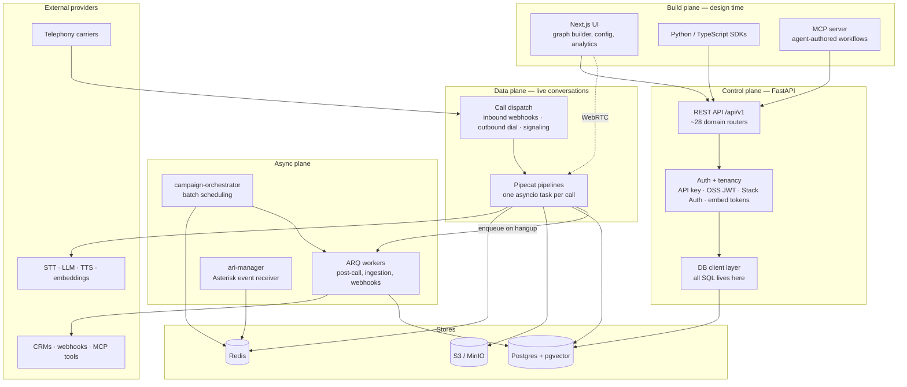
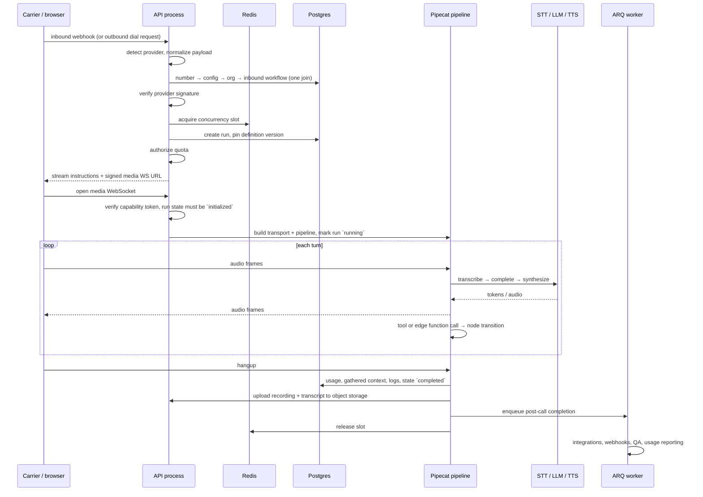

# SpinSci — Solution Architecture

High-level technical architecture of the voice AI agent platform. This describes how the
system is composed and how work flows through it. It is deliberately deployment-agnostic —
Kubernetes topology, autoscaling, and drain mechanics live in
`.kiro/specs/k8s-keda-autoscaling/architecture.md`; the component inventory lives in
`TECH_STACK.md`.

---

## 1. What the system does

Operators build a conversational agent as a **directed graph** in a visual builder. Each node
carries a prompt, a set of tools, and configuration; each edge is a possible transition. The
platform then runs that graph as a **real-time voice conversation** over a phone call, a
browser WebRTC session, or a text chat, and afterwards emits transcripts, recordings,
extracted variables, webhooks, CRM pushes, and usage records.

Two properties shape every design decision below:

- **Conversations are stateful and long-lived.** A call holds an open bidirectional audio
  socket for minutes, with a sub-second latency budget per turn. This is the opposite of the
  stateless request/response assumption most web architecture starts from.
- **Everything is multi-tenant.** `organization_id` is the tenant key and appears on nearly
  every table; isolation is enforced at the query level rather than by a network boundary.

---

## 2. Planes

The system separates into three planes with distinct scaling and failure characteristics.



The control plane and the data plane run **in the same process** today — the FastAPI app both
serves REST traffic and hosts live call pipelines as in-process asyncio tasks. That is a
deliberate simplification (no per-call container, no media handoff), and it is why saturation
is measured as event-loop lag rather than CPU: every call on a pod shares one event loop.

---

## 3. Domain model

Nine entity groups, all hanging off `organizations`.

| Group | Core entities | Role |
|---|---|---|
| Tenancy | `organizations`, `users`, `organization_users`, `organization_configurations` | Tenant boundary and per-org keyed JSON config (AI models, limits, tracing creds) |
| Access | `api_keys`, `embed_tokens` → `embed_sessions`, `external_credentials`, `agent_triggers` | Machine, anonymous-widget, and third-party credential paths |
| Agents | `workflows`, `workflow_definitions`, `folders`, `workflow_templates` | The graph and its immutable versions |
| Executions | `workflow_runs`, `workflow_run_text_sessions`, `workflow_recordings` | One row per conversation, pinned to the exact definition version it ran |
| Dialing | `campaigns` → `queued_runs` | Bulk outbound with retry lineage |
| Telephony | `telephony_configurations`, `telephony_phone_numbers` | Per-org provider credentials and number → inbound workflow routing |
| Knowledge | `knowledge_base_documents` → `knowledge_base_chunks` | RAG corpus; chunks carry a pgvector embedding with an IVFFlat cosine index |
| Extensions | `integrations`, `tools`, `webhook_deliveries` | Outbound connectors and the durable delivery queue |
| Metering | `organization_credit_accounts`, `organization_credit_ledger`, `organization_usage_cycles` | Credit balance and append-only usage ledger |

Two structural decisions matter more than the rest:

**Definitions are versioned and runs pin one.** `workflow_definitions` is append-only
(`draft` / `published` / `archived`); `workflows.released_definition_id` points at the live
version. A `workflow_run` stores `definition_id`, and the runtime reads the graph and its
configuration from **that pinned row**, never from the workflow's current draft. Editing an
agent therefore cannot change the behavior of a call already in progress, and a run's
transcript is always explainable against the exact graph that produced it.

**Runs carry their own context.** `initial_context` (inputs, called/caller number, resolved
provider and model choices) and `gathered_context` (variables extracted during the
conversation) live on the run row as JSON, alongside `usage_info`, `logs`, and the artifact
URLs. Post-call consumers need no other join to reconstruct what happened.

---

## 4. Control plane

A single FastAPI app (`api/app.py`) mounts one aggregate router at `/api/v1`
(`api/routes/main.py`), plus the MCP server as a sub-ASGI app at `/api/v1/mcp` so it inherits
the same proxy rules and the same `X-API-Key` auth.

Layering is enforced by convention and documented in `api/AGENTS.md`:

```
routes/      HTTP concerns only — parse, authorize, resolve organization_id, shape response
services/    domain logic, orchestration, external calls, runtime systems
db/          every query, every session, every transaction
```

No SQLAlchemy import outside `db/`. All data access goes through a single `DBClient`
composed from ~23 per-domain mixins, whose methods take `organization_id` so filtering
happens in SQL rather than in Python.

### Authentication and tenancy

One dependency (`get_user`) resolves four credential shapes in precedence order:

1. `X-API-Key` — org service key; sets the request's org context from the key's own
   `organization_id`, which is how SDK and MCP callers get tenancy without a session.
2. OSS mode — locally issued JWT.
3. Hosted mode — Stack Auth, with just-in-time provisioning of the user, the organization,
   the billing account, and a default model configuration.
4. Embed tokens — anonymous browser widgets, exchanged for a short-lived session with a
   per-token origin allowlist.

Startup (`lifespan`) warms the ARQ Redis pool, preloads per-org tracing exporters, starts the
cross-worker sync manager, and starts the event-loop lag gauge.

### Cross-worker state

Multiple worker processes each hold their own in-memory caches (credentials, resolved
config). A config change handled by one worker is broadcast to the rest over Redis pub/sub
via `WorkerSyncManager` rather than mutated locally.

### Configuration resolution

AI provider selection is layered, not fixed: an org-level model configuration is overlaid
with the workflow version's `model_overrides` to produce one effective configuration per run.
This is what makes STT/LLM/TTS/embeddings swappable per agent, and what lets the platform
run either BYOK provider keys or platform-managed keys behind the same interface.

---

## 5. Data plane: the life of a call



### Admission

Inbound calls from all eight supported carriers hit **one** provider-agnostic endpoint. The
provider is detected from the payload, the payload is normalized, and a single SQL join maps
(provider, account id, called number) → telephony config → organization → inbound workflow.
Matching the phone row inside a config establishes the tenant by construction, so there is no
separate ownership check to forget.

Admission then acquires a Redis concurrency slot, creates the run, and authorizes quota —
strictly in that order, so a call that will not be allowed to complete is never dialed. Every
failure path after run creation both marks the run failed and releases the slot.

### Media socket authentication

The carrier dials back a URL the platform minted, so that URL is a bearer capability. It
carries an HMAC token over the `(workflow, organization, run)` triple, delivered as a
**trailing path segment** rather than a query string because carriers do not reliably forward
query strings. The handler verifies the token, then requires the run to still be in
`initialized` state — a run can only be connected once. The feature is opt-in by secret, and
enforcement is a separate flag so operators can roll it out by watching logs first.

### Pipeline construction

Every call gets its own Pipecat pipeline, assembled per run from the pinned definition:

```
transport.input → STT → [voicemail detector] → user aggregator → LLM
                → callbacks → [recording router] → TTS → transport.output
                → audio buffer → assistant aggregator → metrics
```

In **realtime (speech-to-speech)** mode, STT and TTS collapse into the model itself and the
pipeline shortens accordingly; a side-channel text LLM is still created for out-of-band work
like variable extraction. Provider-specific concerns are confined to a transport factory and
audio config looked up from a registry, so adding a carrier touches no pipeline code.

### The graph as the conversation controller

`PipecatEngine` is the bridge between the graph and the pipeline. On entering a node it swaps
the LLM's system instruction and tool list. **Outgoing edges are registered as LLM
functions** — so the model chooses the next node by calling a tool, and transitions are a
natural consequence of the conversation rather than an external state machine polling for
conditions. Knowledge-base retrieval, MCP tool sessions, variable extraction, idle handling,
max-duration cutoff, and voicemail-triggered hangup all attach at this layer.

### Concurrency accounting

Two layers of active-call state, for two different purposes:

- **Redis, fleet-wide.** A sorted set per organization holds one slot per live call, with an
  optional secondary bucket (e.g. per campaign) and a fleet-wide mirror. Acquire and release
  are single Lua scripts, so limit checks are atomic and stale slots are pruned on the same
  pass — a hard-killed process cannot leak a slot permanently. The fleet mirror exists so the
  autoscaling signal is one `ZCOUNT` instead of a keyspace scan.
- **Per-process, in-memory.** A plain set of run ids, exposed on a health endpoint. This is
  the **drain signal**: the server force-closes live call WebSockets on SIGTERM, so a deploy
  must wait for a worker's count to reach zero before terminating it.

The distinction is worth keeping straight: the Redis count answers "how much work does the
fleet have", the in-memory count answers "is this specific process safe to kill".

### Call end

The pipeline process itself finalizes the run: usage metrics and gathered context to
Postgres, recording and transcript **from in-memory buffers straight to object storage** (no
shared filesystem with the workers), then a single enqueue for post-call processing. Artifacts
are uploaded before the job is enqueued so downstream QA and webhooks always see them.

---

## 6. Async plane

**ARQ workers** (horizontally scalable) handle everything that must not block a conversation:
post-call completion, integration and webhook fan-out, CRM pushes, QA analysis, usage
reporting, campaign batch dispatch, knowledge-base ingestion, and text-chat session closure.
Two cron sweeps act as safety nets for work whose job record can be lost — overdue webhook
deliveries, and text chats that have no transport-disconnect callback to close them.

**Two singleton processes** run at exactly one replica:

- `ari-manager` maintains outbound WebSockets to each org's Asterisk instance and is the
  canonical receiver of ARI events. A second replica would process every event twice.
- `campaign-orchestrator` schedules campaign batches; its dedup and scheduling state is
  in-memory.

Both need leader election before they can be relaxed. In single-host Compose deployments all
of these run inside one container's process tree; in Kubernetes each is its own workload.

---

## 7. Extension seams

The platform is designed to absorb new providers and connectors without core changes.

| Seam | Mechanism | Cost of adding one |
|---|---|---|
| Telephony provider | Registry entry + provider package (transport factory, serializer, webhook handling, signature verification) | No change to routes or pipeline code |
| AI provider (STT/LLM/TTS/embeddings) | Configuration registry + service factory | Config entry; pipeline is provider-agnostic |
| Integration | Self-registering package declaring nodes, routers, runtime sessions, completion handlers | Drop in a package; routers and node types are picked up automatically |
| Tool | Org-scoped tool records, plus MCP servers connected per node | Data, not code |
| Node type | Pydantic-first node schema; the serialized spec is derived from it | Builder, API, and both SDKs stay in sync automatically |

The last row is the load-bearing one: node schemas are defined once in Python, and the
builder's palette, the OpenAPI spec, the generated UI client, and both SDKs are all generated
from that single definition. There is no parallel schema to drift.

---

## 8. Cross-cutting concerns

**Tenant isolation** is query-level. Every org-scoped read passes `organization_id`; every
write of a foreign key pointing at another org-scoped row re-fetches the target under the
caller's org first, because a foreign key proves existence, not ownership.

**Observability** is layered for the two things that actually break: conversations and
scaling. Per-run realtime feedback and node transitions stream to the builder over a
WebSocket and persist into the run's log; turn-level tracing goes to an LLM tracing backend;
errors and product analytics go to their own sinks; and two purpose-built signals — per-pod
event-loop lag and fleet-wide active calls — exist specifically because CPU is a poor
saturation proxy for a shared-event-loop audio workload.

**Failure posture** favors holding steady over guessing. The autoscale metric returns an
error rather than zero when Redis is unreadable, so a failed scrape freezes the replica count
instead of scaling to the floor. Concurrency slots self-heal on a staleness timeout. Webhook
deliveries are durable rows swept by cron, not fire-and-forget. Telephony configs that fail
persistently are parked, and un-parking is always an explicit human action.

**Deployment modes** share one codebase. A single-host Compose install and a multi-workload
Kubernetes deployment differ in process topology and in whether Postgres, Redis, and object
storage are managed services — not in application structure. Auth mode, CORS policy, and
signup availability are read from configuration at runtime, and the UI discovers them from a
health endpoint rather than having them baked into its bundle.

---

## 9. Known constraints

- **The control plane and data plane share a process.** REST traffic and live audio compete
  for the same event loop. Isolating them is the main available structural change if API
  latency and call quality ever need independent guarantees.
- **The media capability token is stateless and replayable** while a run sits in
  `initialized`. Making it one-shot requires minting at run creation and redeeming through an
  atomic state compare-and-swap.
- **Redis is load-bearing twice** — it admits calls and it drives autoscaling — so its
  availability gates both.
- **Two workloads cannot scale out** until leader election is added.
- **Hard process loss cuts calls.** Graceful drain covers planned removal; force-delete and
  node loss are backstopped only by the slot staleness timeout.

---

*Companion documents: `TECH_STACK.md` (component inventory), `api/AGENTS.md` (backend layering
rules), `.kiro/specs/k8s-keda-autoscaling/architecture.md` (Kubernetes topology and
autoscaling), `docs/` (user and operator documentation).*
