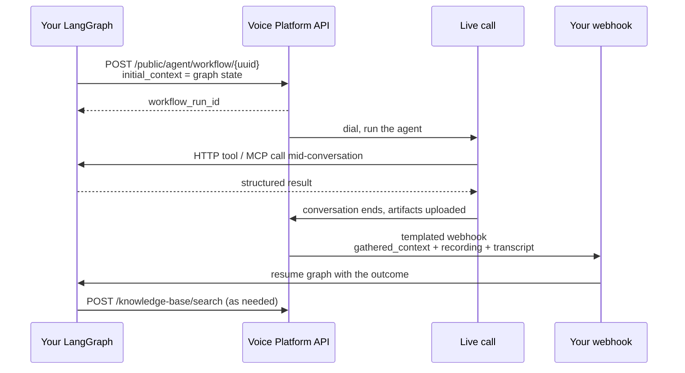

# Voice Platform — Integration Guide for External Agents

For teams running their own agent orchestration (LangGraph, LangChain, custom state machines)
who want to use this platform's voice stack: telephony, speech recognition, speech synthesis,
turn-taking, session lifecycle, recordings, and transcripts.

All paths below are relative to `https://<your-host>/api/v1`.

---

## 1. Read this first: what the platform is

The platform is an **end-to-end voice agent runtime**, not a set of à-la-carte speech
microservices. It owns the real-time loop:

```
audio in → transcribe → decide → synthesize → audio out
```

Turn-taking, interruption handling, voice activity detection, endpointing, barge-in, and the
sub-second latency budget are all managed inside a single in-process pipeline per call. There
is **no HTTP or WebSocket callback that asks an external service "what should I say next"**,
and there is no standalone REST endpoint that returns synthesized speech.

This matters for your design: you cannot keep a LangGraph graph as the conversational
controller and simply "hand it the mic" through a documented API. What you *can* do is one of
three patterns, each with real tradeoffs.

### Which pattern do you want?

| | **A — Agent as tool** | **B — Agent as model** | **C — Agent as orchestrator** |
|---|---|---|---|
| Who decides what is said | Platform | Your LangGraph | Platform |
| Who owns the graph/state | Platform | Your LangGraph | Platform |
| Where LangGraph runs | Called mid-turn | Called every turn | Outside the call |
| Interface | HTTP tool / MCP server | OpenAI-compatible `/chat/completions` | REST |
| Latency added per turn | one tool round trip | full turn is your round trip | none |
| Voice quality risk | low | **you own the latency budget** | none |
| Production readiness | supported, common | supported wire protocol, you carry the burden | supported |

Most teams should start with **A**, use **B** only if the agent logic genuinely cannot be
expressed in the platform's graph, and use **C** for everything that happens before and after
a conversation.

---

## 2. Authentication

Create an organization API key in the dashboard, then send it as a header:

```http
X-API-Key: <your-key>
```

The key resolves both the caller and the organization; every request is automatically scoped
to that organization. `X-API-Key` takes precedence over any `Authorization` header.

**WebSocket endpoints cannot read headers.** Pass the key as a query parameter instead:

```
wss://<host>/api/v1/signaling/{workflow_id}/{run_id}?api_key=<your-key>
```

Common failures: `401` invalid or expired key, `402` organization is out of quota or credit,
`429` concurrent call limit reached, `403` cross-organization access attempt.

---

## 3. Pattern A — Your agent as a tool the voice agent calls

The platform runs the conversation; at the points where you need your own logic, the agent
calls out to you. This keeps the latency-critical path inside the platform and gives you a
plain request/response contract.

Two mechanisms:

**HTTP API tool.** Register an HTTP tool and attach it to nodes in your agent graph. The LLM
calls it as a function with arguments you declare, and the returned JSON becomes available to
subsequent turns.

```http
POST /tools
X-API-Key: <key>

{
  "name": "check_order_status",
  "category": "http_api",
  "definition": { ... }        # endpoint, method, auth credential, parameter schema
}
```

```http
GET    /tools?status=active&category=http_api
GET    /tools/{tool_uuid}
PUT    /tools/{tool_uuid}
DELETE /tools/{tool_uuid}
POST   /tools/{tool_uuid}/test          # http_api tools only; 400 for other categories
```

`POST /tools/{tool_uuid}/test` takes `{ "llm_params": {...}, "preset_params": {...} }` and
executes the tool without a call, which is the fastest way to validate a contract.

**MCP server.** If your LangGraph deployment already exposes MCP, register it as an `mcp`
category tool. The platform discovers the catalog and re-exposes each remote tool to the LLM.
Refresh the catalog after you change it:

```http
POST /tools/{tool_uuid}/mcp/refresh
```

Refresh is fail-safe: if your server is unreachable the call returns `200` and the previously
discovered catalog is preserved rather than emptied.

Credentials for both mechanisms are stored by reference, never inline:

```http
GET /credentials
```

Supported credential types: `none`, `api_key`, `bearer_token`, `basic_auth`, `custom_header`.

### Why this is the recommended path

Your LangGraph invocation happens *within* a turn, while the platform holds the floor and can
cover the wait with filler speech and interruption handling. A slow tool degrades gracefully.
A slow model endpoint (Pattern B) produces dead air.

---

## 4. Pattern B — Your agent as the model endpoint

If your LangGraph graph must own what is said, expose it as an **OpenAI-compatible Chat
Completions endpoint** and point the platform's LLM configuration at it. This is a model
endpoint swap, and it is the only supported way for an external system to generate the
response text for a live voice call.

### Configuration

In the organization or per-agent model configuration, set the LLM provider to an
OpenAI-compatible provider and override `base_url`:

```json
{
  "llm": {
    "provider": "openai",
    "model": "your-graph-name",
    "base_url": "https://your-langgraph-host/v1",
    "api_key": "<key the platform sends to you>"
  }
}
```

The same override exists on the `openrouter`, `atlascloud`, `speaches`, `huggingface`, and
`minimax` provider configurations. Per-agent overrides are layered on top of the
organization-level configuration, so you can route one agent to your graph and leave others on
a standard provider.

### What you must implement

Your endpoint must accept `POST {base_url}/chat/completions` and behave like OpenAI's:

- **Server-sent event streaming.** The platform streams tokens into speech synthesis as they
  arrive. A non-streaming response means the caller hears nothing until your graph finishes.
- **Tool calling, in OpenAI's schema.** This is not optional. The platform injects the agent
  graph's outgoing edges as functions and expects the model to call one to advance the
  conversation. If you ignore them, the conversation cannot leave its current node.
- **The system prompt and tool list the platform sends.** These are rebuilt on every node
  transition from the node's prompt, its attached tools, knowledge base access, and the edges
  leaving it. Your graph receives them as ordinary messages; it does not replace them.
- **Conversation history as sent.** The platform owns context assembly, including any
  compaction. Treat the request as authoritative rather than maintaining your own parallel
  history keyed on conversation id.

### Constraints to plan around

**Latency is now your problem.** Time to first token lands directly in the gap between the
caller finishing their sentence and the agent starting to speak. Budget for first token in the
low hundreds of milliseconds; a multi-second graph traversal is audible as dead air and will
trigger interruption and idle handling.

**Hosted deployments require a publicly resolvable endpoint.** URL validation rejects
`localhost` and any hostname resolving to a private, loopback, link-local, multicast,
reserved, unspecified, or CGNAT address, and rejects schemes other than `http`, `https`, `ws`,
and `wss`. A rejected URL surfaces as `400` at call setup. Self-hosted (OSS) deployments skip
this check entirely, so private-network endpoints work there.

**Speech-to-speech (realtime) modes bypass this seam.** When an agent is configured for a
realtime speech-to-speech model, that model handles recognition, reasoning, and synthesis
internally and your Chat Completions endpoint is not in the conversational path. Pattern B
requires the standard recognize-reason-synthesize configuration.

---

## 5. Pattern C — Your agent orchestrating from outside the call

Everything here is plain REST with `X-API-Key`, suitable for calling from LangGraph nodes,
tools, or scheduled jobs.

### 5.1 Start an outbound call

```http
POST /public/agent/workflow/{workflow_uuid}
X-API-Key: <key>

{
  "phone_number": "+15551234567",
  "initial_context": { "customer_id": "abc-123", "account_tier": "gold" },
  "telephony_configuration_id": 42
}
```

```json
{ "status": "initiated", "workflow_run_id": 90811, "workflow_run_name": "WR-API-4417" }
```

`initial_context` is the injection point for state your graph already holds. Its keys become
template variables available to every prompt in the agent, and they are persisted on the run
so post-call consumers can read them back. The destination number is always authoritative and
cannot be overridden through `initial_context`.

Variants:

| Endpoint | Runs |
|---|---|
| `POST /public/agent/workflow/{workflow_uuid}` | published version |
| `POST /public/agent/test/workflow/{workflow_uuid}` | latest draft, falling back to published |
| `POST /public/agent/{trigger_uuid}` | published version, addressed by trigger handle |
| `POST /public/agent/test/{trigger_uuid}` | latest draft, addressed by trigger handle |

Errors: `402` out of quota, `429` concurrent limit, `404` agent not found or not active,
`400` telephony not configured or dial failed, `409` agent has no execution owner.

There is also `POST /telephony/initiate-call` for test calls against a draft, which resolves
the destination from organization preferences when no number is supplied.

### 5.2 Drive a turn-by-turn text session

The text session API is the closest thing to synchronous conversational control, and it is the
only place you can drive turns request-by-request. It runs the same agent graph, the same
prompts, and the same tools as a voice call — without audio. Use it to test graph behavior
from LangGraph, or to serve a chat surface with the same agent.

```http
POST /workflow/{workflow_id}/text-chat/sessions
{ "name": "session-1", "initial_context": {...}, "annotations": {...} }
```

The response already contains the agent's opening turn, so no extra round trip is needed to
get the greeting.

```http
POST /workflow/{workflow_id}/text-chat/sessions/{run_id}/messages
{ "text": "I want to change my appointment", "expected_revision": 3 }
```

```http
GET  /workflow/{workflow_id}/text-chat/sessions/{run_id}
POST /workflow/{workflow_id}/text-chat/sessions/{run_id}/rewind    { "cursor_turn_id": "...", "expected_revision": 5 }
POST /workflow/{workflow_id}/text-chat/sessions/{run_id}/end       { "expected_revision": 6 }
```

All five return the same object:

```json
{
  "workflow_run_id": 90811,
  "workflow_id": 512,
  "name": "session-1",
  "mode": "textchat",
  "state": "running",
  "is_completed": false,
  "revision": 4,
  "initial_context": {},
  "gathered_context": {},
  "annotations": {},
  "session_data": { "status": "active", "turns": [] },
  "checkpoint": {},
  "created_at": "...",
  "updated_at": "..."
}
```

**Concurrency control is explicit.** Every mutation accepts `expected_revision`. If the stored
revision has moved on, you get `409` with the actual value:

```json
{ "detail": { "message": "Text chat session revision conflict",
              "expected_revision": 3, "actual_revision": 5 } }
```

Send the revision you last saw and treat `409` as "re-read and retry" rather than an error.
Omitting it disables the check, which is fine for a single writer and unsafe otherwise.

Other responses: `400` session already ended or run is not a text session, `402` out of
quota, `404` unknown session or unknown rewind target.

`rewind` truncates the conversation back to a turn and is genuinely useful for evaluation
loops — you can replay a branch without starting a new session.

Sessions left idle are closed automatically by a periodic sweep, since text chat has no
disconnect signal. Call `/end` explicitly when you are done so transcripts and post-session
processing finalize promptly.

### 5.3 Retrieval over your knowledge base

The retrieval endpoint is directly reusable as a RAG tool inside LangGraph. It embeds your
query with the organization's configured embedding model and searches the org's corpus.

```http
POST /knowledge-base/search
X-API-Key: <key>

{
  "query": "what is the cancellation window for annual plans",
  "limit": 5,
  "document_uuids": ["9f1c...", "b220..."],
  "min_similarity": 0.2
}
```

`limit` is 1–50, default 5. `document_uuids` narrows the search; omit it to search everything.
Results come back **without threshold filtering** — apply your own cutoff or reranking
downstream.

Ingestion is asynchronous, in three steps:

```http
POST /knowledge-base/upload-url        → { upload_url, document_uuid, s3_key }
PUT  <upload_url>                      # your file, direct to storage; 30 min, 100 MB cap
POST /knowledge-base/process-document  # queues extraction, chunking, embedding
```

Then poll until `processing_status` reaches `completed` (`pending → processing → completed |
failed`):

```http
GET    /knowledge-base/documents
GET    /knowledge-base/documents/{document_uuid}
DELETE /knowledge-base/documents/{document_uuid}
```

### 5.4 Transcribe an audio file

```http
POST /workflow-recordings/transcribe
X-API-Key: <key>
Content-Type: multipart/form-data

file=@audio.wav
language=en
```

This is **batch transcription of a file you supply**. It is not a streaming recognition
socket, and it is not how live calls are transcribed.

### 5.5 Retrieve recordings and transcripts

Read the run to get artifact references:

```http
GET /workflow/{workflow_id}/runs/{run_id}
```

Relevant fields:

| Field | Contents |
|---|---|
| `state`, `is_completed` | `initialized` → `running` → `completed` |
| `recording_url` | mixed-audio storage key |
| `user_recording_url`, `bot_recording_url` | separated tracks, when enabled |
| `transcript_url` | transcript storage key |
| `*_public_url`, `public_access_token` | tokenized URLs, minted lazily once artifacts exist |
| `gathered_context` | variables the agent extracted during the conversation |
| `initial_context` | what you passed in, plus resolved provider and model choices |
| `usage_info`, `cost_info` | token and duration metering |
| `logs` | per-turn events and node transitions |
| `annotations` | evaluation and QA results |
| `call_type`, `definition_id` | direction, and the exact agent version that ran |

Two ways to fetch the bytes:

```http
GET /public/download/workflow/{token}/{artifact_type}?inline=false
```

`artifact_type` is one of `recording`, `transcript`, `user_recording`, `bot_recording`.
Responds `302` to a signed URL valid for one hour. **This endpoint requires no
authentication** — the token is the credential. Treat those URLs as secrets and do not log
them.

```http
GET /s3/signed-url?key=<storage-key>&expires_in=3600&inline=false
```

Authenticated equivalent, taking a storage key from the run record and returning
`{ url, expires_in }`. Authorization is derived from the key's shape, so only keys belonging
to your organization resolve.

List and report:

```http
GET /workflow/{workflow_id}/runs?page=1&limit=50&filters=[...]&sort_by=&sort_order=
GET /workflow/{workflow_id}/report?start_date=&end_date=        # CSV
```

`filters` is a JSON array; only `dateRange`, `dispositionCode`, `duration`, `status`, and
`tokenUsage` are accepted, and anything else returns `403`.

### 5.6 Receive results by webhook instead of polling

Polling run state is workable but wasteful. Add a webhook node to your agent graph and the
platform will POST to you once the conversation completes and its artifacts are uploaded.

The payload is **entirely defined by your template** — there is no fixed envelope. You write a
JSON template referencing any of:

`workflow_run_id`, `workflow_run_name`, `workflow_id`, `workflow_name`, `campaign_id`,
`call_time`, `initial_context`, `gathered_context`, `cost_info`, `annotations`, `extra`,
`recording_url`, `transcript_url`, `user_recording_url`, `bot_recording_url`.

The four URL variables render as absolute public download URLs when a token exists, and as raw
storage keys otherwise. One key is always present whether you reference it or not:
`call_disposition`.

A template like this:

```json
{
  "run_id": "{{ workflow_run_id }}",
  "customer_id": "{{ initial_context.customer_id }}",
  "outcome": "{{ gathered_context.call_disposition }}",
  "extracted": "{{ gathered_context }}",
  "recording": "{{ recording_url }}",
  "transcript": "{{ transcript_url }}"
}
```

Delivery semantics worth relying on:

- **Durable, not fire-and-forget.** Each delivery is a persisted row. A network error does not
  lose the event.
- **Retried with backoff** on `408`, `425`, `429`, `500`, `502`, `503`, `504`. Most other 4xx
  responses dead-letter immediately, so return a retryable status if you want another attempt.
- **Idempotency is on you.** Deduplicate on the `X-SpinSci-Delivery-Id` header. Attempt number
  arrives as `X-SpinSci-Delivery-Attempt`, and the run id as `X-SpinSci-Workflow-Run-Id`.
- **Payload is rendered once**, at enqueue time, so retries are byte-identical.
- **A sweep re-enqueues overdue deliveries**, so a restart on either side does not drop events.
- Credentials are re-resolved at send time from the credential store. Secret-looking custom
  headers are stripped rather than persisted — use a credential.

### 5.7 Browser-based voice sessions

If your surface is a web app rather than a phone call:

```
WSS /signaling/{workflow_id}/{workflow_run_id}?api_key=<key>
```

Create the run first (`POST /workflow/{workflow_id}/runs` with a `smallwebrtc` mode), then
connect for WebRTC signaling. For anonymous end users, issue an embed token and use the
public signaling socket instead, which requires no key and enforces a per-token origin
allowlist.

---

## 6. Not available today

Being explicit, because each of these is a plausible assumption that will cost you a sprint:

| | Status |
|---|---|
| Speech synthesis from text over REST | **Does not exist.** Synthesis happens only inside a live pipeline. |
| Streaming speech recognition socket | **Does not exist.** File transcription only (§5.4). |
| "What should I say next" callback during a call | **Does not exist.** Closest option is Pattern B. |
| REST endpoint to hang up a live call | **Does not exist.** Termination is in-conversation, via the agent's `end_call` / `transfer_call` tools or a max-duration cutoff. |
| Injecting speech into a call in progress | **Does not exist.** |
| Dedicated run-status endpoint | Use `state` / `is_completed` on the run detail. |
| Retrieval or run access over MCP | The MCP surface is authoring-oriented — listing and creating agents, tools, and node types. Use REST for retrieval and runs. |

If you need per-call barge-in control or mid-call speech injection from an external
orchestrator, that is a platform change, not an integration detail. Raise it as a requirement
rather than working around it.

---

## 7. A concrete LangGraph shape

Combining the patterns as most teams end up using them:



Practical notes:

- **Carry correlation through `initial_context`.** Put your thread id or checkpoint id in
  there at dial time; it comes back on the webhook and on the run record. This is the cleanest
  way to resume a graph.
- **Prefer the webhook over polling.** It fires only after artifacts are durably uploaded, so
  recording and transcript URLs in the payload are always fetchable.
- **Treat the run as the system of record** for what happened: `gathered_context` for extracted
  variables, `logs` for turn-level events, `annotations` for evaluation output, `definition_id`
  for exactly which agent version ran.
- **Validate tools before wiring them into a call** with `POST /tools/{uuid}/test`.
- **Develop against text sessions.** They exercise the same graph, prompts, and tools with no
  telephony cost and a synchronous request/response shape that is far easier to test from
  LangGraph than a live call.

---

## 8. Reference

**Run states:** `initialized` → `running` → `completed`

**Run modes:** `twilio`, `plivo`, `telnyx`, `exotel`, `vonage`, `vobiz`, `cloudonix`, `ari`,
`webrtc`, `smallwebrtc`, `textchat`

**Status codes:**

| Code | Meaning |
|---|---|
| `400` | Malformed request, invalid configuration, session already ended, rejected URL |
| `401` | Missing or invalid API key |
| `402` | Out of quota or credit |
| `403` | Cross-organization access, or a disallowed filter attribute |
| `404` | Not found, or not active |
| `409` | Revision conflict, or run already bound to an active call |
| `429` | Concurrent call limit reached |
| `503` | An upstream managed service is unavailable |

**Machine-readable schema:** the full OpenAPI document is served at `/api/v1/openapi.json` and
is the authoritative reference for request and response shapes. Generated Python and
TypeScript SDKs cover the authoring surface — creating agents, listing tools, node types,
documents, recordings, credentials, and placing test calls. The text session API, retrieval,
transcription, signed URLs, and run listing are **not** in the generated SDKs; call them over
plain HTTP.
