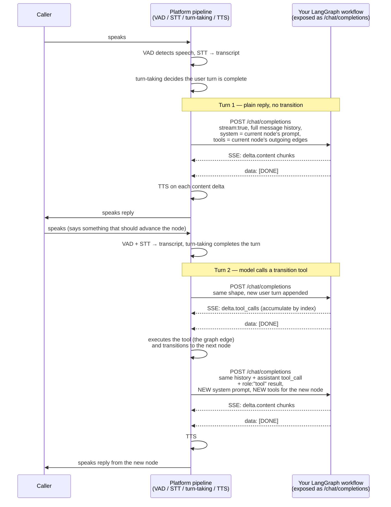

# Bringing Your Own LangGraph Workflow as the Model Endpoint (Deep Dive)

Companion to `VOICE_API_INTEGRATION.md`. That document covers all three integration
patterns; this one is a complete reference for exposing your own **LangGraph workflow**
(or an equivalent agent built some other way) as the model the platform's voice pipeline talks
to.

Read this before you write a line of adapter code. The contract is stricter than "return
some text," and getting the streaming and tool-calling shape wrong produces failures that are
hard to diagnose from the outside (silence, stuck nodes, or a conversation that never leaves
its first turn).

---

## 1. What you are actually building

Only the LLM stage is replaced. Every other processor in the call pipeline — voice activity
detection (VAD), turn-taking and interruption handling, endpointing, voicemail/answering-machine
detection, and call recording — is wired up independently of which LLM provider is configured,
and keeps running exactly as it would with a standard provider:

```
audio in → VAD → STT → [ your workflow replaces only this stage ] → TTS → audio out
                        ▲
                        the LLM stage — driven over HTTP as an
                        OpenAI-compatible Chat Completions client

  turn-taking / interruption / endpointing:   independent of the LLM stage
  voicemail / answering-machine detection:    a separate pipeline stage ahead of the LLM
                                               stage — see §6, it can also call your endpoint
  call recording:                             independent of the LLM stage
```

You are not receiving a phone call. You are receiving **Chat Completions requests**, one per
conversational turn (plus occasional out-of-band, non-conversational requests — see §6). The
platform is the OpenAI client; your service is the server. Turn-taking, interruption,
endpointing, VAD, and speech synthesis all happen around your response, not inside it — none of
it is something your endpoint can see or influence, and none of it changes based on what your
endpoint does.

This is a real constraint, not a formality: the client implementation is a stock OpenAI SDK
client wrapped in a thin retry layer, not a custom integration built for this use case. It
does not know your graph has nodes, checkpoints, or tool-calling semantics of its own — it
only knows the Chat Completions wire format. Every deviation from that format is silently
wrong rather than rejected with a helpful error.

The full cycle, across two conversational turns — a plain reply, then a turn that transitions
to a new node — looks like this:



Three things this makes concrete: **every request carries the entire conversation** (there is
no session to resume), a **node transition is just another turn** — your endpoint sees it as an
ordinary tool call, then gets called again immediately with a fresh `system` message once the
platform has executed that call and moved to the new node — and **VAD/turn-taking sit entirely
upstream of your endpoint**: by the time a request reaches you, the platform has already decided
the caller finished speaking.

---

## 2. Where the seam lives

The LLM section of an organization's or agent's model configuration accepts an OpenAI-compatible
provider with a `base_url` override:

```json
{
  "llm": {
    "provider": "openai",
    "model": "your-graph-name",
    "api_key": "<a key your endpoint expects and validates>",
    "base_url": "https://your-host/v1"
  }
}
```

Configuration is layered: an organization-level configuration is the default, and an
individual agent can override just the `llm` section (`model_overrides` on the agent's
current version) to point only that agent at your endpoint while every other agent keeps
using a standard provider. Nothing else about the agent changes — prompts, tools, knowledge
base attachment, and node graph all continue to be authored and owned in the platform.

The override also exists on a handful of other OpenAI-compatible provider slots
(`openrouter`, `atlascloud`, `speaches`, `huggingface`, `minimax`) if one of those identities
is a better fit for your setup; the wire contract in this document is identical for all of
them, since they all route through the same OpenAI-compatible client code path.

**Realtime (speech-to-speech) agents bypass this seam entirely.** If an agent is configured
for a realtime model, that model does recognition, reasoning, and synthesis as one unit and
your Chat Completions endpoint is never called. This integration only applies to the standard
recognize → reason → synthesize pipeline.

---

## 3. The request you will receive

`POST {base_url}/chat/completions`, `Authorization: Bearer <api_key>` — the exact key value
you put in the LLM configuration, so use it to authenticate the caller.

### Body shape

```json
{
  "model": "your-graph-name",
  "stream": true,
  "stream_options": { "include_usage": true },
  "messages": [
    { "role": "system", "content": "<current node's system prompt>" },
    { "role": "user", "content": "..." },
    { "role": "assistant", "content": "...", "tool_calls": [ ... ] },
    { "role": "tool", "tool_call_id": "...", "content": "..." },
    { "role": "user", "content": "..." }
  ],
  "tools": [ { "type": "function", "function": { "name": "...", "description": "...", "parameters": { ... } } } ],
  "tool_choice": "auto",
  "temperature": 0.1,
  "frequency_penalty": null,
  "presence_penalty": null,
  "seed": null,
  "top_p": null,
  "max_completion_tokens": null,
  "service_tier": null
}
```

Fields you can safely ignore if your model doesn't use them: `frequency_penalty`,
`presence_penalty`, `seed`, `top_p`, `service_tier`. They are forwarded because they're part
of the OpenAI request shape, not because the platform requires you to honor them. `model` and
`stream` are the two fields that matter for routing your own logic.

### The message list is the entire state, every time

There is **no session or thread identifier in the request.** The platform does not call you
with "the next message" and expect you to remember the rest — it sends the **full
conversation so far** on every request: system prompt, every prior user and assistant turn,
and every tool call and tool result. This is deliberate: the platform's in-pipeline context is
the single source of truth, which is what keeps interruption and barge-in correct. Any
server-side memory (a checkpointer, a persisted thread) you build on your side needs to key off
something you extract from the message list itself, since nothing else identifies the
conversation. `initial_context` values you passed at call setup are not repeated in every
request either — if your logic needs them mid-call, have the agent's prompt or an early tool
call surface them into the message history.

### The system message changes between requests, and you must use it

The platform composes a fresh system prompt (and a fresh tool list) **every time the agent
transitions between nodes in its graph**, and sends it as an ordinary `role: "system"`
message at the front of the array. If your model/graph hardcodes or ignores the incoming
system message, node-specific instructions — including the instruction to call a particular
transition tool — never reach your model, and the conversation cannot advance past its
current node. Treat the incoming system message as authoritative input, not as something to
discard in favor of a prompt you own internally.

### Streaming vs. non-streaming

Two distinct request shapes reach your endpoint, and you must support both:

- **`stream: true`, with `stream_options: {"include_usage": true}`.** This is every normal
  conversational turn. Tokens are pushed into speech synthesis as they arrive, so response
  latency is directly audible.
- **`stream: false`, no `stream_options`.** This is an out-of-band, non-conversational call —
  used internally for things like variable extraction from the transcript. It expects a single
  complete response, not a stream, and it is not part of the spoken conversation.

If your endpoint only implements one shape, the other class of call will fail outright rather
than degrade gracefully.

---

## 4. Tool calls are how the conversation moves, not an optional extra

The `tools` array on the request is not sample data — it is populated from the current node's
outgoing edges plus any tools attached to that node (knowledge base retrieval, HTTP tools,
MCP tools). Every outgoing edge becomes a callable function; **calling one of those functions
is the only way the conversation leaves its current node.**

Concretely: if node "collect_appointment_time" has one edge to "confirm_appointment," the
request's `tools` array will include a function whose name identifies that transition. If your
model never emits a `tool_calls` delta for it — because your graph doesn't propagate tool
schemas, or because you strip `tools` before handing the request to your own model — the
conversation is stuck. From the caller's perspective this looks like an agent that keeps
repeating itself or ignoring what the user just said, because it has no way to know it should
have moved on.

You do not need to interpret what a transition function *means*. Treat every entry in `tools`
as an ordinary OpenAI function definition, let your model decide when to call it based on the
system prompt's instructions (which describe when each transition applies), and pass the call
straight back in the response. The platform executes it and rebuilds the next request with a
new system prompt and a new tool list once the transition completes.

The reverse direction — a tool result coming back to you — arrives as a `role: "tool"` message
with the same `tool_call_id` you emitted, inserted right after your assistant message that
made the call. If your graph has its own tools (a LangGraph tool node, for example) that are
*not* part of the transition mechanism, you can run them entirely inside your own process
without ever surfacing them in the wire protocol — only surface the tools you want the
platform's system prompt to describe and the caller to be able to invoke via the wire format
described here.

---

## 5. The response you must produce

### Streaming: Server-Sent Events, OpenAI chunk shape

Emit `chunk` objects as SSE (`data: {...}\n\n`), terminated by `data: [DONE]\n\n`. Two kinds of
delta, and a request can contain either, but a well-formed response should not interleave them
within the same tool call:

**Plain text**, one or more chunks:

```json
{"choices": [{"index": 0, "delta": {"content": "Sure, let me check that "}, "finish_reason": null}]}
{"choices": [{"index": 0, "delta": {"content": "for you."}, "finish_reason": null}]}
```

Every non-empty `delta.content` fragment is treated as speakable text and forwarded to speech
synthesis as it arrives — this is what makes streaming worth doing at all: the caller starts
hearing a response before your full generation is done. Chunking granularity is up to you; the
platform does not require sentence boundaries, word boundaries, or any particular size.

**Tool calls**, accumulated across chunks by index:

```json
{"choices": [{"delta": {"tool_calls": [{"index": 0, "id": "call_abc123", "function": {"name": "transfer_to_billing", "arguments": ""}}]}}]}
{"choices": [{"delta": {"tool_calls": [{"index": 0, "function": {"arguments": "{\"reason\""}}]}}]}
{"choices": [{"delta": {"tool_calls": [{"index": 0, "function": {"arguments": "\": \"refund\"}"}}]}}]}
```

The consuming code keys accumulation on `tool_calls[0].index`: send `id` and
`function.name` once, on the first chunk for that call, then stream `function.arguments` in
as many fragments as you like — they are concatenated in arrival order and parsed as JSON only
once the stream ends. A response with more than one tool call increments `index` for each.
Mixing a `content` delta and a `tool_calls` delta in the same logical turn is legal in the
OpenAI format, but keep in mind that text content sent alongside a tool call is spoken text,
not a description of the tool call — don't narrate "let me check that" as a `content` delta
and then also expect it suppressed just because a tool call follows.

**Usage**, on any chunk if you have it (typically the last one), since `stream_options`
requested it:

```json
{"choices": [], "usage": {"prompt_tokens": 812, "completion_tokens": 47, "total_tokens": 859}}
```

If you don't track token usage, omit the field entirely rather than sending zeros — omission
is the honest signal that usage accounting isn't available from your side.

**Model name.** Echo whatever you want in `chunk.model`; it's recorded for observability, not
validated against the requested `model` field.

### Non-streaming: a single completion object

```json
{
  "choices": [
    { "message": { "role": "assistant", "content": "Your appointment is confirmed for 3 PM." } }
  ]
}
```

Only `choices[0].message.content` is read. No tool calls are expected or handled on this path
— it exists for single-shot extraction-style calls, not conversational turns.

---

## 6. Where non-streaming calls come from

Two internal flows call the LLM outside the main conversation, `stream=false`, with their own
system instruction and message list built from context rather than the live conversation
turn: automatic **variable extraction** at node transitions (pulling structured values out of
what's been said so far) and **voicemail/answering-machine detection**, when enabled. Both are
configured to use the agent's main LLM by default, which means both land on your endpoint if
your endpoint is configured as that agent's LLM. If you'd rather not have your graph handle
these, they can be pointed at a different provider independently in the agent's model
configuration — but if left on the default, implement the non-streaming path correctly rather
than letting it fail.

**Voicemail detection is a separate pipeline stage that runs before your endpoint sees any
conversational turn, and it gates your LLM.** It sits right after STT, classifying the start of
the call as a live conversation or a voicemail/answering-machine greeting, and holds back the
main LLM stage until that classification completes. Two configuration modes decide whether the
classification call reaches your endpoint:

- **`use_workflow_llm: true` (the default).** The classifier calls a fresh instance of the
  agent's configured LLM — i.e. your endpoint — with `stream: false` and its own fixed
  classification prompt, before the caller has said anything you'd recognize as a normal turn.
  Your response to this call is not spoken; the platform reads it to decide `CONVERSATION` vs.
  `VOICEMAIL` and, on a voicemail detection, ends the call without your graph's `content` ever
  reaching the caller.
- **`use_workflow_llm: false`.** The classifier is pointed at an independently configured
  provider/model (defaulting to plain OpenAI `gpt-4.1`), decoupled entirely from your endpoint —
  no classification call reaches you at all.

If voicemail detection is left on the default for an agent pointed at your endpoint, treat the
classification call as a third category of non-streaming request, alongside variable
extraction — implement it the same way: a single, fast, non-streaming completion, not a
conversational turn your graph needs to route through its node logic.

---

## 7. Failure behavior — what happens when your endpoint misbehaves

There is no dedicated error-handling contract; ordinary HTTP and stream failures propagate
through the standard OpenAI client error handling:

- **A timeout** surfaces as a non-fatal pipeline error; the turn produces no spoken response
  — dead air — and the call continues rather than being torn down.
- **Any other exception** (connection refused, malformed stream, non-2xx response) behaves the
  same way: logged as a non-fatal error, turn silently lost, call continues.
- There is **no automatic retry** of a failed turn against your endpoint by default. Treat
  every request as one attempt with no safety net on the caller's side — build your own
  retry/timeout discipline (or a fast, honest error path) inside your service instead of
  relying on the platform to paper over transient failures.

In practice: your uptime and latency are the caller's conversation quality. There is no
degraded fallback path once your endpoint is configured as the agent's model.

---

## 8. URL and network constraints

`base_url` is validated when the call's pipeline is being assembled — at call start, not when
the configuration is saved — so a bad or unreachable URL surfaces as a failure at the moment
someone actually tries to talk to the agent, not earlier.

**Self-hosted deployments:** no restriction. Point `base_url` at `localhost` or any private
network address.

**Hosted/SaaS deployments:** the URL is rejected outright unless it:

- uses `http`, `https`, `ws`, or `wss`,
- has a hostname other than `localhost`, and
- resolves to a public IP — private, loopback, link-local, multicast, reserved, unspecified,
  and CGNAT (`100.64.0.0/10`) ranges are all blocked.

If you're testing against a tunnel or an internal staging host from a hosted deployment,
confirm it resolves to a genuinely public address, or run the test from a self-hosted
deployment instead.

---

## 9. Latency budget — this is the part that actually determines quality

Nothing else in this document matters as much as this: **time to first token from your
endpoint is time the caller spends listening to silence.** The platform starts speaking as
soon as the first `content` delta arrives; everything before that is dead air with no filler,
no "let me think" bridge, unless your own graph produces one as its first streamed tokens.

Design for it directly:

- Get your model producing tokens immediately, not after a multi-step planning phase completes
  silently. If your graph does routing/classification before generating the reply, make sure
  that step is fast, or start streaming a brief acknowledgment while it runs.
- A tool-call turn is inherently slower for the caller, because no `content` deltas exist to
  speak until the tool result comes back and a second generation happens. Long-running tools
  compound directly into silence.
- Treat a few hundred milliseconds to first token as the target, not multiple seconds. There is
  no mechanism in this integration point for masking a slow generation — it is heard exactly as
  it happens.

---

## 10. A minimal reference shape

This is illustrative shape, not a specific framework's idiom — implement it however fits your
stack (FastAPI, plain ASGI, anything that can hold an SSE connection open).

```python
async def chat_completions(request):
    body = await request.json()
    messages = body["messages"]          # full history, every request
    stream = body.get("stream", True)
    tools = body.get("tools", [])        # this call's live transition/tool set

    if not stream:
        # Out-of-band call: run your model once, return a single message.
        content = await run_model_once(messages)
        return json_response({"choices": [{"message": {"role": "assistant", "content": content}}]})

    async def event_stream():
        async for delta in run_model_streaming(messages, tools):
            if delta.kind == "text":
                yield sse({"choices": [{"index": 0, "delta": {"content": delta.text}}]})
            elif delta.kind == "tool_call_start":
                yield sse({"choices": [{"delta": {"tool_calls": [
                    {"index": delta.index, "id": delta.call_id,
                     "function": {"name": delta.name, "arguments": ""}}
                ]}}]})
            elif delta.kind == "tool_call_args":
                yield sse({"choices": [{"delta": {"tool_calls": [
                    {"index": delta.index, "function": {"arguments": delta.fragment}}
                ]}}]})
        yield "data: [DONE]\n\n"

    return streaming_response(event_stream(), media_type="text/event-stream")
```

The part specific to bridging a graph-based agent (LangGraph or otherwise) into
`run_model_streaming` is entirely up to your implementation: convert the incoming OpenAI-shape
`messages` into whatever message objects your graph expects, run it, and map whichever of its
internal events represent "the user-facing reply is producing tokens" onto `content` deltas.
Anything your graph does before or between those points — routing, sub-agent handoffs, internal
tool use — is invisible to the platform as long as the wire-visible events above eventually
arrive. Only the tools you deliberately expose through the `tools` array in the request need a
wire-visible `tool_call` in your response; everything else your graph does internally can stay
internal.

---

## 11. Testing before you point a live agent at it

Voice calls are the most expensive and slowest way to find a protocol bug. Work up to them:

1. **Curl it first.** Send a hand-built request with a `system` message, a couple of turns,
   and a `tools` array containing one function. Confirm you get back a well-formed SSE stream
   or a well-formed JSON object, matching §5 exactly.
2. **Drive it through a text chat session**, not a phone call. Text sessions run the identical
   agent graph, prompts, and tool set with no telephony cost and a synchronous request/response
   shape, so protocol mistakes surface immediately in a session response instead of as
   silence on a live call.
3. **Force a transition.** Have a short test conversation that should trigger at least one
   node change, and confirm the session's `session_data`/turn history shows the transition
   actually happened — not just that your model produced plausible text.
4. **Then test on a real or test call**, watching specifically for: time to first audio, dead
   air after any tool-using turn, and whether the conversation ever leaves its starting node.

---

## 12. Checklist

- [ ] Endpoint is reachable at `{base_url}/chat/completions` and validates the `Authorization: Bearer` value you configured as `api_key`
- [ ] Accepts the full message list every request; does not require or expect a thread/session id
- [ ] Reads and honors the incoming `system` message every request — does not substitute a fixed prompt
- [ ] Implements `stream: true` with content deltas AND `stream: false` with a single message (variable extraction and, if voicemail detection is left on `use_workflow_llm: true`, voicemail classification)
- [ ] Emits `tool_calls` deltas in the OpenAI accumulate-by-index shape when the model decides to call one of the supplied `tools`
- [ ] Handles a `role: "tool"` message being present in a later request as the result of a call you made
- [ ] First token arrives in low hundreds of milliseconds, not seconds
- [ ] Errors fail fast and cleanly rather than hanging the stream open
- [ ] `base_url` resolves to a public address if this is a hosted deployment
- [ ] Verified end-to-end through a text chat session, including at least one node transition, before testing on a live call
